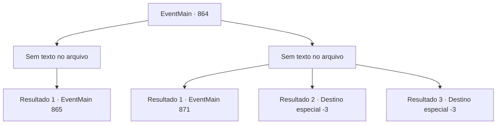

# Eventos principais · 864

[Índice da tabela](index.md) · [Índice geral](../index.md)

ID: `pt:EventMain:864` · Fonte: `EventMain4` · Versão: 1.2.47.

Mapeamento estático dos arquivos; a disponibilidade e a execução dependem do estado da run.

## Texto do evento

*Sem texto no arquivo.*

## Dados de entrada

```json
{
  "id": 864,
  "grade": 1,
  "normalGoal": "",
  "required": ""
}
```

## Mapa das escolhas



## Escolhas e resultados

### Escolha 1

*Sem texto no arquivo; o papel dessa opção depende da interface do jogo.*

Requisitos e outros campos da escolha:

```json
{
  "required": ""
}
```

#### Resultado 1.1

Você e Rosilpha se unem e derrubam o golem. E você decide empilhar as peças em ordem diferente. 

 "Vamos tentar de outra forma."


Continuação registrada: [Evento 865](0865.md) na mesma tabela.

```json
{
  "required": "",
  "chance": "1",
  "nextEvent": 865,
  "type": 2,
  "reward": ""
}
```

### Escolha 2

*Sem texto no arquivo; o papel dessa opção depende da interface do jogo.*

Requisitos e outros campos da escolha:

```json
{
  "required": ""
}
```

#### Resultado 2.1

Você e Rosilpha correm para evitar o punho do golem. Encharcados, você e Rosilpha saem da água e descansam enquanto se secam. Rosilpha torce suas roupas e fala. 

 "Fuhu... acho que teremos que pensar em outra maneira agora."

 Enquanto isso, uma mulher que parece ser uma aventureira se aproxima e fala com você. 

 "Você é {1}. Certo? Rian Naverrovna me pediu para lhe entregar isso."

 Ela lhe entrega uma carta e sai. É uma carta escrita por Rian, filha de Naverr.
 'Contratei aventureiros para encontrar meu pai. Acho que eles poderiam usar sua ajuda. Não seria melhor para você também do que procurar sozinho?'
 A carta sugere que você coopere com os aventureiros e indica um ponto de encontro.

Continuação registrada: [Evento 871](0871.md) na mesma tabela.

```json
{
  "required": "1_0_2|1_1_2",
  "chance": "1",
  "nextEvent": 871,
  "type": 2,
  "reward": "0_0_-1|0_1_-1"
}
```

#### Resultado 2.2

O punho do golem te atinge em cheio, despedaçando seu crânio em pedaços.

Continuação registrada: [Destino especial `-3`](../destinos-especiais.md).

```json
{
  "required": "2_0_2",
  "chance": "1",
  "nextEvent": -3,
  "type": 2,
  "reward": "0_0_-1|0_1_-1"
}
```

#### Resultado 2.3

O punho do golem te atinge em cheio, despedaçando seu crânio em pedaços.

Continuação registrada: [Destino especial `-3`](../destinos-especiais.md).

```json
{
  "required": "2_1_2",
  "chance": "1",
  "nextEvent": -3,
  "type": 2,
  "reward": "0_0_-1|0_1_-1"
}
```

## Referências que chegam a este evento

- [Evento 863 · escolha 2 · resultado 1](0863.md#escolha-2)
- [Evento 863 · escolha 3 · resultado 1](0863.md#escolha-3)
