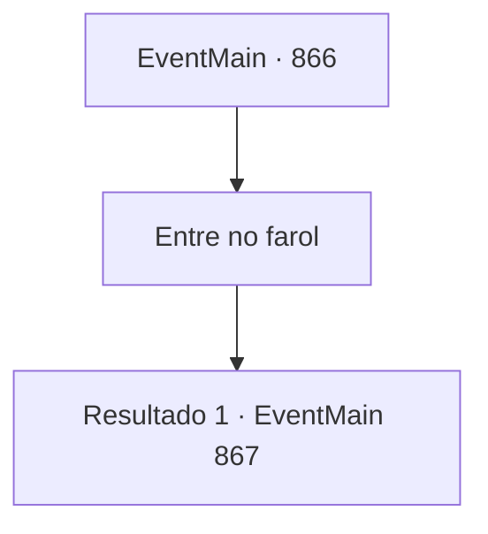

# Eventos principais · 866

[Índice da tabela](index.md) · [Índice geral](../index.md)

ID: `pt:EventMain:866` · Fonte: `EventMain4` · Versão: 1.2.47.

Mapeamento estático dos arquivos; a disponibilidade e a execução dependem do estado da run.

## Texto do evento

*Sem texto no arquivo.*

## Dados de entrada

```json
{
  "id": 866,
  "grade": 1,
  "normalGoal": "",
  "required": ""
}
```

## Mapa das escolhas



## Escolhas e resultados

### Escolha 1

Entre no farol

Requisitos e outros campos da escolha:

```json
{
  "required": ""
}
```

#### Resultado 1.1

Você e Rosilpha nadam até o farol, seguindo em direção à seção superior onde o cristal está embutido. Escadas feitas de pedra estão espiralando ao longo das paredes circulares da torre e coral, algas marinhas e cracas aderem espessamente à superfície. 

 "Devemos estar cansados se subimos essas escadas."

 Rosilpha olha ao redor, então segue em direção aos níveis superiores do farol. O acesso ao último andar é bloqueado por uma pequena porta de ferro vermelho enferrujado. A porta possui um mecanismo de travamento complexo feito de barras de aço dispostas em padrões intrincados. Rosilpha passa os dedos sobre ele e fala. 

 "Aqui, parece que a porta se abre quando movemos essas barras de aço de alguma forma."


Continuação registrada: [Evento 867](0867.md) na mesma tabela.

```json
{
  "required": "",
  "chance": "1",
  "nextEvent": 867,
  "type": 2,
  "reward": ""
}
```

## Referências que chegam a este evento

- [Evento 863 · escolha 1 · resultado 1](0863.md#escolha-1)
- [Evento 865 · escolha 1 · resultado 1](0865.md#escolha-1)
