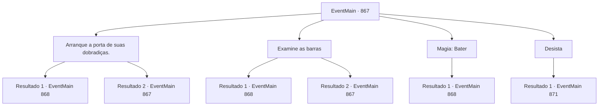

# Eventos principais · 867

[Índice da tabela](index.md) · [Índice geral](../index.md)

ID: `pt:EventMain:867` · Fonte: `EventMain4` · Versão: 1.2.47.

Mapeamento estático dos arquivos; a disponibilidade e a execução dependem do estado da run.

## Texto do evento

*Sem texto no arquivo.*

## Dados de entrada

```json
{
  "id": 867,
  "grade": 1,
  "normalGoal": "",
  "required": ""
}
```

## Mapa das escolhas



## Escolhas e resultados

### Escolha 1

Arranque a porta de suas dobradiças.

Requisitos e outros campos da escolha:

```json
{
  "required": "5_662_0"
}
```

#### Resultado 1.1

Você agarra as barras de aço e puxa a porta com sua força. Então, a porta de ferro enferrujada é arrancada, revelando um corredor que leva ao último andar do farol. Com um pequeno aplauso, Rosilpha fala. 

 "Uau... Impressionante. Você é muito mais forte do que eu pensava."

 Dentro, há uma lâmpada que parece ter uma vez conjurado a luz aqui, com um disco de platina dentro dela. 

 "Oh... Deve ser o disco. Parece que precisamos encontrar uma maneira de abrir a lâmpada."

 O vidro da lâmpada não é comum; parece estar encantado com uma barreira magia, tornando impossível quebrá-lo fisicamente.

Continuação registrada: [Evento 868](0868.md) na mesma tabela.

```json
{
  "required": "",
  "chance": "1|0_5_1",
  "nextEvent": 868,
  "type": 0,
  "reward": ""
}
```

#### Resultado 1.2

Você agarra as barras de aço e puxa a porta com toda a sua força. Mas a porta nunca cede.

Continuação registrada: [Evento 867](0867.md) na mesma tabela.

```json
{
  "required": "",
  "chance": "18",
  "nextEvent": 867,
  "type": 1,
  "reward": "5_662_1"
}
```

### Escolha 2

Examine as barras

Requisitos e outros campos da escolha:

```json
{
  "required": "5_663_0"
}
```

#### Resultado 2.1

Você analisa os padrões das barras de aço. E você, movendo cada peça uma por uma, finalmente abre a porta. Com um pequeno aplauso, Rosilpha fala. 

 "Uau... Impressionante. Você é muito mais inteligente do que eu pensava."

 Você entra no último andar do farol. Dentro, há uma lâmpada que parece ter uma vez conjurado a luz aqui, com um disco de platina dentro dela. 

 "Oh... Deve ser o disco. Parece que precisamos encontrar uma maneira de abrir a lâmpada."

 O vidro da lâmpada não é comum; parece estar encantado com uma barreira magia, tornando impossível quebrá-lo fisicamente.

Continuação registrada: [Evento 868](0868.md) na mesma tabela.

```json
{
  "required": "",
  "chance": "1|0_7_1",
  "nextEvent": 868,
  "type": 0,
  "reward": ""
}
```

#### Resultado 2.2

Você tenta analisar os padrões das barras de aço. No entanto, não importa o quanto você olhe, você não consegue decifrar o padrão.

Continuação registrada: [Evento 867](0867.md) na mesma tabela.

```json
{
  "required": "",
  "chance": "12",
  "nextEvent": 867,
  "type": 1,
  "reward": "5_663_1"
}
```

### Escolha 3

Magia: Bater

Requisitos e outros campos da escolha:

```json
{
  "required": "20_0_1"
}
```

#### Resultado 3.1

Você lança o feitiço. Enquanto as barras enferrujadas se movem para cima e para baixo, a porta se abre, revelando um corredor que leva ao último andar do farol. Dentro, há uma lâmpada que parece ter sido responsável pela luz aqui, com um disco de platina dentro dela. 

 "Oh... Deve ser o disco. Parece que precisamos encontrar uma maneira de abrir a lâmpada."

 O vidro da lâmpada não é comum; parece estar encantado com uma barreira magia, tornando impossível quebrá-lo fisicamente.

Continuação registrada: [Evento 868](0868.md) na mesma tabela.

```json
{
  "required": "",
  "chance": "1",
  "nextEvent": 868,
  "type": 2,
  "reward": ""
}
```

### Escolha 4

Desista

Requisitos e outros campos da escolha:

```json
{
  "required": ""
}
```

#### Resultado 4.1

Incapaz de abrir a porta, você e Rosilpha saem do farol. Encharcados, você e Rosilpha saem da água e descansam enquanto se secam. Rosilpha torce suas roupas e fala. 

 "Fuhu... Acho que teremos que pensar em outra maneira agora."

 Enquanto isso, uma mulher que parece ser uma aventureira se aproxima e fala com você. 

 "Você é {1}. Certo? Rian Naverrovna me pediu para lhe entregar isso."

 Ela lhe entrega uma carta e vai embora. É uma carta escrita por Rian, filha de Naverr.
 'Contratei aventureiros para encontrar meu pai. Acho que eles poderiam usar sua ajuda. Não seria melhor para você do que procurar sozinho?'
 A carta sugere que você coopere com os aventureiros e indica um ponto de encontro.

Continuação registrada: [Evento 871](0871.md) na mesma tabela.

```json
{
  "required": "",
  "chance": "1",
  "nextEvent": 871,
  "type": 2,
  "reward": ""
}
```

## Referências que chegam a este evento

- [Evento 866 · escolha 1 · resultado 1](0866.md#escolha-1)
- [Evento 867 · escolha 1 · resultado 2](0867.md#escolha-1)
- [Evento 867 · escolha 2 · resultado 2](0867.md#escolha-2)
