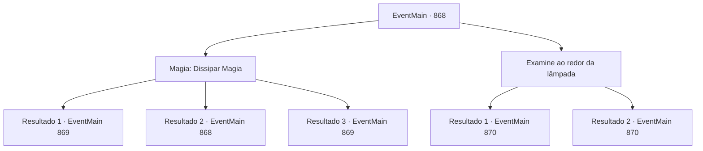

# Eventos principais · 868

[Índice da tabela](index.md) · [Índice geral](../index.md)

ID: `pt:EventMain:868` · Fonte: `EventMain4` · Versão: 1.2.47.

Mapeamento estático dos arquivos; a disponibilidade e a execução dependem do estado da run.

## Texto do evento

*Sem texto no arquivo.*

## Dados de entrada

```json
{
  "id": 868,
  "grade": 1,
  "normalGoal": "",
  "required": ""
}
```

## Mapa das escolhas



## Escolhas e resultados

### Escolha 1

Magia: Dissipar Magia

Requisitos e outros campos da escolha:

```json
{
  "required": "20_0_2|1_1_2|5_664_0"
}
```

#### Resultado 1.1

Com foco intenso, você dissipa a magia criando a barreira. À medida que a barreira desaparece, você consegue recuperar o disco. No entanto, como a barreira reaparece instantaneamente, você recolhe a mão estendida. Rosilpha comenta ao ver isso. 

 "Deve haver um dispositivo gerando essa barreira. Eles pareciam estar seriamente obcecados com esse disco."

 Ele sugere duas opções. A primeira é usar Dispersar Magia novamente e recuperar rapidamente o disco. A outra é encontrar o dispositivo e desativar a barreira com segurança.

Continuação registrada: [Evento 869](0869.md) na mesma tabela.

```json
{
  "required": "21_0_4",
  "chance": "1|0_7_1|0_12_1",
  "nextEvent": 869,
  "type": 0,
  "reward": "0_1_-1"
}
```

#### Resultado 1.2

Você tenta dissipar a magia e remover a barreira, mas falha. Rosilpha sugere tentar de outra forma e continua. 

 "Deve haver um dispositivo gerando essa barreira. Eles pareciam estar seriamente obcecados por este disco."


Continuação registrada: [Evento 868](0868.md) na mesma tabela.

```json
{
  "required": "21_0_4",
  "chance": "40",
  "nextEvent": 868,
  "type": 1,
  "reward": "5_664_1"
}
```

#### Resultado 1.3

Com foco intenso, você dissipa a magia criando a barreira. À medida que a barreira desaparece, você consegue recuperar o disco. No entanto, como a barreira reaparece instantaneamente, você recolhe a mão estendida. Rosilpha comenta ao ver isso. 

 "Deve haver um dispositivo gerando essa barreira. Eles pareciam estar seriamente obcecados com esse disco."

 Ele sugere duas opções. A primeira é usar Dispersar Magia novamente e recuperar rapidamente o disco. A outra é encontrar o dispositivo e desativar a barreira com segurança.

Continuação registrada: [Evento 869](0869.md) na mesma tabela.

```json
{
  "required": "20_0_4",
  "chance": "1",
  "nextEvent": 869,
  "type": 2,
  "reward": "0_1_-1"
}
```

### Escolha 2

Examine ao redor da lâmpada

Requisitos e outros campos da escolha:

```json
{
  "required": ""
}
```

#### Resultado 2.1

Você e Rosilpha investigam ao redor da lâmpada. E descobrem inscrições escritas em antigo Siniano. Vocês traduzem as inscrições. 

 'I. Quando o sol se põe, pressione o ankh para iluminar a luz.
 II. Pressione o relógio uma vez por dia para recuperar o disco e limpá-lo completamente.
 III. Pressione o vento para mudar a direção do disco.
 IV. Se um ladrão vier, pressione a espada e o escudo para soar o alarme.' 

 Abaixo disso, também há alguns símbolos básicos. Parece que representam uma ampulheta, vento, ankh e espada com um escudo.

Continuação registrada: [Evento 870](0870.md) na mesma tabela.

```json
{
  "required": "",
  "chance": "1|0_7_1",
  "nextEvent": 870,
  "type": 0,
  "reward": ""
}
```

#### Resultado 2.2

Você e Rosilpha investigam ao redor da lâmpada. E vocês descobrem inscrições escritas em antigo Siniano. Mas vocês não conseguem traduzir as inscrições. Em vez disso, conseguem reconhecer os símbolos básicos abaixo. Parece que eles representam uma ampulheta, vento, ankh e espada com um escudo. Enquanto Rosilpha examina os símbolos, ele fala. 

 "Parecem ser algum tipo de instruções. Hmm..."


Continuação registrada: [Evento 870](0870.md) na mesma tabela.

```json
{
  "required": "",
  "chance": "25",
  "nextEvent": 870,
  "type": 1,
  "reward": ""
}
```

## Referências que chegam a este evento

- [Evento 867 · escolha 1 · resultado 1](0867.md#escolha-1)
- [Evento 867 · escolha 2 · resultado 1](0867.md#escolha-2)
- [Evento 867 · escolha 3 · resultado 1](0867.md#escolha-3)
- [Evento 868 · escolha 1 · resultado 2](0868.md#escolha-1)
