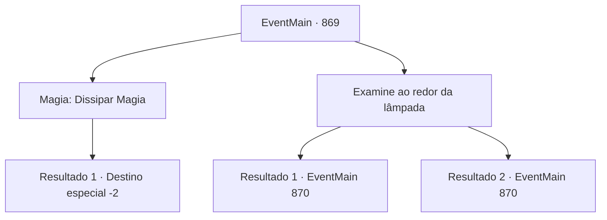

# Eventos principais · 869

[Índice da tabela](index.md) · [Índice geral](../index.md)

ID: `pt:EventMain:869` · Fonte: `EventMain4` · Versão: 1.2.47.

Mapeamento estático dos arquivos; a disponibilidade e a execução dependem do estado da run.

## Texto do evento

*Sem texto no arquivo.*

## Dados de entrada

```json
{
  "id": 869,
  "grade": 1,
  "normalGoal": "",
  "required": ""
}
```

## Mapa das escolhas



## Escolhas e resultados

### Escolha 1

Magia: Dissipar Magia

Requisitos e outros campos da escolha:

```json
{
  "required": "20_0_2|1_1_2"
}
```

#### Resultado 1.1

Você dissipa a barreira mais uma vez. E enquanto isso, Rosilpha recupera o disco. Assim que sua mão se retira, a barreira se reforma instantaneamente. 

 "Ufa... Por pouco. Aqui, pegue isso. Vamos agora."

 Você pega o Disco da Lua e sai do farol. Você e Rosilpha saem da água e descansam enquanto se secam. Rosilpha torce suas roupas e fala. 

 "Já que encontramos o Disco da Lua, só precisamos esperar Naverr vir até aqui. Eu vou ficar aqui e entrar em contato com você quando eu vê-lo. Por favor, me avise se você encontrá-lo."

 Ele segue para a estalagem, se despedindo com um 'cuide-se'.

Continuação registrada: [Destino especial `-2`](../destinos-especiais.md).

```json
{
  "required": "",
  "chance": "1",
  "nextEvent": -2,
  "type": 2,
  "reward": "13_5_3|3_316_1|0_1_-1"
}
```

### Escolha 2

Examine ao redor da lâmpada

Requisitos e outros campos da escolha:

```json
{
  "required": ""
}
```

#### Resultado 2.1

Você e Rosilpha investigam ao redor da lâmpada. E descobrem inscrições escritas em antigo Siniano. Vocês traduzem as inscrições. 

 'I. Quando o sol se põe, pressione o ankh para iluminar a luz.
 II. Pressione o relógio uma vez por dia para recuperar o disco e limpá-lo completamente.
 III. Pressione o vento para mudar a direção do disco.
 IV. Se um ladrão vier, pressione a espada e o escudo para soar o alarme.' 

 Abaixo disso, também há alguns símbolos básicos. Parece que representam uma ampulheta, vento, ankh e espada com um escudo.

Continuação registrada: [Evento 870](0870.md) na mesma tabela.

```json
{
  "required": "",
  "chance": "1|0_7_1",
  "nextEvent": 870,
  "type": 0,
  "reward": ""
}
```

#### Resultado 2.2

Você e Rosilpha investigam ao redor da lâmpada. E vocês descobrem inscrições escritas em antigo Siniano. Mas vocês não conseguem traduzir as inscrições. Em vez disso, conseguem reconhecer os símbolos básicos abaixo. Parece que eles representam uma ampulheta, vento, ankh e espada com um escudo. Enquanto Rosilpha examina os símbolos, ele fala. 

 "Parecem ser algum tipo de instruções. Hmm..."


Continuação registrada: [Evento 870](0870.md) na mesma tabela.

```json
{
  "required": "",
  "chance": "25",
  "nextEvent": 870,
  "type": 1,
  "reward": ""
}
```

## Referências que chegam a este evento

- [Evento 868 · escolha 1 · resultado 1](0868.md#escolha-1)
- [Evento 868 · escolha 1 · resultado 3](0868.md#escolha-1)
