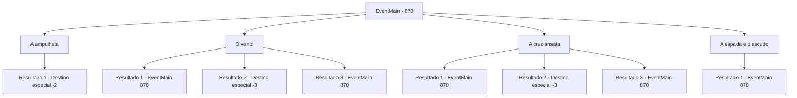

# Eventos principais · 870

[Índice da tabela](index.md) · [Índice geral](../index.md)

ID: `pt:EventMain:870` · Fonte: `EventMain4` · Versão: 1.2.47.

Mapeamento estático dos arquivos; a disponibilidade e a execução dependem do estado da run.

## Texto do evento

*Sem texto no arquivo.*

## Dados de entrada

```json
{
  "id": 870,
  "grade": 1,
  "normalGoal": "",
  "required": ""
}
```

## Mapa das escolhas



## Escolhas e resultados

### Escolha 1

A ampulheta

Requisitos e outros campos da escolha:

```json
{
  "required": ""
}
```

#### Resultado 1.1

Você pressiona o botão gravado com a ampulheta. Então a barreira desaparece, e o selo é liberado. Você pega o Disco da Lua e sai do farol. Você e Rosilpha saem da água e descansam enquanto se secam. Rosilpha torce suas roupas e fala. 

 "Como encontramos o Disco da Lua, só precisamos esperar Naverr vir até aqui. Eu vou ficar aqui e entrar em contato com você quando eu vê-lo. Por favor, me avise se você encontrá-lo."

 Ele segue para a estalagem, se despedindo com um 'cuide-se'.

Continuação registrada: [Destino especial `-2`](../destinos-especiais.md).

```json
{
  "required": "",
  "chance": "1",
  "nextEvent": -2,
  "type": 2,
  "reward": "13_5_3|3_316_1"
}
```

### Escolha 2

O vento

Requisitos e outros campos da escolha:

```json
{
  "required": "5_665_0"
}
```

#### Resultado 2.1

Você pressiona o botão gravado com o vento. Então a eletricidade flui do botão, eletrocutando você. E a eletricidade viaja pela água do mar, chocando também Rosilpha. 

 "Aaaah!! UGGHHH!!!"

 Depois de emitir um grito assustador, Rosilpha consegue abrir a boca depois que a eletricidade para. 

 "...Acho que era o errado."


Continuação registrada: [Evento 870](0870.md) na mesma tabela.

```json
{
  "required": "21_17_1|1_0_2",
  "chance": "1",
  "nextEvent": 870,
  "type": 2,
  "reward": "5_665_1|0_0_-1"
}
```

#### Resultado 2.2

Você pressiona o botão gravado com o vento. Então a eletricidade flui do botão, te eletrocutando. Você tenta soltar a mão, mas não consegue, e eventualmente seu coração para de bater devido ao choque.

Continuação registrada: [Destino especial `-3`](../destinos-especiais.md).

```json
{
  "required": "21_17_1|2_0_2",
  "chance": "1",
  "nextEvent": -3,
  "type": 2,
  "reward": "0_0_-1"
}
```

#### Resultado 2.3

Você pressiona o botão gravado com o vento. Então a eletricidade flui do botão, te eletrocutando. E a eletricidade viaja pela água do mar, chocando também Rosilpha. Não é grande coisa para você. Mas, 

 "Aaaah!! UGGHHH!!!"

 Depois de emitir um grito assustador, Rosilpha consegue abrir a boca depois que a eletricidade para. 

 "Acho que foi o botão errado."


Continuação registrada: [Evento 870](0870.md) na mesma tabela.

```json
{
  "required": "20_17_1",
  "chance": "1",
  "nextEvent": 870,
  "type": 2,
  "reward": "5_665_1"
}
```

### Escolha 3

A cruz ansata

Requisitos e outros campos da escolha:

```json
{
  "required": "5_666_0"
}
```

#### Resultado 3.1

Você pressiona o botão gravado com o ankh. De repente, uma radiância divina emana, empurrando você para longe. Um calor abrasador queima sua carne. Então Rosilpha se aproxima e fala. 

 "Acho que foi o errado."


Continuação registrada: [Evento 870](0870.md) na mesma tabela.

```json
{
  "required": "21_3_0|1_0_2",
  "chance": "1",
  "nextEvent": 870,
  "type": 2,
  "reward": "5_666_1|0_0_-1"
}
```

#### Resultado 3.2

Você pressiona o botão gravado com o ankh. De repente, uma radiância divina emana, envolvendo você em chamas. Você é consumido pelas chamas e reduzido a cinzas.

Continuação registrada: [Destino especial `-3`](../destinos-especiais.md).

```json
{
  "required": "21_3_0|2_0_2",
  "chance": "1",
  "nextEvent": -3,
  "type": 2,
  "reward": "0_0_-1"
}
```

#### Resultado 3.3

Você pressiona o botão gravado com o ankh. De repente, uma radiância divina emana, empurrando você para longe. A luz gentilmente envolve você e logo desaparece. Então Rosilpha se aproxima e fala. 

 "Acho que foi o botão errado."


Continuação registrada: [Evento 870](0870.md) na mesma tabela.

```json
{
  "required": "20_3_0",
  "chance": "1",
  "nextEvent": 870,
  "type": 2,
  "reward": "5_666_1"
}
```

### Escolha 4

A espada e o escudo

Requisitos e outros campos da escolha:

```json
{
  "required": "5_667_0"
}
```

#### Resultado 4.1

Você pressiona o botão gravado com a espada com um escudo. Mas nada acontece. Então Rosilpha se aproxima e fala. 

 "Eu acho que está quebrado."


Continuação registrada: [Evento 870](0870.md) na mesma tabela.

```json
{
  "required": "",
  "chance": "1",
  "nextEvent": 870,
  "type": 2,
  "reward": "5_667_1"
}
```

## Referências que chegam a este evento

- [Evento 868 · escolha 2 · resultado 1](0868.md#escolha-2)
- [Evento 868 · escolha 2 · resultado 2](0868.md#escolha-2)
- [Evento 869 · escolha 2 · resultado 1](0869.md#escolha-2)
- [Evento 869 · escolha 2 · resultado 2](0869.md#escolha-2)
- [Evento 870 · escolha 2 · resultado 1](0870.md#escolha-2)
- [Evento 870 · escolha 2 · resultado 3](0870.md#escolha-2)
- [Evento 870 · escolha 3 · resultado 1](0870.md#escolha-3)
- [Evento 870 · escolha 3 · resultado 3](0870.md#escolha-3)
- [Evento 870 · escolha 4 · resultado 1](0870.md#escolha-4)
