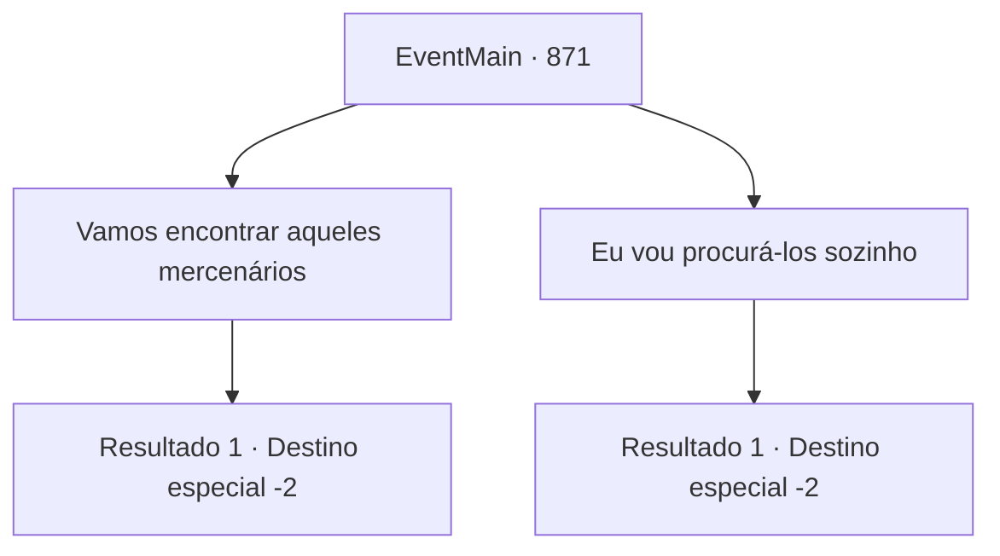

# Eventos principais · 871

[Índice da tabela](index.md) · [Índice geral](../index.md)

ID: `pt:EventMain:871` · Fonte: `EventMain4` · Versão: 1.2.47.

Mapeamento estático dos arquivos; a disponibilidade e a execução dependem do estado da run.

## Texto do evento

*Sem texto no arquivo.*

## Dados de entrada

```json
{
  "id": 871,
  "grade": 1,
  "normalGoal": "",
  "required": ""
}
```

## Mapa das escolhas



## Escolhas e resultados

### Escolha 1

Vamos encontrar aqueles mercenários

Requisitos e outros campos da escolha:

```json
{
  "required": ""
}
```

#### Resultado 1.1

Você decide procurar os aventureiros contratados pela família de Naverr. Então Rosilpha acena com a cabeça e fala. 

 "Boa ideia. Eles podem ter informações sobre Naverr também, então unir forças pode facilitar encontrá-lo. Mas, caso Naverr retorne aqui, eu ficarei para vigiar."

 Você se despede de Rosilpha, concordando em se encontrar novamente no futuro.

Continuação registrada: [Destino especial `-2`](../destinos-especiais.md).

```json
{
  "required": "",
  "chance": "1",
  "nextEvent": -2,
  "type": 2,
  "reward": "13_5_4"
}
```

### Escolha 2

Eu vou procurá-los sozinho

Requisitos e outros campos da escolha:

```json
{
  "required": ""
}
```

#### Resultado 2.1

Você decide encontrar Naverr por conta própria. Com um rosto levemente preocupado, Rosilpha fala. 

 "Essa poderia ser uma maneira de seguir, mas... Tenha cuidado. Eu vou ficar aqui caso Naverr retorne."

 Você se despede de Rosilpha, concordando em se encontrar novamente no futuro.

Continuação registrada: [Destino especial `-2`](../destinos-especiais.md).

```json
{
  "required": "",
  "chance": "1",
  "nextEvent": -2,
  "type": 2,
  "reward": "13_5_5"
}
```

## Referências que chegam a este evento

- [Evento 858 · escolha 5 · resultado 1](0858.md#escolha-5)
- [Evento 864 · escolha 2 · resultado 1](0864.md#escolha-2)
- [Evento 867 · escolha 4 · resultado 1](0867.md#escolha-4)
