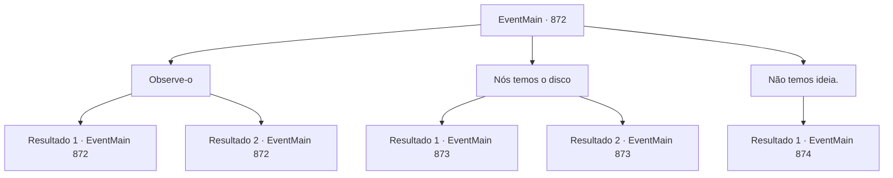

# Eventos principais · 872

[Índice da tabela](index.md) · [Índice geral](../index.md)

ID: `pt:EventMain:872` · Fonte: `EventMain4` · Versão: 1.2.47.

Mapeamento estático dos arquivos; a disponibilidade e a execução dependem do estado da run.

## Texto do evento


 "Aqui, pegue isso."

 Alguns dias depois de encontrar o Disco da Lua, um aventureiro se aproxima de você e entrega uma nota. A nota diz que Naverr apareceu em Sinias. Felizmente, você já está perto de Sinias, então você vai imediatamente para lá. 

 Algumas horas depois, você encontra Rosilpha esperando lá. 

 "Naverr está procurando o Disco da Lua."

 Rosilpha transmite a situação de Naverr e acrescenta que ele está acompanhado por desconhecidos. Você e Rosilpha imediatamente rastreiam Naverr e começam a segui-lo. Quando entram em um beco deserto, você o alcança e segura seu ombro. |drawing_naverrFace| Naverr vê você e Rosilpha, então pisca um olho enquanto fala. 

 "Você se importaria se eu te perguntasse algo? Posso perguntar se você sabe onde está localizado o Disco da Lua?"

 Com um tom bastante diferente do habitual, ele se dirige a você de forma desconfortável. Quatro mercenários estão ao lado de Naverr, e seus rostos estão em branco e sem expressão. Eles nem piscam, apenas observam você e Rosilpha.

## Dados de entrada

```json
{
  "id": 872,
  "grade": 1,
  "normalGoal": "",
  "required": "13_5_3|1_2_50"
}
```

## Mapa das escolhas



## Escolhas e resultados

### Escolha 1

Observe-o

Requisitos e outros campos da escolha:

```json
{
  "required": "5_670_0"
}
```

#### Resultado 1.1

Você verifica a aparência de Naverr. Então ele pisca novamente, e você percebe que ele está sinalizando algo. Vendo ele fingindo não reconhecê-lo, parece que Naverr quer manter em segredo dos mercenários que vocês se conhecem. Então, Rosilpha fala. 

 "Quem são aquelas pessoas ao seu lado? A atmosfera parece tensa."

 Ao ouvir isso, Naverr acena com a mão. 

 "Eles são apenas meus guarda-costas pessoais. É perigoso lá fora para um arqueólogo viajar sozinho."


Continuação registrada: [Evento 872](0872.md) na mesma tabela.

```json
{
  "required": "",
  "chance": "1|0_14_1",
  "nextEvent": 872,
  "type": 0,
  "reward": "5_670_1"
}
```

#### Resultado 1.2

Você dá uma olhada no rosto de Naverr. Então ele pisca novamente. Deve ter entrado algo em seu olho. Então, Rosilpha fala. 

 "Quem são aquelas pessoas ao seu lado? A atmosfera parece tensa."

 Ao ouvir isso, Naverr acena com a mão. 

 "Eles são apenas meus seguranças. É perigoso lá fora para um arqueólogo viajar sozinho."


Continuação registrada: [Evento 872](0872.md) na mesma tabela.

```json
{
  "required": "",
  "chance": "15",
  "nextEvent": 872,
  "type": 1,
  "reward": "5_670_2"
}
```

### Escolha 2

Nós temos o disco

Requisitos e outros campos da escolha:

```json
{
  "required": ""
}
```

#### Resultado 2.1

Você diz a ele que encontrou o Disco da Lua e agora o possui. Então Naverr lhe entrega uma bolsa de couro pesada e fala. 

 "Eu te darei isso, então por favor me venda o disco."

 Naverr continua piscando um olho enquanto entrega a bolsa. Você entende o sinal de Naverr. Naverr está tentando implicar através de seus gestos e expressões que há algo dentro da bolsa que ele quer lhe dar, e se você não entregar o disco, você poderia estar em perigo.

Continuação registrada: [Evento 873](0873.md) na mesma tabela.

```json
{
  "required": "",
  "chance": "1|0_14_1",
  "nextEvent": 873,
  "type": 0,
  "reward": "5_671_1"
}
```

#### Resultado 2.2

Você diz a ele que encontrou o Disco da Lua e agora o possui. Então Naverr lhe entrega um pesado saco de couro e fala. 

 "Eu te darei isso, então por favor me venda o disco."

 Você olha para o rosto de Naverr. Mas não consegue entender sua intenção.

Continuação registrada: [Evento 873](0873.md) na mesma tabela.

```json
{
  "required": "",
  "chance": "14",
  "nextEvent": 873,
  "type": 1,
  "reward": ""
}
```

### Escolha 3

Não temos ideia.

Requisitos e outros campos da escolha:

```json
{
  "required": ""
}
```

#### Resultado 3.1

Você diz a ele que não sabe. Então, a pele dos mercenários ao lado de Naverr de repente fica roxa turva, e múltiplos tentáculos surgem. As criaturas distorcidas, revelando sua verdadeira forma, imediatamente começam a atacar.

Continuação registrada: [Evento 874](0874.md) na mesma tabela.

```json
{
  "required": "",
  "chance": "1",
  "nextEvent": 874,
  "type": 2,
  "reward": "6_4_170",
  "place": 4
}
```

## Referências que chegam a este evento

- [Evento 872 · escolha 1 · resultado 1](0872.md#escolha-1)
- [Evento 872 · escolha 1 · resultado 2](0872.md#escolha-1)
