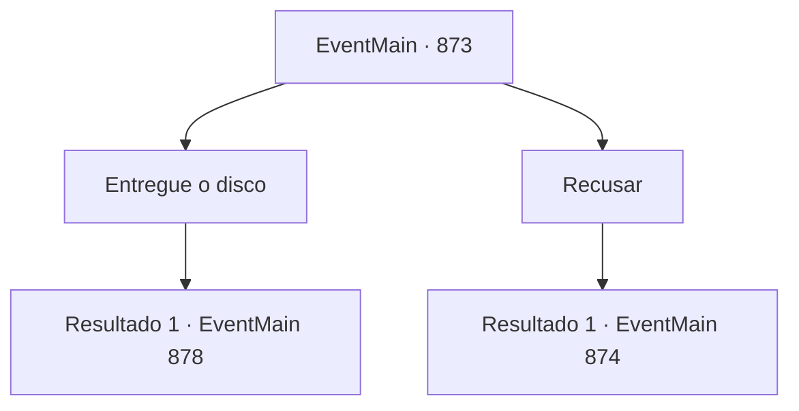

# Eventos principais · 873

[Índice da tabela](index.md) · [Índice geral](../index.md)

ID: `pt:EventMain:873` · Fonte: `EventMain4` · Versão: 1.2.47.

Mapeamento estático dos arquivos; a disponibilidade e a execução dependem do estado da run.

## Texto do evento

*Sem texto no arquivo.*

## Dados de entrada

```json
{
  "id": 873,
  "grade": 1,
  "normalGoal": "",
  "required": ""
}
```

## Mapa das escolhas



## Escolhas e resultados

### Escolha 1

Entregue o disco

Requisitos e outros campos da escolha:

```json
{
  "required": "5_671_1"
}
```

#### Resultado 1.1

Você diz a Rosilpha para entregar o disco. 

 "O quê... Você tem certeza disso?"

 Você acena novamente em resposta à pergunta de Rosilpha. Então, você tira o Disco da Lua de sua mochila e entrega para Naverr. E você recebe um pequeno bolsa de couro de Naverr. 

 "Agradeço. Vou me retirar, então."

 Naverr se despede educadamente e parte com seus mercenários. Rosilpha lhe entrega a bolsa de couro. Dentro, você encontra algumas moedas de ouro e o pingente do medalhão de Naverr.

Continuação registrada: [Evento 878](0878.md) na mesma tabela.

```json
{
  "required": "",
  "chance": "1",
  "nextEvent": 878,
  "type": 2,
  "reward": "4_316_1|3_317_1|0_4_100"
}
```

### Escolha 2

Recusar

Requisitos e outros campos da escolha:

```json
{
  "required": ""
}
```

#### Resultado 2.1

Você recusa a oferta dele. Então, a pele dos mercenários ao lado de Naverr de repente se torna roxa turva, e múltiplos tentáculos surgem. As criaturas distorcidas, revelando sua verdadeira forma, imediatamente começam a atacar.

Continuação registrada: [Evento 874](0874.md) na mesma tabela.

```json
{
  "required": "",
  "chance": "1",
  "nextEvent": 874,
  "type": 2,
  "reward": "6_4_170",
  "place": 4
}
```

## Referências que chegam a este evento

- [Evento 872 · escolha 2 · resultado 1](0872.md#escolha-2)
- [Evento 872 · escolha 2 · resultado 2](0872.md#escolha-2)
