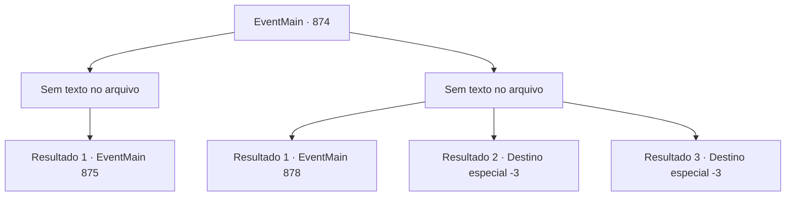

# Eventos principais · 874

[Índice da tabela](index.md) · [Índice geral](../index.md)

ID: `pt:EventMain:874` · Fonte: `EventMain4` · Versão: 1.2.47.

Mapeamento estático dos arquivos; a disponibilidade e a execução dependem do estado da run.

## Texto do evento

*Sem texto no arquivo.*

## Dados de entrada

```json
{
  "id": 874,
  "grade": 1,
  "normalGoal": "",
  "required": ""
}
```

## Mapa das escolhas



## Escolhas e resultados

### Escolha 1

*Sem texto no arquivo; o papel dessa opção depende da interface do jogo.*

Requisitos e outros campos da escolha:

```json
{
  "required": ""
}
```

#### Resultado 1.1

Você e Rosilpha derrotam as criaturas bizarras. O chão está manchado de sangue arroxeado, e um odor repugnante enche o ar. Então algo brilhante em várias cores cai de seus corpos. Naverr pega e fala. 

 "O plano deu errado... De qualquer forma, vamos sair daqui. Pode haver mais deles."

 Você, Naverr e Rosilpha deixam a cidade juntos.

Continuação registrada: [Evento 875](0875.md) na mesma tabela.

```json
{
  "required": "",
  "chance": "1",
  "nextEvent": 875,
  "type": 2,
  "reward": ""
}
```

### Escolha 2

*Sem texto no arquivo; o papel dessa opção depende da interface do jogo.*

Requisitos e outros campos da escolha:

```json
{
  "required": ""
}
```

#### Resultado 2.1

Você e Rosilpha estão encurralados pelos ataques das criaturas distorcidas. Então, Naverr intervém e fala. 

 "Causar mais confusão pode trazer problemas. Vamos encerrar por aqui. Já conseguimos o que viemos buscar."

 Seguindo as palavras de Naverr, eles pegam o disco e partem, enquanto você se levanta. Então, Rosilpha fala. 

 "Olhe. Tem algo aqui, no chão."

 Uma pequena bolsa de couro está onde eles partiram. Você pega a bolsa e verifica o conteúdo. Dentro, há algumas moedas de ouro e o pingente do colar de Naverr.

Continuação registrada: [Evento 878](0878.md) na mesma tabela.

```json
{
  "required": "1_0_2|1_1_2",
  "chance": "1",
  "nextEvent": 878,
  "type": 2,
  "reward": "0_0_-1|0_1_-1|3_317_1|0_4_100|4_316_1"
}
```

#### Resultado 2.2

Os tentáculos da criatura retorcida se enrolam em volta da sua cabeça. Os dentes afiados que se projetam dos tentáculos perfuram sua carne, e com uma força tremenda, esmagam seus ossos instantaneamente.

Continuação registrada: [Destino especial `-3`](../destinos-especiais.md).

```json
{
  "required": "2_0_2",
  "chance": "1",
  "nextEvent": -3,
  "type": 2,
  "reward": "0_0_-1|0_1_-1"
}
```

#### Resultado 2.3

Os tentáculos da criatura retorcida se enrolam em volta da sua cabeça. Os dentes afiados que se projetam dos tentáculos perfuram sua carne, e com uma força tremenda, esmagam seus ossos instantaneamente.

Continuação registrada: [Destino especial `-3`](../destinos-especiais.md).

```json
{
  "required": "2_1_2",
  "chance": "1",
  "nextEvent": -3,
  "type": 2,
  "reward": "0_0_-1|0_1_-1"
}
```

## Referências que chegam a este evento

- [Evento 872 · escolha 3 · resultado 1](0872.md#escolha-3)
- [Evento 873 · escolha 2 · resultado 1](0873.md#escolha-2)
