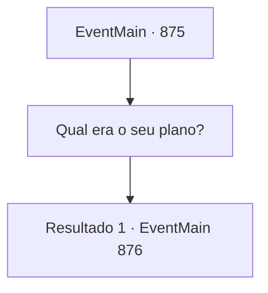

# Eventos principais · 875

[Índice da tabela](index.md) · [Índice geral](../index.md)

ID: `pt:EventMain:875` · Fonte: `EventMain4` · Versão: 1.2.47.

Mapeamento estático dos arquivos; a disponibilidade e a execução dependem do estado da run.

## Texto do evento

*Sem texto no arquivo.*

## Dados de entrada

```json
{
  "id": 875,
  "grade": 1,
  "normalGoal": "",
  "required": ""
}
```

## Mapa das escolhas



## Escolhas e resultados

### Escolha 1

Qual era o seu plano?

Requisitos e outros campos da escolha:

```json
{
  "required": "5_672_0"
}
```

#### Resultado 1.1

Ao ser perguntado, Naverr para de andar e ofega para respirar e falar. 

 "Ufa... Olhe isso."

 Ele tira seu pingente de medalhão de seus bolsos internos e mostra para você. Há um pequeno bilhete dentro do pingente. 'Eu quebrei um selo antigo e obtive a 'Lente de Éter'; um componente da chave que abrirá o caminho para o Plano Astral. Mas isso convocou entidades desconhecidas que devoram almas. Eu as chamei de 'devoradoras de almas.' De qualquer forma, elas estão tentando entrar no Plano Astral, onde todas as almas acabam, e eu preciso da sua ajuda para detê-las. Venha para o Olho Azul da Selva de Andaria na noite em que a lua carmesim se levantar. Destrua o portal no momento em que elas cruzarem para o Plano Astral. Então podemos prendê-las na fenda dimensional.'

Continuação registrada: [Evento 876](0876.md) na mesma tabela.

```json
{
  "required": "",
  "chance": "1",
  "nextEvent": 876,
  "type": 2,
  "reward": "5_672_1"
}
```

## Referências que chegam a este evento

- [Evento 874 · escolha 1 · resultado 1](0874.md#escolha-1)
