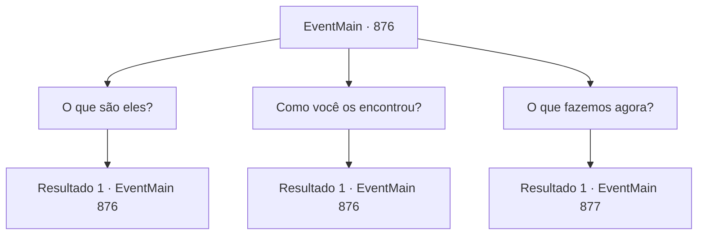

# Eventos principais · 876

[Índice da tabela](index.md) · [Índice geral](../index.md)

ID: `pt:EventMain:876` · Fonte: `EventMain4` · Versão: 1.2.47.

Mapeamento estático dos arquivos; a disponibilidade e a execução dependem do estado da run.

## Texto do evento

*Sem texto no arquivo.*

## Dados de entrada

```json
{
  "id": 876,
  "grade": 1,
  "normalGoal": "",
  "required": ""
}
```

## Mapa das escolhas



## Escolhas e resultados

### Escolha 1

O que são eles?

Requisitos e outros campos da escolha:

```json
{
  "required": "5_673_0"
}
```

#### Resultado 1.1


 "Eles podem mudar de aparência à vontade. Quando os encontrei pela primeira vez,  também pensei que fossem humanos, mas logo percebi que não eram."

  Ele franze a testa e continua.  

 "Eles são entidades que devoram almas.  Eu os chamei de 'devoradores de almas.'  Eles se enrolam ao redor da cabeça da vítima com os tentáculos no rosto e..."

  Enquanto Naverr tenta explicar os modos de alimentação dos devoradores de almas, Rosilpha acena com a mão para impedi-lo.  

 "Pare... Pare com isso. Estou passando mal."


Continuação registrada: [Evento 876](0876.md) na mesma tabela.

```json
{
  "required": "",
  "chance": "1",
  "nextEvent": 876,
  "type": 2,
  "reward": "5_673_1"
}
```

### Escolha 2

Como você os encontrou?

Requisitos e outros campos da escolha:

```json
{
  "required": "5_673_1"
}
```

#### Resultado 2.1

Ele ofega por ar e continua. 

 "Eu estava me despedindo de Rosilpha e voltando para o Brikkalua. Eu ia relatar o artefato que encontrei para a sociedade acadêmica. Então eles apareceram. Pensei que fossem apenas bandidos no início."

 Naverr diz que lutou contra eles, mas acabou sendo capturado quando revelaram sua verdadeira forma. 

 "Eles exigiram que eu encontrasse um artefato para ajudá-los a viajar para o Plano Astral. Então fingi ajudá-los, enquanto esperava por uma chance de encontrá-lo."


Continuação registrada: [Evento 876](0876.md) na mesma tabela.

```json
{
  "required": "",
  "chance": "1",
  "nextEvent": 876,
  "type": 2,
  "reward": "5_673_2"
}
```

### Escolha 3

O que fazemos agora?

Requisitos e outros campos da escolha:

```json
{
  "required": "5_673_2"
}
```

#### Resultado 3.1

Você pergunta a ele o que fazer em seguida. Então Naverr responde. 

 "Vamos para a Universidade de Brikkalua. Eu conheço um lugar seguro para guardar este artefato."

 Mas Rosilpha discorda. 

 "Não. Este item deve ser destruído. Não pode cair nas mãos de ninguém."


Continuação registrada: [Evento 877](0877.md) na mesma tabela.

```json
{
  "required": "",
  "chance": "1",
  "nextEvent": 877,
  "type": 2,
  "reward": ""
}
```

## Referências que chegam a este evento

- [Evento 875 · escolha 1 · resultado 1](0875.md#escolha-1)
- [Evento 876 · escolha 1 · resultado 1](0876.md#escolha-1)
- [Evento 876 · escolha 2 · resultado 1](0876.md#escolha-2)
