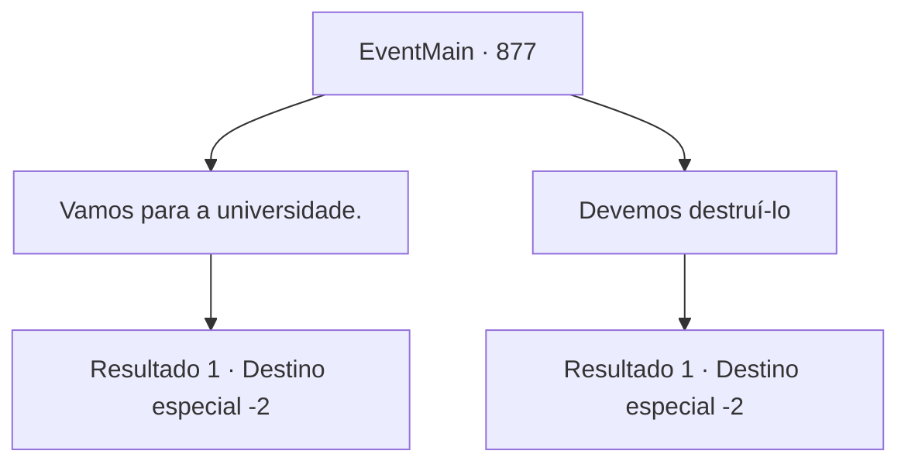

# Eventos principais · 877

[Índice da tabela](index.md) · [Índice geral](../index.md)

ID: `pt:EventMain:877` · Fonte: `EventMain4` · Versão: 1.2.47.

Mapeamento estático dos arquivos; a disponibilidade e a execução dependem do estado da run.

## Texto do evento

*Sem texto no arquivo.*

## Dados de entrada

```json
{
  "id": 877,
  "grade": 1,
  "normalGoal": "",
  "required": ""
}
```

## Mapa das escolhas



## Escolhas e resultados

### Escolha 1

Vamos para a universidade.

Requisitos e outros campos da escolha:

```json
{
  "required": ""
}
```

#### Resultado 1.1

Você escolhe ir para a universidade e manter este artefato. Rosilpha usa uma expressão ligeiramente ansiosa e murmura, 'Eu me pergunto se vai dar certo...' Então, algo aparece no céu. |drawing_outerShip| Parece uma água-viva gigante ou um lula enorme. À medida que seus tentáculos longos se estendem, os devoradores de almas começam a descer para o chão montados neles. 

 "Ah, meu Deus... Devemos fugir rapidamente! Vamos nos dispersar por enquanto e nos encontrar na universidade depois!"

 Naverr corre à frente, dizendo que fazer isso pode confundir os inimigos. Rosilpha também deseja sorte a você e corre em uma direção diferente. Você pega o artefato e foge, longe dos devoradores de almas.

Continuação registrada: [Destino especial `-2`](../destinos-especiais.md).

```json
{
  "required": "",
  "chance": "1",
  "nextEvent": -2,
  "type": 2,
  "reward": "3_315_1|13_5_6"
}
```

### Escolha 2

Devemos destruí-lo

Requisitos e outros campos da escolha:

```json
{
  "required": ""
}
```

#### Resultado 2.1

Você escolhe destruir os artefatos. Naverr coloca relutantemente a Lente Ether no chão, desapontado. Você pega uma pedra para destruí-la. No entanto, apesar de várias tentativas, nem o Disco da Lua nem a Lente Ether mostram sinais de dano. Desta vez, Rosilpha cria uma bola de fogo em sua mão para queimá-la. Mas mais uma vez, eles permanecem intactos. 

 "Parece que métodos comuns não funcionarão. Talvez devêssemos levá-los para a Serpente Divina em Andaria e pedir à Serpente Divina..."

 Antes que as palavras de Rosilpha pudessem terminar, algo aparece no céu. |drawing_outerShip| Parece uma água-viva gigante ou um lula enorme. À medida que seus tentáculos se estendem, os devoradores de almas começam a descer para o chão montados neles. 

 "Ah, meu Deus... Devemos fugir rapidamente! Vamos nos dispersar por enquanto e nos encontrar na universidade depois!"

 Naverr corre à frente, dizendo que fazer isso pode confundir os inimigos. Rosilpha também lhe deseja sorte e corre em uma direção diferente. Você pega o artefato e foge, desviando dos devoradores de almas.

Continuação registrada: [Destino especial `-2`](../destinos-especiais.md).

```json
{
  "required": "",
  "chance": "1",
  "nextEvent": -2,
  "type": 2,
  "reward": "3_315_1|13_5_7"
}
```

## Referências que chegam a este evento

- [Evento 876 · escolha 3 · resultado 1](0876.md#escolha-3)
