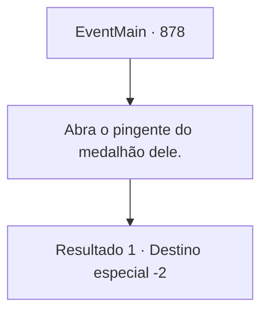

# Eventos principais · 878

[Índice da tabela](index.md) · [Índice geral](../index.md)

ID: `pt:EventMain:878` · Fonte: `EventMain4` · Versão: 1.2.47.

Mapeamento estático dos arquivos; a disponibilidade e a execução dependem do estado da run.

## Texto do evento

*Sem texto no arquivo.*

## Dados de entrada

```json
{
  "id": 878,
  "grade": 1,
  "normalGoal": "",
  "required": ""
}
```

## Mapa das escolhas



## Escolhas e resultados

### Escolha 1

Abra o pingente do medalhão dele.

Requisitos e outros campos da escolha:

```json
{
  "required": ""
}
```

#### Resultado 1.1

Ao abrir o pingente medalhão, você encontra uma nota deixada por Naverr dentro. 'Quebrei um selo antigo e obtive a 'Lente de Éter'; um componente da chave que abrirá o caminho para o Plano Astral. Mas isso convocou entidades desconhecidas que devoram almas. Eu as chamei de 'devoradoras de almas'. De qualquer forma, elas estão tentando entrar no Plano Astral, onde todas as almas acabam, e eu preciso da sua ajuda para detê-las. Venha para o Olho Azul da Selva de Andaria na noite em que a lua carmesim se levantar. Destrua o portal no momento em que elas cruzarem para o Plano Astral. Então podemos aprisioná-las na fenda dimensional.' 

 "Hmm... Nesse caso, seria sábio irmos para a Selva de Andaria e nos prepararmos antes que elas o façam. Vamos nos encontrar lá."

 Após ler o conteúdo, você e Rosilpha decidem se encontrar no Patinho Flutuante.

Continuação registrada: [Destino especial `-2`](../destinos-especiais.md).

```json
{
  "required": "",
  "chance": "1",
  "nextEvent": -2,
  "type": 2,
  "reward": "13_5_8"
}
```

## Referências que chegam a este evento

- [Evento 873 · escolha 1 · resultado 1](0873.md#escolha-1)
- [Evento 874 · escolha 2 · resultado 1](0874.md#escolha-2)
