# Eventos principais · 879

[Índice da tabela](index.md) · [Índice geral](../index.md)

ID: `pt:EventMain:879` · Fonte: `EventMain4` · Versão: 1.2.47.

Mapeamento estático dos arquivos; a disponibilidade e a execução dependem do estado da run.

## Texto do evento

Você se dirige ao Patito Flotante, onde decidiu encontrar-se com Rosilpha pela última vez. Você o encontra novamente perto da Jungla de Andaria. Olhando ansioso, ele toca seu arco. 

 "Vamos."


## Dados de entrada

```json
{
  "id": 879,
  "grade": 1,
  "normalGoal": "",
  "required": "13_5_8|1_2_100"
}
```

## Mapa das escolhas

```mermaid
flowchart TD
  E["EventMain · 879"]
  C0["Dirija-se para a Lentilha-d&#x27;água Flutuante"]
  E --> C0
  R0_0["Resultado 1 · EventMain 880"]
  C0 --> R0_0
```



## Escolhas e resultados

### Escolha 1

Dirija-se para a Lentilha-d'água Flutuante

Requisitos e outros campos da escolha:

```json
{
  "required": ""
}
```

#### Resultado 1.1

Ao chegar, alguns gripplis trabalhando na erva-de-pato endireitam as costas e se levantam. Eles fazem um som de desaprovação para Rosilpha. 

 "Vagando para lá e para cá, adiando a agricultura... "

 Há aquele que lutou com Rosilpha alguns dias atrás. Mas, ao contrário do que aconteceu antes, ele segue direto para a casa do ancião, sem dar atenção a eles.

Continuação registrada: [Evento 880](0880.md) na mesma tabela.

```json
{
  "required": "",
  "chance": "1",
  "nextEvent": 880,
  "type": 2,
  "reward": ""
}
```

## Referências que chegam a este evento

Nenhum `nextEvent` positivo da mesma tabela aponta para este nó. Isso não prova que seja inacessível: sorteio e estado de história podem selecioná-lo.

