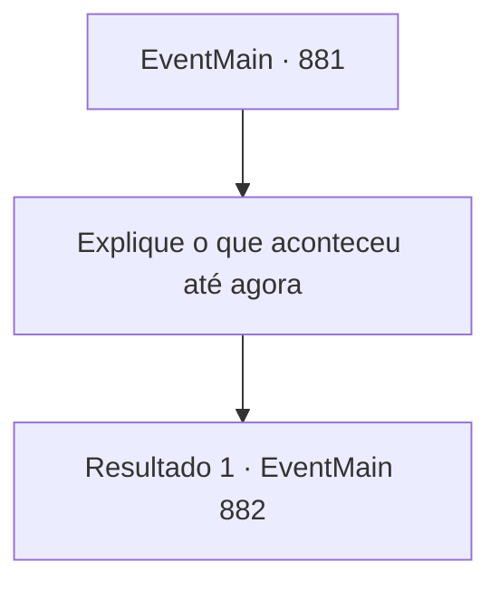

# Eventos principais · 881

[Índice da tabela](index.md) · [Índice geral](../index.md)

ID: `pt:EventMain:881` · Fonte: `EventMain4` · Versão: 1.2.47.

Mapeamento estático dos arquivos; a disponibilidade e a execução dependem do estado da run.

## Texto do evento

*Sem texto no arquivo.*

## Dados de entrada

```json
{
  "id": 881,
  "grade": 1,
  "normalGoal": "",
  "required": ""
}
```

## Mapa das escolhas



## Escolhas e resultados

### Escolha 1

Explique o que aconteceu até agora

Requisitos e outros campos da escolha:

```json
{
  "required": "5_675_0"
}
```

#### Resultado 1.1

Você explica tudo para a Serpente Divina. Ao terminar, o totem da Serpente Divina fala, piscando os olhos. 

 "Você tem algum tempo até a lua carmesim se levantar. Reúna alguns úteis. Eles tentarão preservar o portal para o Plano Astral. Derrote-os e destrua o portal."

 Então o ancião grippli se curva, dizendo que os gripplis do Patinho Flutuante seguirão seu comando. Então, a Serpente Divina acrescenta. 

 "Rosilpha. {1}. Vocês dois devem encontrar um relicário, escondido aqui nesta selva. Ele está imbuido com meus poderes, então ajudará."

 Ouvindo isso, o rosto de Rosilpha se ilumina. Seus olhos brilham de antecipação. 

 "O..Obrigado! Farei o meu melhor!!"


Continuação registrada: [Evento 882](0882.md) na mesma tabela.

```json
{
  "required": "",
  "chance": "1",
  "nextEvent": 882,
  "type": 2,
  "reward": "5_675_1"
}
```

## Referências que chegam a este evento

- [Evento 880 · escolha 2 · resultado 1](0880.md#escolha-2)
- [Evento 986 · escolha 2 · resultado 1](0986.md#escolha-2)
