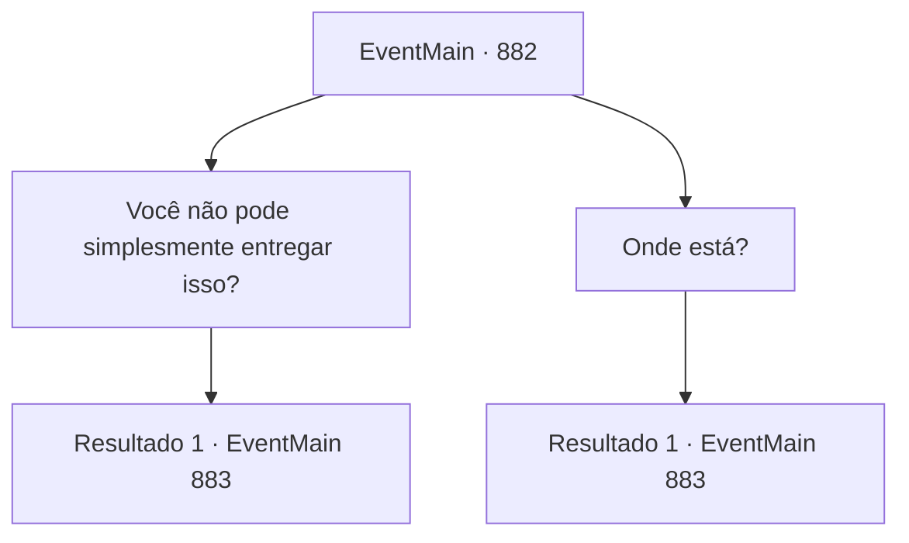

# Eventos principais · 882

[Índice da tabela](index.md) · [Índice geral](../index.md)

ID: `pt:EventMain:882` · Fonte: `EventMain4` · Versão: 1.2.47.

Mapeamento estático dos arquivos; a disponibilidade e a execução dependem do estado da run.

## Texto do evento

*Sem texto no arquivo.*

## Dados de entrada

```json
{
  "id": 882,
  "grade": 1,
  "normalGoal": "",
  "required": ""
}
```

## Mapa das escolhas



## Escolhas e resultados

### Escolha 1

Você não pode simplesmente entregar isso?

Requisitos e outros campos da escolha:

```json
{
  "required": ""
}
```

#### Resultado 1.1

O mais velho grita em espanto. 

 "O que..! Você... Você rude..!"

 A Serpente Divina fala com voz calma, sem se preocupar com sua resposta. 

 "Desejo sorte em encontrá-lo."

 A Serpente Divina ordena encontrar uma escultura de pedra em forma de homem, localizada no lado nordeste desta aldeia. Você e Rosilpha deixam a aldeia.

Continuação registrada: [Evento 883](0883.md) na mesma tabela.

```json
{
  "required": "",
  "chance": "1",
  "nextEvent": 883,
  "type": 2,
  "reward": ""
}
```

### Escolha 2

Onde está?

Requisitos e outros campos da escolha:

```json
{
  "required": ""
}
```

#### Resultado 2.1

A Serpente Divina nos disse para encontrar uma escultura de pedra em forma de homem, localizada no lado nordeste desta aldeia. Você e Rosilpha deixam a aldeia.

Continuação registrada: [Evento 883](0883.md) na mesma tabela.

```json
{
  "required": "",
  "chance": "1",
  "nextEvent": 883,
  "type": 2,
  "reward": ""
}
```

## Referências que chegam a este evento

- [Evento 881 · escolha 1 · resultado 1](0881.md#escolha-1)
