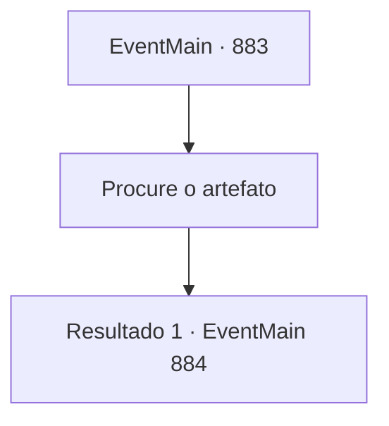

# Eventos principais · 883

[Índice da tabela](index.md) · [Índice geral](../index.md)

ID: `pt:EventMain:883` · Fonte: `EventMain4` · Versão: 1.2.47.

Mapeamento estático dos arquivos; a disponibilidade e a execução dependem do estado da run.

## Texto do evento

*Sem texto no arquivo.*

## Dados de entrada

```json
{
  "id": 883,
  "grade": 1,
  "normalGoal": "",
  "required": ""
}
```

## Mapa das escolhas



## Escolhas e resultados

### Escolha 1

Procure o artefato

Requisitos e outros campos da escolha:

```json
{
  "required": ""
}
```

#### Resultado 1.1

Você e Rosilpha deixam a Duckweed Flutuante e, após caminhar várias horas para nordeste, encontram as ruínas antigas de um rosto humano gigante gravado nas paredes. Encontrar as ruínas foi fácil, pois a própria selva abriu caminho para vocês dois. |drawing_jungleTemple| As ruínas estão cobertas pelas raízes das árvores espessas que a cercam, escondendo o local.  Um portão de pedra coberto de musgo os recebe. Entre o portão estão raízes de árvores que cresceram em rachaduras aqui e ali, criando uma pequena abertura.

Continuação registrada: [Evento 884](0884.md) na mesma tabela.

```json
{
  "required": "",
  "chance": "1",
  "nextEvent": 884,
  "type": 2,
  "reward": ""
}
```

## Referências que chegam a este evento

- [Evento 882 · escolha 1 · resultado 1](0882.md#escolha-1)
- [Evento 882 · escolha 2 · resultado 1](0882.md#escolha-2)
