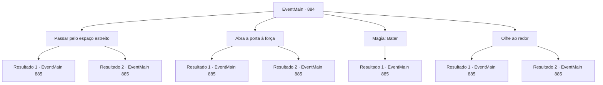

# Eventos principais · 884

[Índice da tabela](index.md) · [Índice geral](../index.md)

ID: `pt:EventMain:884` · Fonte: `EventMain4` · Versão: 1.2.47.

Mapeamento estático dos arquivos; a disponibilidade e a execução dependem do estado da run.

## Texto do evento

*Sem texto no arquivo.*

## Dados de entrada

```json
{
  "id": 884,
  "grade": 1,
  "normalGoal": "",
  "required": ""
}
```

## Mapa das escolhas



## Escolhas e resultados

### Escolha 1

Passar pelo espaço estreito

Requisitos e outros campos da escolha:

```json
{
  "required": ""
}
```

#### Resultado 1.1

Você se espreme no vão enredado com raízes de árvores e consegue entrar nas ruínas. Rosilpha poderia empurrar seu corpo relativamente mais facilmente do que você. Dentro das ruínas, um corredor escuro se estende sem fim. Conforme você segue pelo corredor escuro, há escadas de pedra no final, e ao descer, um porão é revelado. Talvez seja porque tanto tempo passou - raios de luz estão vazando pelos vãos do teto desabado. Rosilpha fala, apontando para o espaço central. 

 "Lá. Olhe para aquilo. Parece ser o relicário que a Serpente Divina mencionou."

 Lá, há uma pequena escultura branca de uma serpente. As escamas da serpente mudam de cor conforme o ângulo. Quando você e Rosilpha alcançam o relicário, a serpente se divide em duas, envolvendo os braços de vocês.

Continuação registrada: [Evento 885](0885.md) na mesma tabela.

```json
{
  "required": "2_5_25",
  "chance": "1",
  "nextEvent": 885,
  "type": 2,
  "reward": "3_312_1"
}
```

#### Resultado 1.2

Você encaixa seu corpo na fenda emaranhada com as raízes da árvore. Mas você fica preso. A fenda era muito estreita para deixar seu corpo musculoso passar. 

 "Oops..! Espere um segundo. Eu consigo isso."

 Rosilpha tenta te tirar, mas ele não é forte o suficiente. Depois de te mandar esperar mais uma vez, ele vai embora. Logo, o portão de pedra se abre e te deixa sair. 

 "Havia uma placa de pressão. Agora, vamos."

 Você e Rosilpha entram nas ruínas juntos. Seguindo pelo corredor escuro, há escadas de pedra no final, e ao descer, um porão é revelado. Talvez seja porque muito tempo passou - raios de luz estão vazando pelas fendas do teto desabado. Rosilpha fala, apontando para o espaço central. 

 "Ali. Olhe para aquilo. Parece ser o relicário que a Serpente Divina mencionou."

 Ali, há uma pequena escultura branca de uma serpente. As escamas da serpente mudam de cor conforme o ângulo. Quando você e Rosilpha alcançam o relicário, a serpente se divide em duas, se enrolando nos braços de vocês.

Continuação registrada: [Evento 885](0885.md) na mesma tabela.

```json
{
  "required": "1_5_25",
  "chance": "1",
  "nextEvent": 885,
  "type": 2,
  "reward": "3_312_1"
}
```

### Escolha 2

Abra a porta à força

Requisitos e outros campos da escolha:

```json
{
  "required": ""
}
```

#### Resultado 2.1

Você coloca suas mãos na fenda emaranhada com raízes de árvores e abre o antigo portão de pedra. Com o som de pedra moendo, um corredor escuro aparece. Seguindo pelo corredor escuro, há escadas de pedra no final, e conforme você desce, um porão é revelado. Talvez seja porque tanto tempo passou - raios de luz estão vazando pelas fendas do teto desabado. Rosilpha fala, apontando para o espaço central. 

 "Lá. Olhe para aquilo. Parece ser o relicário que a Serpente Divina mencionou."

 Nele, há uma pequena escultura branca de uma serpente. As escamas da serpente mudam de cor conforme o ângulo. Quando você e Rosilpha alcançam o relicário, a serpente se divide em duas, envolvendo seus braços e os de Rosilpha.

Continuação registrada: [Evento 885](0885.md) na mesma tabela.

```json
{
  "required": "",
  "chance": "1|0_5_1",
  "nextEvent": 885,
  "type": 0,
  "reward": "3_312_1"
}
```

#### Resultado 2.2

Você empurra suas mãos na fenda emaranhada com raízes de árvores e empurra o antigo portão de pedra. Mas parece que você não é forte o suficiente para abri-lo. Então Rosilpha acena para você, falando. 

 "Venha para cá. Há uma placa de pressão suspeita aqui."

 Como ele disse, há uma placa de pressão com uma forma de serpente branca esculpida. Quando Rosilpha a pressiona, o portão de pedra se abre. 

 "Agora, vamos. "

 Você e Rosilpha entram nas ruínas juntos. Seguindo pelo corredor escuro, há escadas de pedra no final, e ao descer, um porão é revelado. Talvez porque tenha passado tanto tempo, a luz está vazando pelas lacunas do teto desabado. Rosilpha aponta para o espaço central. 

 "Ali. Olhe para aquilo. Parece ser o relicário que a Serpente Divina mencionou."

 Nele, há uma pequena escultura de serpente branca como a neve. As escamas da serpente mudam de cor conforme o ângulo. Quando você e Rosilpha chegam perto e estendem as mãos, a serpente se divide em duas e se enrola em seus braços e nos de Rosilpha.

Continuação registrada: [Evento 885](0885.md) na mesma tabela.

```json
{
  "required": "",
  "chance": "18",
  "nextEvent": 885,
  "type": 1,
  "reward": "3_312_1"
}
```

### Escolha 3

Magia: Bater

Requisitos e outros campos da escolha:

```json
{
  "required": "20_0_1"
}
```

#### Resultado 3.1

Você abre o portão das ruínas usando magia. Com o som de pedras se movendo, um corredor escuro aparece. Seguindo pelo corredor escuro, há escadas de pedra no final, e ao descer, um porão é revelado. Talvez porque tenha passado tanto tempo, a luz está vazando pelas lacunas do teto desabado. Rosilpha aponta para o espaço central. 

 "Lá. Olhe para aquilo. Parece ser o relicário que a Serpente Divina mencionou."

 Lá, há uma pequena escultura de serpente branca como a neve. As escamas da serpente mudam de cor conforme o ângulo. Quando você e Rosilpha chegam perto e estendem as mãos, a serpente se divide em duas e se enrola em seus braços e nos de Rosilpha.

Continuação registrada: [Evento 885](0885.md) na mesma tabela.

```json
{
  "required": "",
  "chance": "1",
  "nextEvent": 885,
  "type": 2,
  "reward": "3_312_1"
}
```

### Escolha 4

Olhe ao redor

Requisitos e outros campos da escolha:

```json
{
  "required": ""
}
```

#### Resultado 4.1

Você encontra uma placa de pressão com uma forma de serpente branca esculpida, localizada ao redor do portão de pedra. E quando você a pressiona, o portão se abre. 

 "Oh, havia um dispositivo para abrir o portão?"

 Você e Rosilpha entram juntos nas ruínas. Seguindo pelo corredor escuro, há escadas de pedra no final, e conforme você desce, um porão é revelado. Talvez porque tenha passado tanto tempo, a luz está vazando pelos vãos do teto desabado. Rosilpha aponta para o espaço central. 

 "Lá. Olhe para aquilo. Parece ser o relicário que a Serpente Divina mencionou."

 Nele, há uma pequena escultura de serpente branca como a neve. As escamas da serpente mudam de cor conforme o ângulo. Quando você e Rosilpha chegam perto e estendem as mãos, a serpente se divide em duas e se enrola em seus braços e nos de Rosilpha.

Continuação registrada: [Evento 885](0885.md) na mesma tabela.

```json
{
  "required": "",
  "chance": "1|0_14_1",
  "nextEvent": 885,
  "type": 0,
  "reward": "3_312_1"
}
```

#### Resultado 4.2

Você procura ao redor das ruínas, mas não consegue encontrar nada. Nesse momento, Rosilpha te chama. 

 "Vem para cá."

 Você vai até Rosilpha e percebe que o portão está aberto. 

 "Havia uma placa de pressão aqui, então eu a pressionei e o portão abriu. Agora, vamos."

 Você e Rosilpha entram juntos nas ruínas. Seguindo pelo corredor escuro, há escadas de pedra no final, e ao descer, um porão é revelado. Talvez porque tenha passado tanto tempo, a luz está vazando pelas lacunas do teto desabado. Rosilpha aponta para o espaço central. 

 "Ali. Olha isso. Parece ser o relicário que a Serpente Divina mencionou."

 Lá está uma pequena escultura de serpente branca como a neve. As escamas da serpente mudam de cor conforme o ângulo. Quando você e Rosilpha chegam perto e estendem as mãos, a serpente se divide em duas e se enrola em seus braços e nos de Rosilpha.

Continuação registrada: [Evento 885](0885.md) na mesma tabela.

```json
{
  "required": "",
  "chance": "10",
  "nextEvent": 885,
  "type": 1,
  "reward": "3_312_1"
}
```

## Referências que chegam a este evento

- [Evento 883 · escolha 1 · resultado 1](0883.md#escolha-1)
