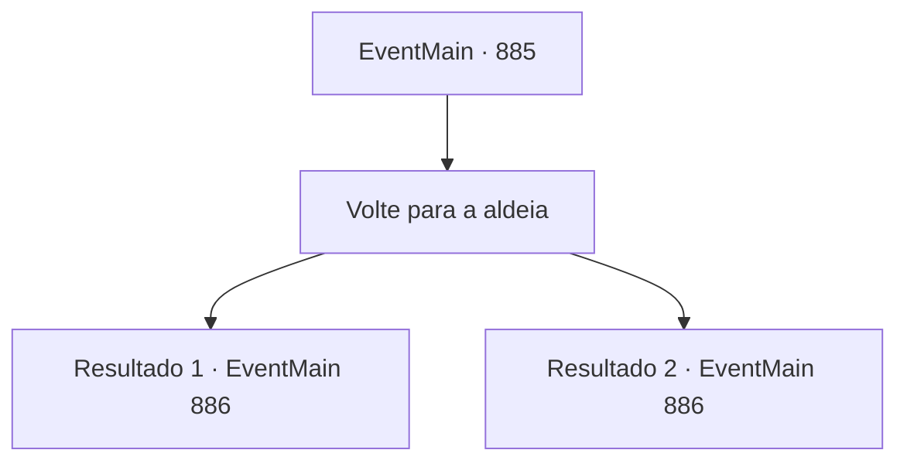

# Eventos principais · 885

[Índice da tabela](index.md) · [Índice geral](../index.md)

ID: `pt:EventMain:885` · Fonte: `EventMain4` · Versão: 1.2.47.

Mapeamento estático dos arquivos; a disponibilidade e a execução dependem do estado da run.

## Texto do evento

*Sem texto no arquivo.*

## Dados de entrada

```json
{
  "id": 885,
  "grade": 1,
  "normalGoal": "",
  "required": ""
}
```

## Mapa das escolhas



## Escolhas e resultados

### Escolha 1

Volte para a aldeia

Requisitos e outros campos da escolha:

```json
{
  "required": ""
}
```

#### Resultado 1.1

Você e Rosilpha saem das ruínas. Rosilpha olha fixamente para a pulseira enrolada em seu pulso, impressionado. 

 "Eu... Eu recebi o poder da Serpente Divina..."

 Ele murmura que não pode decepcionar a Serpente Divina. Depois que você e Rosilpha voltam para a vila, cada um decide se preparar para a batalha iminente. Rosilpha vai para casa afiar e polir suas flechas magias, e o ancião está informando os gripplis para se prepararem para a batalha. Com a notícia de uma batalha iminente, uma tensão pesada paira entre os gripplis. Os avatares e campeões da Serpente Divina também se reúnem no Patinho Flutuante. Uma enorme serpente tecida em cipós de árvores, jaguares que parecem ser a encarnação literal da escuridão, humanos amarelos cegantes fluindo com eletricidade, sem mencionar outras raças como goblins e orcs - uma coisa que eles compartilham é que seus corpos estão inscritos com o símbolo de uma serpente. 

 "Pela Andaria."

 O ancião grippli os recebe calorosamente. Logo depois, uma lua carmesim se ergue sobre a selva.

Continuação registrada: [Evento 886](0886.md) na mesma tabela.

```json
{
  "required": "26_9_1",
  "chance": "1",
  "nextEvent": 886,
  "type": 2,
  "reward": "27_29_1"
}
```

#### Resultado 1.2

Você e Rosilpha saem das ruínas. Rosilpha olha fixamente para a pulseira enrolada em seu pulso, impressionado. 

 "Eu... Eu recebi o poder da Serpente Divina..."

 Ele murmura que não pode decepcionar a Serpente Divina. Depois que você e Rosilpha voltam para a vila, cada um decide se preparar para a batalha iminente. Rosilpha vai para casa afiar e polir suas flechas magias, e o ancião está informando os gripplis para se prepararem para a batalha. Com a notícia de uma batalha iminente, uma tensão pesada paira entre os gripplis. Os avatares e campeões da Serpente Divina também se reúnem no Patinho Flutuante. Uma enorme serpente tecida em cipós de árvores, jaguares que parecem ser a encarnação literal da escuridão, humanos amarelos cegantes fluindo com eletricidade, sem mencionar outras raças como goblins e orcs - uma coisa que eles compartilham é que seus corpos estão inscritos com o símbolo de uma serpente. 

 "Pela Andaria."

 O ancião grippli os recebe calorosamente. Logo depois, uma lua carmesim se ergue sobre a selva.

Continuação registrada: [Evento 886](0886.md) na mesma tabela.

```json
{
  "required": "28_9_1",
  "chance": "1",
  "nextEvent": 886,
  "type": 2,
  "reward": ""
}
```

## Referências que chegam a este evento

- [Evento 884 · escolha 1 · resultado 1](0884.md#escolha-1)
- [Evento 884 · escolha 1 · resultado 2](0884.md#escolha-1)
- [Evento 884 · escolha 2 · resultado 1](0884.md#escolha-2)
- [Evento 884 · escolha 2 · resultado 2](0884.md#escolha-2)
- [Evento 884 · escolha 3 · resultado 1](0884.md#escolha-3)
- [Evento 884 · escolha 4 · resultado 1](0884.md#escolha-4)
- [Evento 884 · escolha 4 · resultado 2](0884.md#escolha-4)
