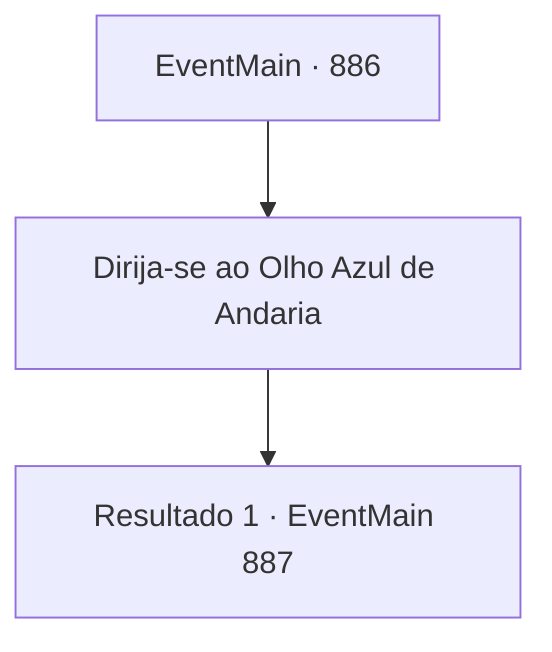

# Eventos principais · 886

[Índice da tabela](index.md) · [Índice geral](../index.md)

ID: `pt:EventMain:886` · Fonte: `EventMain4` · Versão: 1.2.47.

Mapeamento estático dos arquivos; a disponibilidade e a execução dependem do estado da run.

## Texto do evento

*Sem texto no arquivo.*

## Dados de entrada

```json
{
  "id": 886,
  "grade": 1,
  "normalGoal": "",
  "required": ""
}
```

## Mapa das escolhas



## Escolhas e resultados

### Escolha 1

Dirija-se ao Olho Azul de Andaria

Requisitos e outros campos da escolha:

```json
{
  "required": ""
}
```

#### Resultado 1.1

Vocês, Rosilpha, os campeões da Serpente Divina, e guerreiros de diferentes raças avançam juntos pela selva. O grupo chega ao lago chamado 'o Olho Azul de Andaria'. |drawing_astralPortal| A lua carmesim se reflete no lago azul, e sobre ele está o portal conectado ao Plano Astral, aberto. Na frente dele estão Naverr, devoradores de almas, e algo que se parece com uma enorme água-viva. O ancião esconde o grupo usando a bênção da Serpente Divina. Graças ao ancião, ninguém é avistado pelos devoradores de almas. Entre os devoradores de almas há uma entidade que se destaca dos outros. O ancião murmura olhando para ela. 

 "Maior do que a vida... deve ser o líder deles."

 Naverr parece estar esperando por algo olhando ao redor, enquanto os devoradores de almas tentam arrastá-lo para o portal.

Continuação registrada: [Evento 887](0887.md) na mesma tabela.

```json
{
  "required": "",
  "chance": "1",
  "nextEvent": 887,
  "type": 2,
  "reward": ""
}
```

## Referências que chegam a este evento

- [Evento 885 · escolha 1 · resultado 1](0885.md#escolha-1)
- [Evento 885 · escolha 1 · resultado 2](0885.md#escolha-1)
