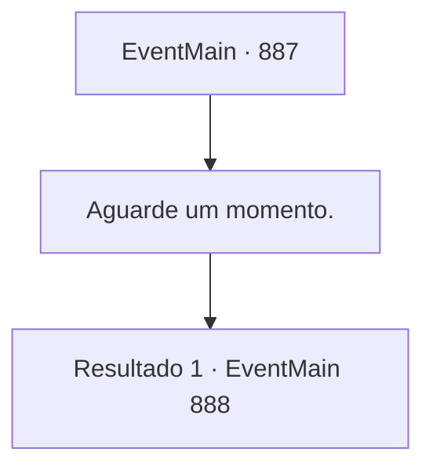

# Eventos principais · 887

[Índice da tabela](index.md) · [Índice geral](../index.md)

ID: `pt:EventMain:887` · Fonte: `EventMain4` · Versão: 1.2.47.

Mapeamento estático dos arquivos; a disponibilidade e a execução dependem do estado da run.

## Texto do evento

*Sem texto no arquivo.*

## Dados de entrada

```json
{
  "id": 887,
  "grade": 1,
  "normalGoal": "",
  "required": ""
}
```

## Mapa das escolhas



## Escolhas e resultados

### Escolha 1

Aguarde um momento.

Requisitos e outros campos da escolha:

```json
{
  "required": ""
}
```

#### Resultado 1.1

Você espera por um momento, testando a água. Naverr é arrastado para o portal, e o líder devoralmas o segue. Nesse momento, o ancião grippli grita. 

 "Agora!! Todos ataquem!!"

 Você, Rosilpha e todos os seus aliados correm em direção ao portal. Somente então os devoradores de almas percebem o ataque surpresa, mas já é tarde demais.

Continuação registrada: [Evento 888](0888.md) na mesma tabela.

```json
{
  "required": "",
  "chance": "1",
  "nextEvent": 888,
  "type": 2,
  "reward": "6_0_169",
  "place": 1
}
```

## Referências que chegam a este evento

- [Evento 886 · escolha 1 · resultado 1](0886.md#escolha-1)
