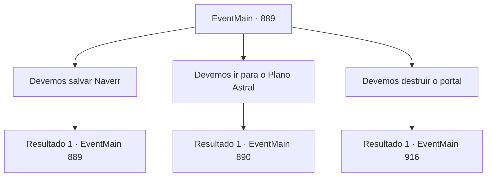

# Eventos principais · 889

[Índice da tabela](index.md) · [Índice geral](../index.md)

ID: `pt:EventMain:889` · Fonte: `EventMain4` · Versão: 1.2.47.

Mapeamento estático dos arquivos; a disponibilidade e a execução dependem do estado da run.

## Texto do evento

*Sem texto no arquivo.*

## Dados de entrada

```json
{
  "id": 889,
  "grade": 1,
  "normalGoal": "",
  "required": ""
}
```

## Mapa das escolhas



## Escolhas e resultados

### Escolha 1

Devemos salvar Naverr

Requisitos e outros campos da escolha:

```json
{
  "required": "5_676_0"
}
```

#### Resultado 1.1

Você diz que precisa ir resgatar Naverr. Então o ancião se aproxima e te impede. 

 "Se você passar pelo portal, eles chegarão ao Plano Astral. Não era o plano destruir o portal antes que eles chegassem ao Plano Astral?"

 O ancião diz que esse caminho é muito mais seguro e razoável. 

 "Você quer persegui-los até o Plano Astral, apenas para salvar um humano? Se você falhar em derrotá-los lá, todas as almas serão devoradas. Não podemos correr esse risco."


Continuação registrada: [Evento 889](0889.md) na mesma tabela.

```json
{
  "required": "",
  "chance": "1",
  "nextEvent": 889,
  "type": 2,
  "reward": "5_676_1"
}
```

### Escolha 2

Devemos ir para o Plano Astral

Requisitos e outros campos da escolha:

```json
{
  "required": "5_676_1"
}
```

#### Resultado 2.1

Apesar da preocupação do mais velho, você mantém sua posição de entrar no Plano Astral. Naquele momento, o avatar da Serpente Divina, a serpente de videira da árvore, fala. 

 "Suba. Se realmente vamos fazer isso, podemos muito bem ir até o fim."

 Você sobe na serpente de videira da árvore, e alguns guerreiros e Rosilpha, que decidiram se juntar à sua causa, também o fazem. Com mais um grito de guerra, seu grupo entra no portal. Vocês passam pelo vazio do rift dimensional, desprovido de qualquer sinal de, bem, qualquer coisa, antes de finalmente chegarem ao Plano Astral. O lugar não se parece em nada com o Plano Material. Um espaço brilhante aparentemente interminável é preenchido por uma fina névoa e luz das estrelas. Não há chão para pisar, mas de alguma forma você consegue flutuar no ar. 

 "Olhe, ali!"

 Quando você olha para onde Rosilpha apontou, encontra a enorme água-viva e os devoradores de almas que viu antes.

Continuação registrada: [Evento 890](0890.md) na mesma tabela.

```json
{
  "required": "",
  "chance": "1",
  "nextEvent": 890,
  "type": 2,
  "reward": ""
}
```

### Escolha 3

Devemos destruir o portal

Requisitos e outros campos da escolha:

```json
{
  "required": "5_676_1"
}
```

#### Resultado 3.1

Você diz que o portal deve ser fechado rapidamente, conforme os planos de Naverr. 

 "Todos, afastem-se."

 Seguindo o comando da Serpente Divina, você e os guerreiros de Andaria se afastam do portal. Depois disso, os campeões da Serpente Divina destroem o portal com toda a sua força. O próprio espaço parece estar se despedaçando. A partir da onda de choque e do barulho, é como se uma colossal cúpula de vidro, grande o suficiente para cobrir todo o céu, estivesse sendo despedaçada em pedaços. A tremenda onda de choque sacode tanto o chão quanto o céu, lançando os campeões ao chão. <b>

 "Uuurgh...!"

</b> Os campeões gritam de dor antes de desaparecerem na selva. Pedaços rasgados da dimensão se espalham, iluminando a fenda dimensional.

Continuação registrada: [Evento 916](0916.md) na mesma tabela.

```json
{
  "required": "",
  "chance": "1",
  "nextEvent": 916,
  "type": 2,
  "reward": "15_6_3"
}
```

## Referências que chegam a este evento

- [Evento 888 · escolha 1 · resultado 1](0888.md#escolha-1)
- [Evento 888 · escolha 2 · resultado 1](0888.md#escolha-2)
- [Evento 889 · escolha 1 · resultado 1](0889.md#escolha-1)
