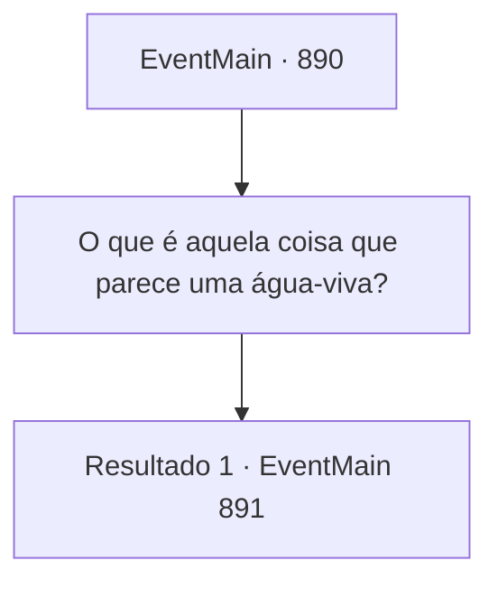

# Eventos principais · 890

[Índice da tabela](index.md) · [Índice geral](../index.md)

ID: `pt:EventMain:890` · Fonte: `EventMain4` · Versão: 1.2.47.

Mapeamento estático dos arquivos; a disponibilidade e a execução dependem do estado da run.

## Texto do evento

*Sem texto no arquivo.*

## Dados de entrada

```json
{
  "id": 890,
  "grade": 1,
  "normalGoal": "",
  "required": ""
}
```

## Mapa das escolhas



## Escolhas e resultados

### Escolha 1

O que é aquela coisa que parece uma água-viva?

Requisitos e outros campos da escolha:

```json
{
  "required": ""
}
```

#### Resultado 1.1

Rosilpha responde à pergunta. 

 "Não sei ao certo. Talvez... o navio de batalha deles ou algo assim? Uma coisa que tenho certeza, no entanto? Precisamos destruir isso."

 Enquanto isso, guerreiros da Selva de Andaria iniciam a batalha contra devoradores de almas. Aqui e ali, gritos de guerra e sangue jorram. Então, cada um dos tentáculos do navio dos devoradores de almas se move por conta própria, emitindo feixes de energia roxa. Guerreiros atingidos pelos feixes são lançados no vasto vazio.

Continuação registrada: [Evento 891](0891.md) na mesma tabela.

```json
{
  "required": "",
  "chance": "1",
  "nextEvent": 891,
  "type": 2,
  "reward": ""
}
```

## Referências que chegam a este evento

- [Evento 889 · escolha 2 · resultado 1](0889.md#escolha-2)
