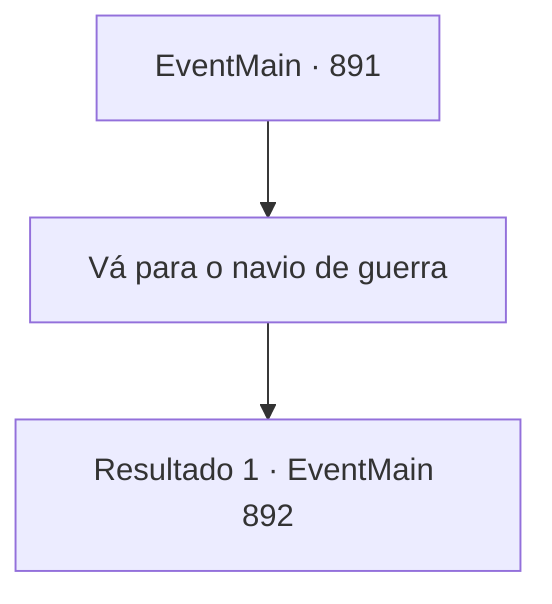

# Eventos principais · 891

[Índice da tabela](index.md) · [Índice geral](../index.md)

ID: `pt:EventMain:891` · Fonte: `EventMain4` · Versão: 1.2.47.

Mapeamento estático dos arquivos; a disponibilidade e a execução dependem do estado da run.

## Texto do evento

*Sem texto no arquivo.*

## Dados de entrada

```json
{
  "id": 891,
  "grade": 1,
  "normalGoal": "",
  "required": ""
}
```

## Mapa das escolhas



## Escolhas e resultados

### Escolha 1

Vá para o navio de guerra

Requisitos e outros campos da escolha:

```json
{
  "required": ""
}
```

#### Resultado 1.1

Você e Rosilpha se aproximam do navio de guerra. Alguns devoradores de almas tentam impedi-los, mas guerreiros de Andaria se colocam contra eles. Entre eles, há alguns gripplis que lutaram contra Rosilpha antes. Ele grita com raiva. 

 "Você! Eu disse que te veria na próxima vez! Não se esqueça!!"

 Então Rosilpha responde, sorrindo levemente. 

 "Ele torna muito difícil dizer para não morrer."

 Depois disso, ele nada novamente em direção ao navio de guerra. Naquele momento, algo brilhante começa a se reunir em um dos tentáculos. Então, o tentáculo dispara um raio roxo em você.

Continuação registrada: [Evento 892](0892.md) na mesma tabela.

```json
{
  "required": "",
  "chance": "1",
  "nextEvent": 892,
  "type": 2,
  "reward": ""
}
```

## Referências que chegam a este evento

- [Evento 890 · escolha 1 · resultado 1](0890.md#escolha-1)
