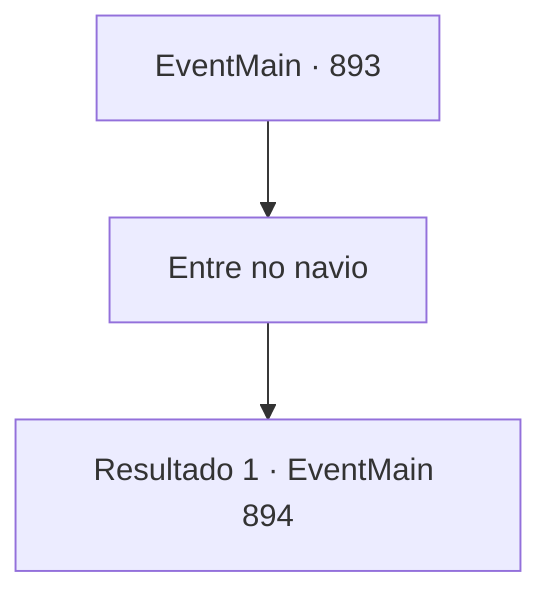

# Eventos principais · 893

[Índice da tabela](index.md) · [Índice geral](../index.md)

ID: `pt:EventMain:893` · Fonte: `EventMain4` · Versão: 1.2.47.

Mapeamento estático dos arquivos; a disponibilidade e a execução dependem do estado da run.

## Texto do evento

*Sem texto no arquivo.*

## Dados de entrada

```json
{
  "id": 893,
  "grade": 1,
  "normalGoal": "",
  "required": ""
}
```

## Mapa das escolhas



## Escolhas e resultados

### Escolha 1

Entre no navio

Requisitos e outros campos da escolha:

```json
{
  "required": ""
}
```

#### Resultado 1.1

O interior do navio de guerra parece órgãos de uma criatura, e é emaranhado como um labirinto intricado, tornando difícil a navegação. Naquele momento, você vê um rosto familiar. É Naverr. Ele está preso em uma cápsula translúcida. Quando Rosilpha o avista e balança sua adaga, a cápsula se abre e um líquido quente flui dela. Ele ajuda Naverr a se levantar, falando. 

 "Aqui para te resgatar! Todos os outros estão lutando contra os devoradores de almas."

 Então Naverr responde com um sorriso pálido. 

 "Haha... Parece que nada pode te deter. Ótimo. Me siga."

 Naverr lidera o caminho, dizendo que sabe onde está a Rainha. Você e Rosilpha seguem Naverr, indo para as partes mais profundas do navio de guerra. Depois de passar por um corredor estreito feito de células roxas vibrantes, um espaço circular amplo é revelado. Fascículos complicados estão conectados a esferas com símbolos que você nunca viu antes, e um devoralmas roxo está examinando-os.

Continuação registrada: [Evento 894](0894.md) na mesma tabela.

```json
{
  "required": "",
  "chance": "1",
  "nextEvent": 894,
  "type": 2,
  "reward": ""
}
```

## Referências que chegam a este evento

- [Evento 892 · escolha 1 · resultado 1](0892.md#escolha-1)
- [Evento 892 · escolha 1 · resultado 2](0892.md#escolha-1)
- [Evento 892 · escolha 1 · resultado 4](0892.md#escolha-1)
- [Evento 892 · escolha 2 · resultado 1](0892.md#escolha-2)
- [Evento 892 · escolha 2 · resultado 2](0892.md#escolha-2)
- [Evento 892 · escolha 2 · resultado 4](0892.md#escolha-2)
- [Evento 892 · escolha 3 · resultado 1](0892.md#escolha-3)
- [Evento 892 · escolha 3 · resultado 2](0892.md#escolha-3)
