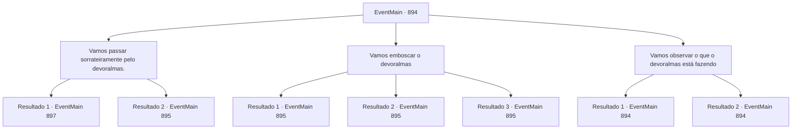

# Eventos principais · 894

[Índice da tabela](index.md) · [Índice geral](../index.md)

ID: `pt:EventMain:894` · Fonte: `EventMain4` · Versão: 1.2.47.

Mapeamento estático dos arquivos; a disponibilidade e a execução dependem do estado da run.

## Texto do evento

*Sem texto no arquivo.*

## Dados de entrada

```json
{
  "id": 894,
  "grade": 1,
  "normalGoal": "",
  "required": ""
}
```

## Mapa das escolhas



## Escolhas e resultados

### Escolha 1

Vamos passar sorrateiramente pelo devoralmas.

Requisitos e outros campos da escolha:

```json
{
  "required": ""
}
```

#### Resultado 1.1

Você conclui que não precisa lutar, e sugere passar pelo devoralmas e ir direto para a Rainha. Naverr e Rosilpha concordam, acenando silenciosamente. Você passa silenciosamente pelo devoralmas, enquanto ele está focado em algo. Você segue Naverr e entra no lugar mais profundo do navio de batalha. Enquanto isso, parece que uma batalha feroz está acontecendo lá fora. O navio treme de choque, você ouve o som de rugidos e gritos misturados. Enquanto isso, Naverr permanece calmo. 

 "Aqui. Este é o lugar. A Rainha deve estar aqui, dentro desta sala."

 Onde ele aponta é uma porta redonda coberta com algum tipo de veias sanguíneas metálicas. Há uma joia avermelhada no meio da porta. Nesse momento, Naverr vomita repentinamente. 

 "Blagh..! *tosse*...*tosse*"

 Rosilpha dá tapinhas em suas costas e fala. 

 "Naverr. Você espera aqui por um tempo. Nós vamos derrotar a Rainha."

 Naverr acena com a mão em recusa. 

 "Não. Estou bem. Não se preocupe, não é nada."


Continuação registrada: [Evento 897](0897.md) na mesma tabela.

```json
{
  "required": "",
  "chance": "1",
  "nextEvent": 897,
  "type": 0,
  "reward": "5_677_1"
}
```

#### Resultado 1.2

Você conclui que não precisa lutar, e sugere passar pelo devoralmas e ir direto para a rainha. Naverr e Rosilpha concordam, acenando silenciosamente. Você tenta passar silenciosamente pelo devoralmas, enquanto ele está focado em algo. Mas o som sinistro de algo espirrando ecoa pelo ar. Parece que Rosilpha pisou em algo. 

 "Bem... merda."

 Esse som foi alto o suficiente para ser ouvido não apenas por você e Naverr, mas também pelo devoralmas. Ele espalha seus inúmeros tentáculos com olhos vermelhos brilhantes.

Continuação registrada: [Evento 895](0895.md) na mesma tabela.

```json
{
  "required": "",
  "chance": "1",
  "nextEvent": 895,
  "type": 1,
  "reward": "6_0_170",
  "place": 15
}
```

### Escolha 2

Vamos emboscar o devoralmas

Requisitos e outros campos da escolha:

```json
{
  "required": ""
}
```

#### Resultado 2.1

Você se aproxima do lado esquerdo do devoralmas. Então, você corre e o ataca. Com um respingo de fluidos corporais roxos, vários tentáculos caem no chão. Depois disso, ele espalha inúmeros tentáculos com olhos vermelhos brilhantes.

Continuação registrada: [Evento 895](0895.md) na mesma tabela.

```json
{
  "required": "21_5_4|21_43_1",
  "chance": "1|0_6_1",
  "nextEvent": 895,
  "type": 0,
  "reward": "6_2_170",
  "place": 15
}
```

#### Resultado 2.2

Você se aproxima do lado esquerdo do devoralmas. Então, você corre e o ataca. Mas parece que ele já percebeu seu ataque antecipadamente. Ele espalha seus dedos afiados e finos e usa telecinese. Seu ataque é repelido por causa disso. 

 "Hehe..."

 Com um evidente ridículo, ele espalha inúmeras tentáculos.

Continuação registrada: [Evento 895](0895.md) na mesma tabela.

```json
{
  "required": "21_5_4|21_43_1",
  "chance": "16",
  "nextEvent": 895,
  "type": 1,
  "reward": "6_0_170",
  "place": 15
}
```

#### Resultado 2.3

Você se aproxima do lado esquerdo do devoralmas. Então, você corre e o ataca. Com um respingo de fluidos corporais roxos, vários tentáculos caem no chão. Depois disso, ele espalha inúmeros tentáculos com olhos vermelhos brilhantes.

Continuação registrada: [Evento 895](0895.md) na mesma tabela.

```json
{
  "required": "-1|20_5_4|20_43_1",
  "chance": "1",
  "nextEvent": 895,
  "type": 2,
  "reward": "6_2_170",
  "place": 15
}
```

### Escolha 3

Vamos observar o que o devoralmas está fazendo

Requisitos e outros campos da escolha:

```json
{
  "required": "5_678_0"
}
```

#### Resultado 3.1

Você fica olhando o que aquele monstro está fazendo. Seus tentáculos se movem rapidamente tocando as esferas. Cada vez que ele toca uma esfera, muda a inclinação da nave, ou o som de uma explosão é ouvido do lado de fora. Com base nas informações, você supõe que ele está controlando o navio de guerra. Se sua hipótese é verdadeira ou não será revelado quando você o derrotar.

Continuação registrada: [Evento 894](0894.md) na mesma tabela.

```json
{
  "required": "",
  "chance": "1|0_14_1|0_7_1",
  "nextEvent": 894,
  "type": 0,
  "reward": "5_678_1"
}
```

#### Resultado 3.2

Você fica olhando o que aquele monstro está fazendo. Seus tentáculos se movem rapidamente tocando as esferas, mas você não consegue entender o que isso significa.

Continuação registrada: [Evento 894](0894.md) na mesma tabela.

```json
{
  "required": "",
  "chance": "20",
  "nextEvent": 894,
  "type": 1,
  "reward": "5_678_2"
}
```

## Referências que chegam a este evento

- [Evento 893 · escolha 1 · resultado 1](0893.md#escolha-1)
- [Evento 894 · escolha 3 · resultado 1](0894.md#escolha-3)
- [Evento 894 · escolha 3 · resultado 2](0894.md#escolha-3)
