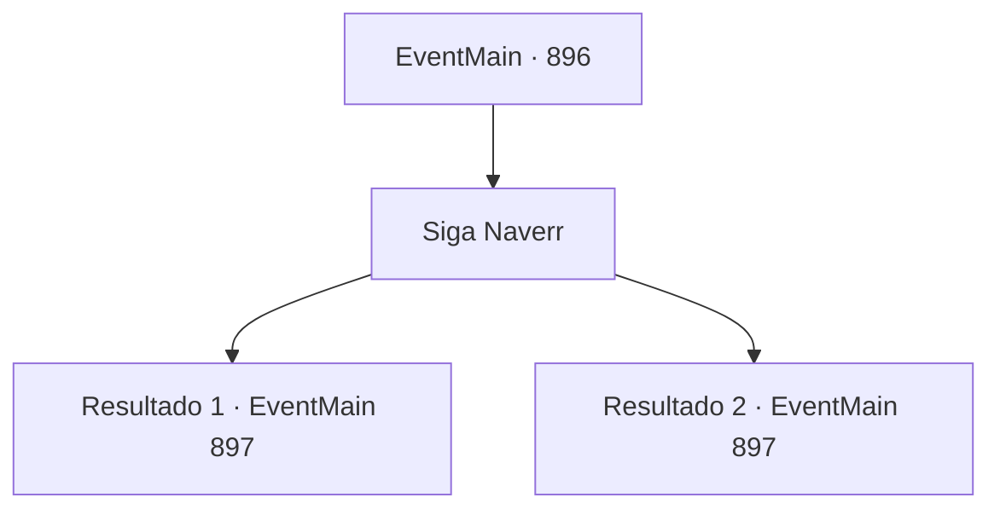

# Eventos principais · 896

[Índice da tabela](index.md) · [Índice geral](../index.md)

ID: `pt:EventMain:896` · Fonte: `EventMain4` · Versão: 1.2.47.

Mapeamento estático dos arquivos; a disponibilidade e a execução dependem do estado da run.

## Texto do evento

*Sem texto no arquivo.*

## Dados de entrada

```json
{
  "id": 896,
  "grade": 1,
  "normalGoal": "",
  "required": ""
}
```

## Mapa das escolhas



## Escolhas e resultados

### Escolha 1

Siga Naverr

Requisitos e outros campos da escolha:

```json
{
  "required": ""
}
```

#### Resultado 1.1

Você segue atrás de Naverr e entra no lugar mais profundo do navio de guerra. Enquanto isso, parece que uma batalha feroz está acontecendo lá fora. O navio treme de choque, você ouve o som de rugidos e gritos misturados. Enquanto isso, Naverr permanece calmo. 

 "Aqui. Este é o lugar. A Rainha deve estar aqui, dentro desta sala."

 Onde ele aponta é uma porta redonda coberta com algum tipo de veias sanguíneas metálicas. Há uma joia avermelhada no meio da porta. Nesse momento, Naverr vomita repentinamente. 

 "Blagh..! *tosse*...*tosse*"

 Rosilpha dá tapinhas em suas costas e fala. 

 "Naverr. Você espera aqui por um tempo. Nós vamos derrotar a Rainha."

 Naverr acena com a mão em recusa. 

 "Não. Estou bem. Não se preocupe, não é nada."

 Você percebe que, à medida que ele se aproxima da rainha, sua condição piora rapidamente. Parece que, enquanto Naverr estava cativo, a rainha deve ter feito algo com ele. E, de alguma forma, você tem a sensação de que o bracelete da Serpente Divina pode ser capaz de protegê-lo.

Continuação registrada: [Evento 897](0897.md) na mesma tabela.

```json
{
  "required": "",
  "chance": "1|0_14_1",
  "nextEvent": 897,
  "type": 0,
  "reward": "5_769_1"
}
```

#### Resultado 1.2

Você segue atrás de Naverr e entra no lugar mais profundo do navio de guerra. Enquanto isso, parece que uma batalha feroz está acontecendo lá fora. O navio treme de choque, você ouve o som de rugidos e gritos misturados. Enquanto isso, Naverr permanece calmo. 

 "Aqui. Este é o lugar. A Rainha deve estar aqui, dentro desta sala."

 Onde ele aponta é uma porta redonda coberta com algum tipo de veias sanguíneas metálicas. Há uma joia avermelhada no meio da porta. Nesse momento, Naverr vomita repentinamente. 

 "Blagh..! *tosse*...*tosse*"

 Rosilpha dá tapinhas em suas costas e fala. 

 "Naverr. Você espera aqui por um tempo. Nós vamos derrotar a Rainha."

 Naverr acena com a mão em recusa. 

 "Não. Estou bem. Não se preocupe, não é nada."


Continuação registrada: [Evento 897](0897.md) na mesma tabela.

```json
{
  "required": "",
  "chance": "10",
  "nextEvent": 897,
  "type": 1,
  "reward": ""
}
```

## Referências que chegam a este evento

- [Evento 895 · escolha 2 · resultado 1](0895.md#escolha-2)
