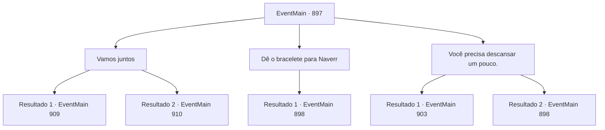

# Eventos principais · 897

[Índice da tabela](index.md) · [Índice geral](../index.md)

ID: `pt:EventMain:897` · Fonte: `EventMain4` · Versão: 1.2.47.

Mapeamento estático dos arquivos; a disponibilidade e a execução dependem do estado da run.

## Texto do evento

*Sem texto no arquivo.*

## Dados de entrada

```json
{
  "id": 897,
  "grade": 1,
  "normalGoal": "",
  "required": ""
}
```

## Mapa das escolhas



## Escolhas e resultados

### Escolha 1

Vamos juntos

Requisitos e outros campos da escolha:

```json
{
  "required": ""
}
```

#### Resultado 1.1

Você diz a Naverr para se juntar a você. Rosilpha pondera por um momento e assente. 

 "Certo... Ficar aqui pode ser mais perigoso."

 As joias brilham intensamente enquanto Naverr se aproxima, e a porta redonda é aberta. Ao abrir a porta, um vasto espaço é revelado. |drawing_outerQueenTrue| Há um emaranhado de tentáculos de cor cinza claro que se parece com um cérebro enorme. Em sua superfície, algo brilhante está se movendo ao longo das veias sanguíneas, e sob isso, há inúmeros tentáculos com espinhos. A forma de uma bela dama está pendurada na parte inferior do enorme monte, assim como uma pituitária. Você, Rosilpha e Naverr se aproximam da Rainha. Assim que a Rainha vê Naverr, ela fala com um enorme senso de intimidação. 

 "Naverr. Mate-os."

 Então, Naverr grita de dor, caindo no chão. Seu cabelo cai rapidamente, sua carne se transforma em apenas um segundo, e tentáculos brotam. Quando ele se levanta, ele já se transformou em um devoralmas.

Continuação registrada: [Evento 909](0909.md) na mesma tabela.

```json
{
  "required": "10_111_1|18_769_1",
  "chance": "1",
  "nextEvent": 909,
  "type": 2,
  "reward": "6_0_169|5_679_1",
  "place": 15
}
```

#### Resultado 1.2

Você diz a Naverr para se juntar a você. Rosilpha pondera por um momento e assente. 

 "Certo... Ficar aqui pode ser mais perigoso."

 As joias brilham intensamente enquanto Naverr se aproxima, e a porta redonda é aberta. Ao abrir a porta, um vasto espaço é revelado. |drawing_outerQueenTrue| Há um emaranhado de tentáculos de cor cinza claro que se parece com um cérebro enorme. Em sua superfície, algo brilhante está se movendo ao longo das veias sanguíneas, e sob isso, há inúmeros tentáculos com espinhos. A forma de uma bela dama está pendurada na parte inferior do enorme monte, assim como uma pituitária. Você, Rosilpha e Naverr se aproximam da Rainha. Assim que a Rainha vê Naverr, ela fala com um enorme senso de intimidação. 

 "-----"

 Mas nada pode ser ouvido. Seu cajado está anulando os comandos da Rainha. 

 "Nem perto! HA!"

 O cajado joga Naverr para trás, e então começa a disparar Flechas magias contra a Rainha. A Rainha então estica seus tentáculos, franzindo a testa com raiva.

Continuação registrada: [Evento 910](0910.md) na mesma tabela.

```json
{
  "required": "8_111_1",
  "chance": "1",
  "nextEvent": 910,
  "type": 2,
  "reward": "6_0_171",
  "place": 15
}
```

### Escolha 2

Dê o bracelete para Naverr

Requisitos e outros campos da escolha:

```json
{
  "required": "5_769_1"
}
```

#### Resultado 2.1

Você entrega o bracelete a Naverr e pede que ele se junte a você. Ele responde com uma expressão de gratidão, dizendo: 

 "...Obrigado. Minha cabeça parecia que ia explodir, mas agora me sinto muito melhor."

 As joias brilham intensamente enquanto Naverr se aproxima, e a porta redonda se abre. Quando a porta se abre, um espaço vasto é revelado. |drawing_outerQueenTrue| Há um emaranhado de tentáculos de cor cinza claro que se parece com um cérebro enorme. Em sua superfície, algo brilhante está se movendo ao longo das veias sanguíneas, e sob isso, há inúmeros tentáculos com espinhos. A forma de uma bela dama está pendurada na parte inferior do enorme monte, assim como uma pituitária. Você, Rosilpha e Naverr se aproximam da Rainha. Assim que a Rainha vê Naverr, ela fala com uma enorme aura de intimidação.

Continuação registrada: [Evento 898](0898.md) na mesma tabela.

```json
{
  "required": "",
  "chance": "1",
  "nextEvent": 898,
  "type": 2,
  "reward": "5_769_2|4_312_1"
}
```

### Escolha 3

Você precisa descansar um pouco.

Requisitos e outros campos da escolha:

```json
{
  "required": ""
}
```

#### Resultado 3.1

Você diz a Naverr para se esconder por um tempo. Naverr pondera por um momento e assente. 

 "Certo... farei isso."

 As joias brilham intensamente enquanto Naverr se aproxima, e a porta redonda é aberta. Ao abrir a porta, um vasto espaço é revelado. |drawing_outerQueenTrue| Há um emaranhado de tentáculos de cor cinza claro que se parece com um cérebro enorme. Em sua superfície, algo brilhante está se movendo ao longo das veias sanguíneas, e sob isso, há inúmeros tentáculos com espinhos. A forma de uma bela dama está pendurada na parte inferior do enorme monte, assim como uma pituitária. Você e Rosilpha se aproximam da rainha. A Rainha olha para você e começa a falar. 

 "... Por que não conversamos?"


Continuação registrada: [Evento 903](0903.md) na mesma tabela.

```json
{
  "required": "-1|23_7_1|8_312_1",
  "chance": "1",
  "nextEvent": 903,
  "type": 2,
  "reward": ""
}
```

#### Resultado 3.2

Você diz a Naverr para se esconder por um tempo. Naverr pondera por um momento e assente. 

 "Certo... Farei isso."

 As joias brilham intensamente enquanto Naverr se aproxima, e a porta redonda é aberta. Ao abrir a porta, um vasto espaço é revelado. |drawing_outerQueenTrue| Há um emaranhado de tentáculos de cor cinza claro que se parece com um cérebro enorme. Em sua superfície, algo brilhante está se movendo ao longo das veias sanguíneas, e sob isso, há inúmeros tentáculos com espinhos. A forma de uma bela dama está pendurada na parte inferior do enorme monte, assim como uma pituitária. Você e Rosilpha se aproximam da rainha. Então a Rainha olha para você, e assim que seu olhar se fixa em você, você é congelado de medo.

Continuação registrada: [Evento 898](0898.md) na mesma tabela.

```json
{
  "required": "24_7_1|10_312_1",
  "chance": "1",
  "nextEvent": 898,
  "type": 2,
  "reward": ""
}
```

## Referências que chegam a este evento

- [Evento 894 · escolha 1 · resultado 1](0894.md#escolha-1)
- [Evento 895 · escolha 1 · resultado 1](0895.md#escolha-1)
- [Evento 896 · escolha 1 · resultado 1](0896.md#escolha-1)
- [Evento 896 · escolha 1 · resultado 2](0896.md#escolha-1)
