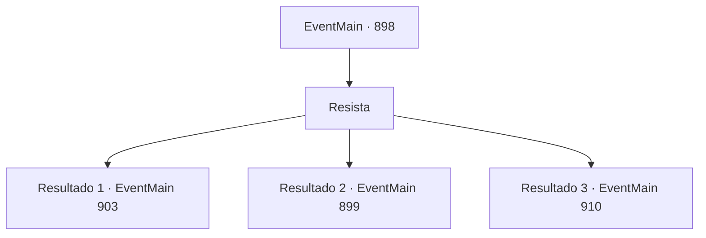

# Eventos principais · 898

[Índice da tabela](index.md) · [Índice geral](../index.md)

ID: `pt:EventMain:898` · Fonte: `EventMain4` · Versão: 1.2.47.

Mapeamento estático dos arquivos; a disponibilidade e a execução dependem do estado da run.

## Texto do evento

*Sem texto no arquivo.*

## Dados de entrada

```json
{
  "id": 898,
  "grade": 1,
  "normalGoal": "",
  "required": ""
}
```

## Mapa das escolhas



## Escolhas e resultados

### Escolha 1

Resista

Requisitos e outros campos da escolha:

```json
{
  "required": ""
}
```

#### Resultado 1.1

Você sacode o domínio da Rainha. Então, a Rainha começa a falar. 

 "... Por que não conversamos?"


Continuação registrada: [Evento 903](0903.md) na mesma tabela.

```json
{
  "required": "18_769_2",
  "chance": "1|0_12_1",
  "nextEvent": 903,
  "type": 0,
  "reward": ""
}
```

#### Resultado 1.2

O domínio da rainha prende seu corpo, eventualmente dominando também sua mente. A Rainha fala com você, seus olhos dourados brilhando intensamente. 

 "Lute por mim."

 Seguindo seu comando, você começa a atacar Rosilpha.

Continuação registrada: [Evento 899](0899.md) na mesma tabela.

```json
{
  "required": "",
  "chance": "30",
  "nextEvent": 899,
  "type": 1,
  "reward": "6_0_173",
  "place": 15
}
```

#### Resultado 1.3

Você sacode o domínio da Rainha. Então, a Rainha começa a falar. 

 "... Por que não conver..."

 No entanto, Naverr parece não ter intenção de ouvir. Ele imediatamente avança e golpeia a rainha com seu facão. A rainha reage com seus tentáculos, desviando o ataque, com o rosto contorcido de raiva enquanto estende seus tentáculos em direção a ele.

Continuação registrada: [Evento 910](0910.md) na mesma tabela.

```json
{
  "required": "5_769_2",
  "chance": "1|0_12_1",
  "nextEvent": 910,
  "type": 0,
  "reward": "6_2_171",
  "place": 15
}
```

## Referências que chegam a este evento

- [Evento 897 · escolha 2 · resultado 1](0897.md#escolha-2)
- [Evento 897 · escolha 3 · resultado 2](0897.md#escolha-3)
