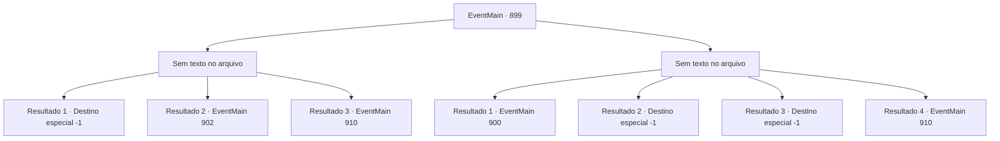

# Eventos principais · 899

[Índice da tabela](index.md) · [Índice geral](../index.md)

ID: `pt:EventMain:899` · Fonte: `EventMain4` · Versão: 1.2.47.

Mapeamento estático dos arquivos; a disponibilidade e a execução dependem do estado da run.

## Texto do evento

*Sem texto no arquivo.*

## Dados de entrada

```json
{
  "id": 899,
  "grade": 1,
  "normalGoal": "",
  "required": ""
}
```

## Mapa das escolhas



## Escolhas e resultados

### Escolha 1

*Sem texto no arquivo; o papel dessa opção depende da interface do jogo.*

Requisitos e outros campos da escolha:

```json
{
  "required": ""
}
```

#### Resultado 1.1


 "T- isso não pode ser...!"

 Rosilpha não é páreo para você. Você eventualmente o derrota com suas próprias mãos. A Rainha te abraça gentilmente com seus tentáculos. 

 "Fufu... Juntos, quebraremos esse ciclo. {1}."

 Assim que termina de falar, sua boca se divide em cruzes, revelando os tentáculos brancos. Eles se enterram em seu nariz, boca e ouvidos em apenas um segundo. A súbita dor te deixa impotente para resistir. 

 "Agora. Você é um de nós."

 Assim, você perde sua mente e se torna um devoralmas.

Continuação registrada: [Destino especial `-1`](../destinos-especiais.md).

```json
{
  "required": "5_677_1|18_769_2",
  "chance": "1",
  "nextEvent": -1,
  "type": 2,
  "reward": "15_6_4|15_6_0|25_8_1"
}
```

#### Resultado 1.2


 "T- isso não pode ser...!"

 Rosilpha não é páreo para você. Você eventualmente o derrota com suas próprias mãos. A Rainha gentilmente te abraça com seus tentáculos. 

 "Fufu... Juntos, quebraremos esse ciclo. {1}."

 Então, um impacto poderoso destroça as paredes da sala, e um grupo dos campeões da Serpente Divina entra correndo. Uma enorme serpente de videira, uma jaguatirica sombria e um sasquatch amarelo coberto de eletricidade atacam a Rainha de diferentes direções. Graças a eles, você é libertado do domínio da rainha. A Rainha os confronta furiosamente. 

 "EU NÃO SEREI PERTURBADA!!"


Continuação registrada: [Evento 902](0902.md) na mesma tabela.

```json
{
  "required": "18_677_1",
  "chance": "1",
  "nextEvent": 902,
  "type": 2,
  "reward": "6_2_171",
  "place": 15
}
```

#### Resultado 1.3

Você encurrala Rosilpha em um canto. Nesse momento, um objeto cilíndrico prateado rola até seus pés. Do cilindro, um intenso flash de luz explode, seguido por uma névoa densa e esfumaçada. O clarão avassalador cega você por um momento, e a rainha não é uma exceção. 

 "Aargh!! Malditos..!"

 A rainha segura os olhos, cambaleando e agitando seus tentáculos de forma descontrolada. No caos, o controle dela sobre você se quebra. Aproveitando o momento, Naverr se aproxima de você. 

 "Você voltou a si?! Agora é nossa chance! Rápido, acabe com esse monstro!"


Continuação registrada: [Evento 910](0910.md) na mesma tabela.

```json
{
  "required": "5_769_2",
  "chance": "1",
  "nextEvent": 910,
  "type": 2,
  "reward": "6_2_171",
  "place": 15
}
```

### Escolha 2

*Sem texto no arquivo; o papel dessa opção depende da interface do jogo.*

Requisitos e outros campos da escolha:

```json
{
  "required": ""
}
```

#### Resultado 2.1

A flecha de Rosilpha se crava em sua perna. Uma dor extrema se espalha, você cai de joelhos, e Rosilpha luta contra a Rainha sozinho. No entanto, sua luta não dura muito. O tentáculo da Rainha perfura o corpo de Rosilpha. Então, Naverr grita. 

 "Rosilpha! {1}!"

 Ele agarra seu facão e avança contra a rainha. Mas um único gesto da Rainha o petrifica. Então, ele grita dolorosamente enquanto seu corpo se contorce, seu cabelo cai, e sua pele fica escura. No final, ele se torna um devoralmas. 

 "Uurgh...dói..."

 Enquanto isso, Rosilpha agarra o tentáculo que perfurou seu estômago com as mãos ensanguentadas. Então ele puxa a corda do arco, usando Mão do Mago. 

 "Flecha magia de Rosilpha..!"

 Ele faz seu último disparo, nomeado em sua homenagem. Mas Naverr bloqueia a flecha. 

 "Mate-os."

 Como a Rainha ordena, o que costumava ser Naverr despedaça a cabeça de Rosilpha. Então, ele se aproxima de você.

Continuação registrada: [Evento 900](0900.md) na mesma tabela.

```json
{
  "required": "1_0_2|1_1_2|18_769_2",
  "chance": "1",
  "nextEvent": 900,
  "type": 2,
  "reward": "6_2_169|5_679_1|5_680_1",
  "place": 15
}
```

#### Resultado 2.2

A flecha de Rosilpha se crava em sua perna. Uma dor extrema se espalha, você cai de joelhos, e Rosilpha luta contra a Rainha sozinho. No entanto, sua luta não dura muito. O tentáculo da Rainha perfura o corpo de Rosilpha. Então, Naverr grita: 

 "Rosilpha! {1}!"

 Ele agarra seu facão e avança contra a rainha. Mas um simples gesto da Rainha o petrifica. Então, ele grita dolorosamente enquanto seu corpo se contorce, seu cabelo cai, e sua carne fica escura. No final, ele se torna um devoralmas. 

 "Aaah... dói..."

 Enquanto isso, Rosilpha agarra o tentáculo que perfurou seu estômago com as mãos ensanguentadas. Então ele puxa a corda do arco, usando Mão do Mago. 

 "Flecha magia de Rosilpha..!"

 Ele faz seu último disparo, nomeado em sua homenagem. Mas Naverr bloqueia a flecha. 

 "Mate-os."

 Como a Rainha ordena, o que costumava ser Naverr despedaça a cabeça de Rosilpha. Então, ela se aproxima de você. Sem hesitar, ela levanta os braços e parte sua cabeça ao meio.

Continuação registrada: [Destino especial `-1`](../destinos-especiais.md).

```json
{
  "required": "2_0_2|18_769_2",
  "chance": "1",
  "nextEvent": -1,
  "type": 2,
  "reward": "0_0_-1|0_1_-1|15_6_0|25_8_1"
}
```

#### Resultado 2.3

A flecha de Rosilpha se crava em sua perna. Uma dor extrema se espalha, você cai de joelhos, e Rosilpha luta contra a Rainha sozinho. No entanto, sua luta não dura muito. O tentáculo da Rainha perfura o corpo de Rosilpha. Então, Naverr grita: 

 "Rosilpha! {1}!"

 Ele agarra seu facão e avança contra a rainha. Mas um simples gesto da Rainha o petrifica. Então, ele grita dolorosamente enquanto seu corpo se contorce, seu cabelo cai, e sua carne fica escura. No final, ele se torna um devoralmas. 

 "Aaah... dói..."

 Enquanto isso, Rosilpha agarra o tentáculo que perfurou seu estômago com as mãos ensanguentadas. Então ele puxa a corda do arco, usando Mão do Mago. 

 "Flecha magia de Rosilpha..!"

 Ele faz seu último disparo, nomeado em sua homenagem. Mas Naverr bloqueia a flecha. 

 "Mate-os."

 Como a Rainha ordena, o que costumava ser Naverr despedaça a cabeça de Rosilpha. Então, ela se aproxima de você. Sem hesitar, ela levanta os braços e parte sua cabeça ao meio.

Continuação registrada: [Destino especial `-1`](../destinos-especiais.md).

```json
{
  "required": "2_1_2|18_769_2",
  "chance": "1",
  "nextEvent": -1,
  "type": 2,
  "reward": "0_0_-1|0_1_-1|15_6_0|25_8_1"
}
```

#### Resultado 2.4

Rosilpha te encurrala em um canto. Nesse momento, um objeto cilíndrico prateado rola até seus pés. Do cilindro, um intenso flash de luz explode, seguido por uma névoa densa e esfumaçada. O clarão avassalador cega você por um momento, e a rainha não é uma exceção. 

 "Aargh!! Malditos..!"

 A rainha segura os olhos, cambaleando e agitando seus tentáculos de forma descontrolada. No caos, o controle dela sobre você se quebra. Aproveitando o momento, Naverr se aproxima de você. 

 "Você voltou a si?! Agora é nossa chance! Rápido, acabe com esse monstro!"


Continuação registrada: [Evento 910](0910.md) na mesma tabela.

```json
{
  "required": "5_769_2",
  "chance": "1",
  "nextEvent": 910,
  "type": 2,
  "reward": "6_2_171",
  "place": 15
}
```

## Referências que chegam a este evento

- [Evento 898 · escolha 1 · resultado 2](0898.md#escolha-1)
