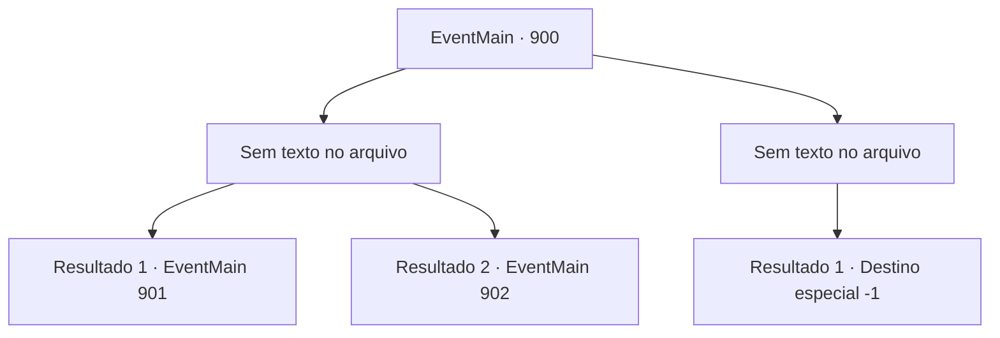

# Eventos principais · 900

[Índice da tabela](index.md) · [Índice geral](../index.md)

ID: `pt:EventMain:900` · Fonte: `EventMain4` · Versão: 1.2.47.

Mapeamento estático dos arquivos; a disponibilidade e a execução dependem do estado da run.

## Texto do evento

*Sem texto no arquivo.*

## Dados de entrada

```json
{
  "id": 900,
  "grade": 1,
  "normalGoal": "",
  "required": ""
}
```

## Mapa das escolhas



## Escolhas e resultados

### Escolha 1

*Sem texto no arquivo; o papel dessa opção depende da interface do jogo.*

Requisitos e outros campos da escolha:

```json
{
  "required": ""
}
```

#### Resultado 1.1

Você derrota o que costumava ser Naverr. A Rainha olha para você, zombando. 

 "Coisa travessa. Você não precisava fazer isso."

 Ela levanta o dedo e aponta para você. Então, um raio de relâmpago carmesim é disparado em sua direção.

Continuação registrada: [Evento 901](0901.md) na mesma tabela.

```json
{
  "required": "5_677_1",
  "chance": "1",
  "nextEvent": 901,
  "type": 2,
  "reward": "6_0_171",
  "place": 15
}
```

#### Resultado 1.2

Você derrota o que costumava ser Naverr. A Rainha olha para você, zombando. 

 "Coisa travessa. Você não precisava fazer isso."

 Ela levanta o dedo e aponta para você. Então, um impacto poderoso destroça as paredes da sala, e um grupo dos campeões da Serpente Divina entra correndo. Uma enorme serpente de videira de árvore, uma onça sombria e um pé-grande amarelo coberto de eletricidade atacam a Rainha de diferentes direções. Graças a eles, você é libertado do domínio da rainha. A Rainha os enfrenta furiosamente. 

 "EU NÃO SEREI PERTURBADA!!"


Continuação registrada: [Evento 902](0902.md) na mesma tabela.

```json
{
  "required": "18_677_1",
  "chance": "1",
  "nextEvent": 902,
  "type": 2,
  "reward": "6_2_171",
  "place": 15
}
```

### Escolha 2

*Sem texto no arquivo; o papel dessa opção depende da interface do jogo.*

Requisitos e outros campos da escolha:

```json
{
  "required": ""
}
```

#### Resultado 2.1

Você é derrotado pelo devoralmas que costumava ser Naverr. Sem hesitação, ele separa sua cabeça do seu corpo.

Continuação registrada: [Destino especial `-1`](../destinos-especiais.md).

```json
{
  "required": "",
  "chance": "1",
  "nextEvent": -1,
  "type": 2,
  "reward": "0_0_-1|0_1_-1|15_6_0|25_8_1"
}
```

## Referências que chegam a este evento

- [Evento 899 · escolha 2 · resultado 1](0899.md#escolha-2)
