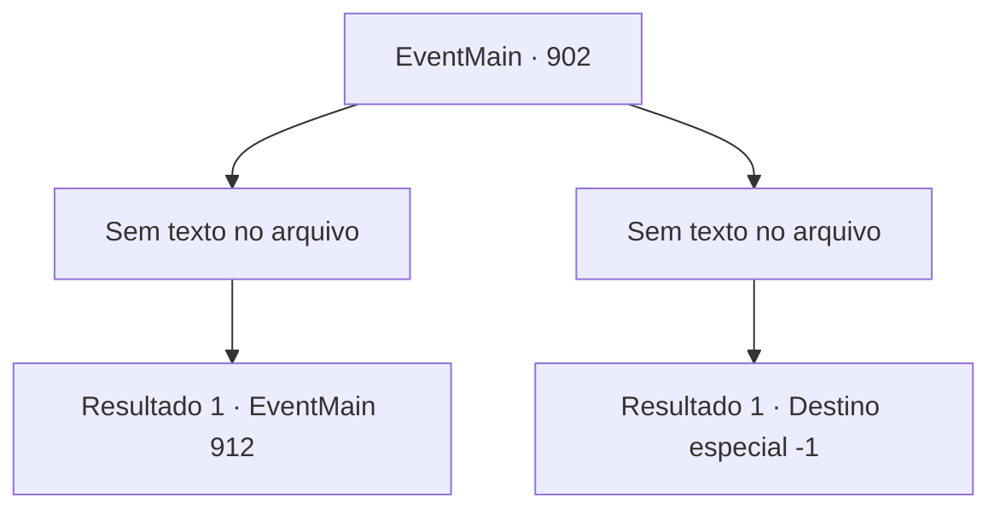

# Eventos principais · 902

[Índice da tabela](index.md) · [Índice geral](../index.md)

ID: `pt:EventMain:902` · Fonte: `EventMain4` · Versão: 1.2.47.

Mapeamento estático dos arquivos; a disponibilidade e a execução dependem do estado da run.

## Texto do evento

*Sem texto no arquivo.*

## Dados de entrada

```json
{
  "id": 902,
  "grade": 1,
  "normalGoal": "",
  "required": ""
}
```

## Mapa das escolhas



## Escolhas e resultados

### Escolha 1

*Sem texto no arquivo; o papel dessa opção depende da interface do jogo.*

Requisitos e outros campos da escolha:

```json
{
  "required": ""
}
```

#### Resultado 1.1

Você luta contra a Rainha, junto com os campeões da Selva de Andaria. Finalmente, você derrota a Rainha. Ela se agarra a você em seus últimos suspiros. 

 "Eu... Eu não vou morrer assim..!"

 Então seu rosto se divide em cruzes, tentáculos brancos se estendem dela. Mas você sacode a Rainha e esmaga sua cabeça no chão. Seu movimento para. Você carrega o cadáver de Rosilpha em suas costas e sai do navio de guerra. A batalha do lado de fora também acabou. <link=shake>

 "*croak* *croak* *croak*!!"

</link> O som de sapos ecoa pelo local. Deve ser assim que os gripplis celebram a vitória.

Continuação registrada: [Evento 912](0912.md) na mesma tabela.

```json
{
  "required": "",
  "chance": "1",
  "nextEvent": 912,
  "type": 2,
  "reward": "5_679_1|5_680_1"
}
```

### Escolha 2

*Sem texto no arquivo; o papel dessa opção depende da interface do jogo.*

Requisitos e outros campos da escolha:

```json
{
  "required": ""
}
```

#### Resultado 2.1

Você luta contra a Rainha, junto com os campeões da Selva de Andaria. No entanto, usando as almas que consumiu até agora, a Rainha mostra um poderoso domínio na batalha. Eventualmente, ela derrota os campeões, cambaleando em sua direção. 

 "Você está tornando isso muito mais difícil para si mesmo... Você não deveria ter me desafiado."

 Os tentáculos da Rainha se enrolam em volta do seu pescoço. Em seguida, ela arranca sua cabeça do seu corpo.

Continuação registrada: [Destino especial `-1`](../destinos-especiais.md).

```json
{
  "required": "",
  "chance": "1",
  "nextEvent": -1,
  "type": 2,
  "reward": "0_0_-1|0_1_-1|15_6_0"
}
```

## Referências que chegam a este evento

- [Evento 899 · escolha 1 · resultado 2](0899.md#escolha-1)
- [Evento 900 · escolha 1 · resultado 2](0900.md#escolha-1)
