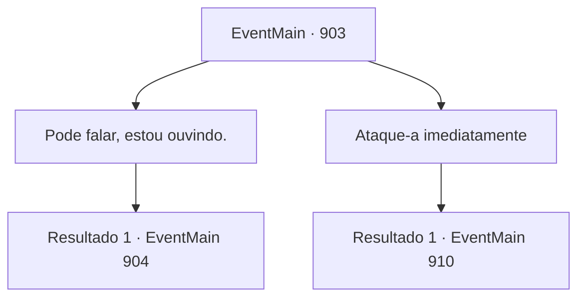

# Eventos principais · 903

[Índice da tabela](index.md) · [Índice geral](../index.md)

ID: `pt:EventMain:903` · Fonte: `EventMain4` · Versão: 1.2.47.

Mapeamento estático dos arquivos; a disponibilidade e a execução dependem do estado da run.

## Texto do evento

*Sem texto no arquivo.*

## Dados de entrada

```json
{
  "id": 903,
  "grade": 1,
  "normalGoal": "",
  "required": ""
}
```

## Mapa das escolhas



## Escolhas e resultados

### Escolha 1

Pode falar, estou ouvindo.

Requisitos e outros campos da escolha:

```json
{
  "required": ""
}
```

#### Resultado 1.1

Você decide ouvir a Rainha. Ela olha para você com seus olhos dourados e diz com uma voz gentil e terna. 

 "Nós somos Nepe-Akalish. Não temos intenção de lutar contra você. Pelo contrário - nós... estamos aqui para te salvar."

 Rosilpha pergunta o que isso significa. A Rainha responde com um leve sorriso. 

 "Seus Deuses criaram um sistema para explorá-los - o sistema que vocês humanos chamam de reencarnação. Presos em um ciclo interminável de nascimento e morte, vocês dedicam sua fé e almas a eles. E essas chamadas divindades sobrevivem com suas homenagens sem sentido."

 Ela continua com uma voz intensificada. 

 "Pense nisso. Como os deuses são egoístas. Como são imprudentes. Sem vocês, eles não são nada - e ainda assim tratam vocês como se fossem gado! O que pretendemos fazer... é quebrar esse ciclo de exploração."


Continuação registrada: [Evento 904](0904.md) na mesma tabela.

```json
{
  "required": "",
  "chance": "1",
  "nextEvent": 904,
  "type": 2,
  "reward": ""
}
```

### Escolha 2

Ataque-a imediatamente

Requisitos e outros campos da escolha:

```json
{
  "required": ""
}
```

#### Resultado 2.1

Em vez de responder, você ataca a Rainha imediatamente. Ela bloqueia seu ataque balançando seus tentáculos, e os estica franzindo a testa com ira.

Continuação registrada: [Evento 910](0910.md) na mesma tabela.

```json
{
  "required": "",
  "chance": "1",
  "nextEvent": 910,
  "type": 2,
  "reward": "6_0_171",
  "place": 15
}
```

## Referências que chegam a este evento

- [Evento 897 · escolha 3 · resultado 1](0897.md#escolha-3)
- [Evento 898 · escolha 1 · resultado 1](0898.md#escolha-1)
