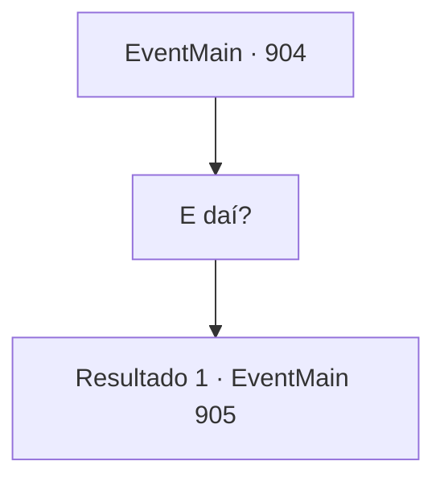

# Eventos principais · 904

[Índice da tabela](index.md) · [Índice geral](../index.md)

ID: `pt:EventMain:904` · Fonte: `EventMain4` · Versão: 1.2.47.

Mapeamento estático dos arquivos; a disponibilidade e a execução dependem do estado da run.

## Texto do evento

*Sem texto no arquivo.*

## Dados de entrada

```json
{
  "id": 904,
  "grade": 1,
  "normalGoal": "",
  "required": ""
}
```

## Mapa das escolhas



## Escolhas e resultados

### Escolha 1

E daí?

Requisitos e outros campos da escolha:

```json
{
  "required": ""
}
```

#### Resultado 1.1

A Rainha parece ponderar por um momento. Enquanto isso, algo brilhante está fluindo em suas veias. 

 "Então... gostaria que vocês cooperassem comigo. Não. Tudo o que vocês têm que fazer é ficar de lado e observar. Não tenho intenção de enganá-los. Eu os libertarei."

 Rosilpha grita furiosamente. 

 "Ha! Uma mentira descarada! Você nem sabe do que está falando!"

 A Rainha ainda permanece calma e continua. 

 "Sei que é difícil aceitar. Vou dar a vocês algum tempo para pensar."


Continuação registrada: [Evento 905](0905.md) na mesma tabela.

```json
{
  "required": "",
  "chance": "1",
  "nextEvent": 905,
  "type": 2,
  "reward": ""
}
```

## Referências que chegam a este evento

- [Evento 903 · escolha 1 · resultado 1](0903.md#escolha-1)
