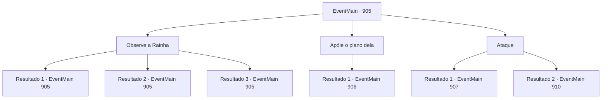

# Eventos principais · 905

[Índice da tabela](index.md) · [Índice geral](../index.md)

ID: `pt:EventMain:905` · Fonte: `EventMain4` · Versão: 1.2.47.

Mapeamento estático dos arquivos; a disponibilidade e a execução dependem do estado da run.

## Texto do evento

*Sem texto no arquivo.*

## Dados de entrada

```json
{
  "id": 905,
  "grade": 1,
  "normalGoal": "",
  "required": ""
}
```

## Mapa das escolhas



## Escolhas e resultados

### Escolha 1

Observe a Rainha

Requisitos e outros campos da escolha:

```json
{
  "required": "5_682_0"
}
```

#### Resultado 1.1

Você dá uma olhada mais de perto na Rainha. Não parece estar mentindo. Ainda assim, você assume que está escondendo algo. Você percebe que durante toda a conversa, algo brilhante tem fluído para a Rainha, através das veias cinzentas. Você percebe que a Rainha está apenas ganhando tempo, esperando por essa transfusão.

Continuação registrada: [Evento 905](0905.md) na mesma tabela.

```json
{
  "required": "10_111_1",
  "chance": "1|0_14_1",
  "nextEvent": 905,
  "type": 0,
  "reward": "5_682_1"
}
```

#### Resultado 1.2

Você dá uma olhada mais de perto na Rainha. Não parece estar mentindo. Você não encontra mais nada de particular além disso.

Continuação registrada: [Evento 905](0905.md) na mesma tabela.

```json
{
  "required": "10_111_1",
  "chance": "20",
  "nextEvent": 905,
  "type": 1,
  "reward": "5_682_9"
}
```

#### Resultado 1.3

Você dá uma olhada mais de perto na Rainha. Então, seu bastão sussurra. 

 "Não é mentira. Mas, está escondendo algo. Sobre o que acontece quando o ciclo de reencarnação é quebrado. Isso significa que não mais vidas nascem. Nesse caso, almas mortas seguirão diretamente para a boca da Rainha, alimentando-a."

 O bastão continua, apontando para as veias cinzentas. 

 "Ela está se empanturrando com as almas agora. Ela está ganhando tempo."


Continuação registrada: [Evento 905](0905.md) na mesma tabela.

```json
{
  "required": "8_111_1",
  "chance": "1",
  "nextEvent": 905,
  "type": 2,
  "reward": "5_682_1"
}
```

### Escolha 2

Apóie o plano dela

Requisitos e outros campos da escolha:

```json
{
  "required": ""
}
```

#### Resultado 2.1

Você decide ficar ao lado da Rainha. Rosilpha grita, enlouquecendo. 

 "O que..! Do que você está falando!?"

 A Rainha estende as mãos e fala. 

 "Uma escolha sábia. Agora, garoto tagarela. Qual será sua resposta?"

 A resposta de Rosilpha vem na forma de uma flecha. Quando a flecha atinge o braço da Rainha, ela prende Rosilpha com seus tentáculos. 

 "Que infeliz. Que você parece incapaz de entender minha hospitalidade. Espere aí, criança."

 Ela estende a mão para você mais uma vez. 

 "Aproxime-se. Eu oficialmente o iniciarei como um de nós."


Continuação registrada: [Evento 906](0906.md) na mesma tabela.

```json
{
  "required": "",
  "chance": "1",
  "nextEvent": 906,
  "type": 2,
  "reward": ""
}
```

### Escolha 3

Ataque

Requisitos e outros campos da escolha:

```json
{
  "required": ""
}
```

#### Resultado 3.1

Você corre imediatamente para a Rainha, atacando-a. A Rainha bloqueia seu ataque com seus tentáculos, falando. 

 "E ainda assim você continua a desafiar-me."

 Então, um impacto poderoso destroça as paredes da sala, e um grupo dos campeões da Serpente Divina entra correndo. Uma enorme serpente de videira, uma onça sombria e um sasquatch amarelo coberto de eletricidade atacam a Rainha de diferentes direções. Graças a eles, você é libertado do domínio da rainha. A Rainha os enfrenta furiosamente. 

 "EU NÃO SEREI PERTURBADA!!"


Continuação registrada: [Evento 907](0907.md) na mesma tabela.

```json
{
  "required": "18_677_1",
  "chance": "1",
  "nextEvent": 907,
  "type": 2,
  "reward": "6_2_171",
  "place": 15
}
```

#### Resultado 3.2

Você corre imediatamente para a Rainha, atacando-a. A Rainha bloqueia seu ataque com seus tentáculos, falando. 

 "E ainda assim você continua a me desafiar."


Continuação registrada: [Evento 910](0910.md) na mesma tabela.

```json
{
  "required": "5_677_1",
  "chance": "1",
  "nextEvent": 910,
  "type": 2,
  "reward": "6_0_171",
  "place": 15
}
```

## Referências que chegam a este evento

- [Evento 904 · escolha 1 · resultado 1](0904.md#escolha-1)
- [Evento 905 · escolha 1 · resultado 1](0905.md#escolha-1)
- [Evento 905 · escolha 1 · resultado 2](0905.md#escolha-1)
- [Evento 905 · escolha 1 · resultado 3](0905.md#escolha-1)
