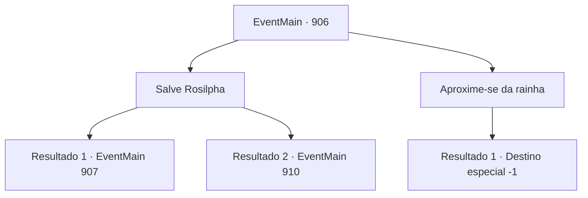

# Eventos principais · 906

[Índice da tabela](index.md) · [Índice geral](../index.md)

ID: `pt:EventMain:906` · Fonte: `EventMain4` · Versão: 1.2.47.

Mapeamento estático dos arquivos; a disponibilidade e a execução dependem do estado da run.

## Texto do evento

*Sem texto no arquivo.*

## Dados de entrada

```json
{
  "id": 906,
  "grade": 1,
  "normalGoal": "",
  "required": ""
}
```

## Mapa das escolhas



## Escolhas e resultados

### Escolha 1

Salve Rosilpha

Requisitos e outros campos da escolha:

```json
{
  "required": ""
}
```

#### Resultado 1.1

Você arranca os tentáculos da Rainha e resgata Rosilpha. Então, os outros tentáculos da Rainha se lançam em sua direção imediatamente. 

 "E ainda assim você continua a desafiar-me."

 Em seguida, um impacto poderoso destroça as paredes da sala, e um grupo dos campeões da Serpente Divina entra correndo. Uma enorme serpente de videira, uma jaguatirica sombria e um sasquatch amarelo coberto de eletricidade atacam a Rainha por diferentes direções. Graças a eles, você é libertado do domínio da rainha. A Rainha os enfrenta furiosamente. 

 "EU NÃO SEREI PERTURBADA!!"


Continuação registrada: [Evento 907](0907.md) na mesma tabela.

```json
{
  "required": "18_677_1",
  "chance": "1",
  "nextEvent": 907,
  "type": 2,
  "reward": "6_2_171",
  "place": 15
}
```

#### Resultado 1.2

Você arranca os tentáculos da Rainha e resgata Rosilpha. Em seguida, os outros tentáculos da Rainha se lançam em sua direção imediatamente. 

 "...E ainda assim você continua a me desafiar. Que infelicidade..."

 Algo flui para o corpo da Rainha através das veias. Então um senso de domínio irrompe da Rainha, significativo o suficiente para queimar sua carne. 

 "Agora então. Morra."

 Assim que termina, raios de relâmpagos carmesim são disparados.

Continuação registrada: [Evento 910](0910.md) na mesma tabela.

```json
{
  "required": "5_677_1",
  "chance": "1",
  "nextEvent": 910,
  "type": 2,
  "reward": "6_0_171",
  "place": 15
}
```

### Escolha 2

Aproxime-se da rainha

Requisitos e outros campos da escolha:

```json
{
  "required": ""
}
```

#### Resultado 2.1

Você se aproxima da rainha. Ela pega suas mãos com um sorriso terno e bonito. A Rainha te abraça gentilmente com seus tentáculos. 

 "Fufu... Juntos, vamos quebrar esse ciclo. {1}."

 Assim que termina de falar, sua boca se divide em cruzes, revelando os tentáculos brancos. Eles se enterram em seu nariz, boca e ouvidos em apenas um segundo. A súbita onda de dor te deixa impotente para resistir. 

 "Agora você é um de nós."

 Assim, você perde sua mente e se torna um devoralmas.

Continuação registrada: [Destino especial `-1`](../destinos-especiais.md).

```json
{
  "required": "",
  "chance": "1",
  "nextEvent": -1,
  "type": 2,
  "reward": "15_6_4|25_8_1|15_6_0"
}
```

## Referências que chegam a este evento

- [Evento 905 · escolha 2 · resultado 1](0905.md#escolha-2)
