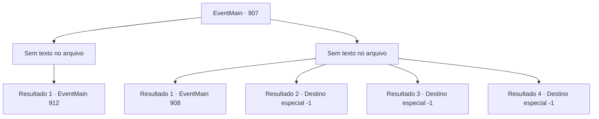

# Eventos principais · 907

[Índice da tabela](index.md) · [Índice geral](../index.md)

ID: `pt:EventMain:907` · Fonte: `EventMain4` · Versão: 1.2.47.

Mapeamento estático dos arquivos; a disponibilidade e a execução dependem do estado da run.

## Texto do evento

*Sem texto no arquivo.*

## Dados de entrada

```json
{
  "id": 907,
  "grade": 1,
  "normalGoal": "",
  "required": ""
}
```

## Mapa das escolhas



## Escolhas e resultados

### Escolha 1

*Sem texto no arquivo; o papel dessa opção depende da interface do jogo.*

Requisitos e outros campos da escolha:

```json
{
  "required": ""
}
```

#### Resultado 1.1

Você luta contra a Rainha, junto com os campeões da Selva de Andaria. Finalmente, você derrota a Rainha. Ela se agarra a você em seus últimos suspiros. 

 "Eu... Eu não vou morrer assim..!"

 Então seu rosto se divide em cruzes, tentáculos brancos se estendem dela. Mas você sacode a Rainha e esmaga sua cabeça no chão. Seu movimento para. Você carrega Rosilpha e sai da sala. Naverr, que estava esperando do lado de fora, te abraça apertado e fala. 

 "Bem feito. Bem feito...! Vamos voltar agora."

 Você sai da nave de batalha dos devoradores de almas com eles. A batalha do lado de fora também acabou. Com a Rainha morta, os outros devoradores de almas também pararam de se mover. <link=shake>

 "*ribbit* *ribbit* *ribbit*!!"

</link> O som de sapos ecoa pelo lugar. Deve ser assim que os gripplis celebram a vitória.

Continuação registrada: [Evento 912](0912.md) na mesma tabela.

```json
{
  "required": "",
  "chance": "1",
  "nextEvent": 912,
  "type": 2,
  "reward": ""
}
```

### Escolha 2

*Sem texto no arquivo; o papel dessa opção depende da interface do jogo.*

Requisitos e outros campos da escolha:

```json
{
  "required": ""
}
```

#### Resultado 2.1

Você luta contra a Rainha, junto com os campeões da Selva de Andaria. No entanto, usando as almas que consumiu até agora, a Rainha mostra uma grande destreza na batalha. Eventualmente, ela derrota os campeões, cambaleando em sua direção. 

 "Você está tornando isso muito mais difícil para si mesmo... Você não deveria ter cruzado meu caminho."

 Antes mesmo de você conseguir se levantar, os tentáculos afiados da Rainha se esticam. Mas eles não alcançam você. É porque Rosilpha os bloqueou com seu corpo. 

 "Ai... isso dói..."

 Rosilpha agarra o tentáculo que perfurou seu estômago com suas mãos ensanguentadas. Então ele puxa a corda do arco, usando Mão do Mago. 

 "Flecha magia de Rosilpha..!"

 Ele faz seu último disparo, nomeado em sua homenagem. Mas a Rainha simplesmente o reflete com suas mãos. 

 "É isso o melhor que você... huh?"

 A voz confiante da Rainha para de falar. Há uma flecha presa entre os olhos da Rainha. A flecha que ela bloqueou era falsa, e a verdadeira estava imbuida com invisibilidade magia. <link=shake>

 "Ai..aaAAARRGH!!!"

</link> A Rainha grita dolorosamente, torcendo seu corpo. E então, assim como tinta preta se espalhando em água clara, o corpo da Rainha se torna negro e desmorona. Rosilpha explode em uma pequena risada olhando para isso. 

 "Ei, {1}. Lembre-se de como eu morri... Isso... eu lutei com astúcia..!.Como um grippli faria...!"

 Essas são suas últimas palavras, antes de perder o controle de seu arco.

Continuação registrada: [Evento 908](0908.md) na mesma tabela.

```json
{
  "required": "1_0_2|1_1_2",
  "chance": "1",
  "nextEvent": 908,
  "type": 2,
  "reward": "5_680_1"
}
```

#### Resultado 2.2

Você luta contra a Rainha, junto com os campeões da Selva de Andaria. No entanto, usando as almas que consumiu até agora, a Rainha mostra um poderoso domínio na batalha. Eventualmente, ela derrota os campeões, cambaleando em sua direção. 

 "Você está tornando isso muito mais difícil para si mesmo... Você não deveria ter me desafiado."

 Antes mesmo de você conseguir se levantar, os tentáculos afiados da Rainha se esticam. 

 "N- NÃO!"

 Rosilpha puxa apressadamente a corda de seu arco, mas é tarde demais. Os tentáculos cortam impiedosamente sua cabeça de seu corpo.

Continuação registrada: [Destino especial `-1`](../destinos-especiais.md).

```json
{
  "required": "1_0_2|1_1_2",
  "chance": "1",
  "nextEvent": -1,
  "type": 2,
  "reward": "0_0_-1|0_1_-1|15_6_0|25_8_1"
}
```

#### Resultado 2.3

Você luta contra a Rainha, junto com os campeões da Selva de Andaria. No entanto, usando as almas que consumiu até agora, a Rainha mostra um poderoso domínio na batalha. Eventualmente, ela derrota os campeões, cambaleando em sua direção. 

 "Você está tornando isso muito mais difícil para si mesmo... Você não deveria ter me desafiado."

 Antes mesmo de você conseguir se levantar, os tentáculos afiados da Rainha se esticam. 

 "N- NÃO!"

 Rosilpha puxa apressadamente a corda de seu arco, mas é tarde demais. Os tentáculos cortam impiedosamente sua cabeça de seu corpo.

Continuação registrada: [Destino especial `-1`](../destinos-especiais.md).

```json
{
  "required": "2_0_2",
  "chance": "1",
  "nextEvent": -1,
  "type": 2,
  "reward": "0_0_-1|0_1_-1|15_6_0|25_8_1"
}
```

#### Resultado 2.4

Você luta contra a Rainha, junto com os campeões da Selva de Andaria. No entanto, usando as almas que consumiu até agora, a Rainha mostra uma grande destreza na batalha. Eventualmente, ela derrota os campeões, cambaleando em sua direção. 

 "Você está tornando isso muito mais difícil para si mesmo... Você não deveria ter me desafiado."

 Antes mesmo de você conseguir se levantar, os tentáculos afiados da Rainha se esticam. 

 "N- NÃO!"

 Rosilpha puxa apressadamente a corda de seu arco, mas é tarde demais. Os tentáculos cortam impiedosamente sua cabeça de seu corpo.

Continuação registrada: [Destino especial `-1`](../destinos-especiais.md).

```json
{
  "required": "2_1_2",
  "chance": "1",
  "nextEvent": -1,
  "type": 2,
  "reward": "0_0_-1|0_1_-1|15_6_0|25_8_1"
}
```

## Referências que chegam a este evento

- [Evento 905 · escolha 3 · resultado 1](0905.md#escolha-3)
- [Evento 906 · escolha 1 · resultado 1](0906.md#escolha-1)
