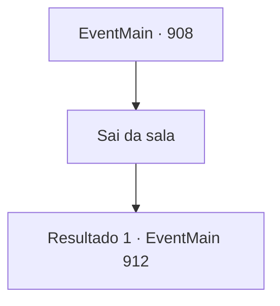

# Eventos principais · 908

[Índice da tabela](index.md) · [Índice geral](../index.md)

ID: `pt:EventMain:908` · Fonte: `EventMain4` · Versão: 1.2.47.

Mapeamento estático dos arquivos; a disponibilidade e a execução dependem do estado da run.

## Texto do evento

*Sem texto no arquivo.*

## Dados de entrada

```json
{
  "id": 908,
  "grade": 1,
  "normalGoal": "",
  "required": ""
}
```

## Mapa das escolhas



## Escolhas e resultados

### Escolha 1

Sai da sala

Requisitos e outros campos da escolha:

```json
{
  "required": ""
}
```

#### Resultado 1.1

Você carrega o cadáver de Rosilpha e sai do quarto da Rainha. Naverr, que estava esperando do lado de fora, te abraça apertado e fala. 

 "Bem feito! Onde está Rosi-... ah, entendi..."

 Ele fica em silêncio por um tempo, rezando por Rosilpha. Você e Naverr saem da nave de batalha dos devoradores de almas. A batalha lá fora também acabou. Os guerreiros de Andaria compartilham a alegria da vitória rugindo de excitação ou se abraçando. <link=shake>

 "*ribbit* *ribbit* *ribbit*!!"

</link> O som de sapos ecoa pelo local. Deve ser assim que os gripplis celebram a vitória.

Continuação registrada: [Evento 912](0912.md) na mesma tabela.

```json
{
  "required": "",
  "chance": "1",
  "nextEvent": 912,
  "type": 2,
  "reward": "5_680_1"
}
```

## Referências que chegam a este evento

- [Evento 907 · escolha 2 · resultado 1](0907.md#escolha-2)
