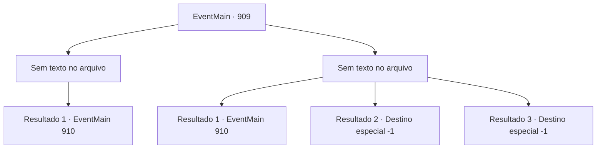

# Eventos principais · 909

[Índice da tabela](index.md) · [Índice geral](../index.md)

ID: `pt:EventMain:909` · Fonte: `EventMain4` · Versão: 1.2.47.

Mapeamento estático dos arquivos; a disponibilidade e a execução dependem do estado da run.

## Texto do evento

*Sem texto no arquivo.*

## Dados de entrada

```json
{
  "id": 909,
  "grade": 1,
  "normalGoal": "",
  "required": ""
}
```

## Mapa das escolhas



## Escolhas e resultados

### Escolha 1

*Sem texto no arquivo; o papel dessa opção depende da interface do jogo.*

Requisitos e outros campos da escolha:

```json
{
  "required": ""
}
```

#### Resultado 1.1

Você derrota o devoralmas que costumava ser Naverr. Quando ele perde a consciência e cai, a Rainha comenta, como se algo infeliz tivesse acontecido. 

 "Oh, que pena... Vocês dois eram próximos? Precisava ir tão longe?"

 Rosilpha range os dentes e puxa a corda de seu arco em resposta à provocação da Rainha. A luta começa depois disso.

Continuação registrada: [Evento 910](0910.md) na mesma tabela.

```json
{
  "required": "",
  "chance": "1",
  "nextEvent": 910,
  "type": 2,
  "reward": "6_0_171",
  "place": 15
}
```

### Escolha 2

*Sem texto no arquivo; o papel dessa opção depende da interface do jogo.*

Requisitos e outros campos da escolha:

```json
{
  "required": ""
}
```

#### Resultado 2.1

O devoralmas Naverr te esmaga, tentando devorar você com sua boca horrenda, mas logo é nocauteado pelo feitiço de Estilhaçar de Rosilpha. Quando ele perde a consciência e cai, a Rainha comenta, como se algo infeliz tivesse acontecido. 

 "Ah, que pena... Vocês não eram próximos?"

 Rosilpha range os dentes e puxa a corda de seu arco em resposta à provocação da Rainha. A luta começa depois disso.

Continuação registrada: [Evento 910](0910.md) na mesma tabela.

```json
{
  "required": "1_0_2|1_1_2",
  "chance": "1",
  "nextEvent": 910,
  "type": 2,
  "reward": "6_0_171|0_0_-1|0_1_-1",
  "place": 15
}
```

#### Resultado 2.2

O que costumava ser Naverr te prende com seus tentáculos. 

 "N.. não!"

 Rosilpha voa uma flecha, mas é tarde demais. Tentáculos torcem seu pescoço e o rasgam impiedosamente.

Continuação registrada: [Destino especial `-1`](../destinos-especiais.md).

```json
{
  "required": "2_0_2",
  "chance": "1",
  "nextEvent": -1,
  "type": 2,
  "reward": "0_0_-1|0_1_-1|15_6_0|25_8_1"
}
```

#### Resultado 2.3

O que costumava ser Naverr se enrola ao seu redor com seus tentáculos. 

 "N- NÃO!"

 Rosilpha puxa apressadamente a corda de seu arco, mas é tarde demais. Os tentáculos impiedosamente cortam sua cabeça do seu corpo.

Continuação registrada: [Destino especial `-1`](../destinos-especiais.md).

```json
{
  "required": "2_1_2",
  "chance": "1",
  "nextEvent": -1,
  "type": 2,
  "reward": "0_0_-1|0_1_-1|15_6_0|25_8_1"
}
```

## Referências que chegam a este evento

- [Evento 897 · escolha 1 · resultado 1](0897.md#escolha-1)
