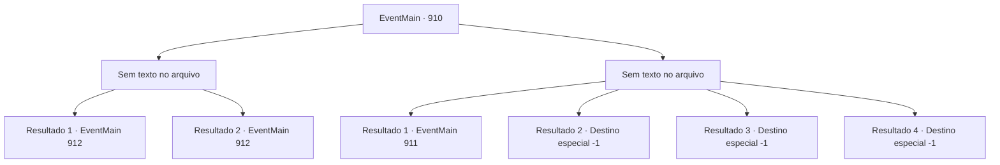

# Eventos principais · 910

[Índice da tabela](index.md) · [Índice geral](../index.md)

ID: `pt:EventMain:910` · Fonte: `EventMain4` · Versão: 1.2.47.

Mapeamento estático dos arquivos; a disponibilidade e a execução dependem do estado da run.

## Texto do evento

*Sem texto no arquivo.*

## Dados de entrada

```json
{
  "id": 910,
  "grade": 1,
  "normalGoal": "",
  "required": ""
}
```

## Mapa das escolhas



## Escolhas e resultados

### Escolha 1

*Sem texto no arquivo; o papel dessa opção depende da interface do jogo.*

Requisitos e outros campos da escolha:

```json
{
  "required": ""
}
```

#### Resultado 1.1

Rosilpha é jogada ao chão pelos ataques da Rainha. Mas você aproveita a oportunidade, desferindo o golpe final na Rainha. Ela se agarra a você em seus estertores de morte. 

 "Eu... Eu não vou morrer assim..!"

 Então seu rosto se divide em cruzes, tentáculos brancos se estendem dela. Mas você sacode a Rainha e esmaga sua cabeça no chão. Seu movimento para. Você carrega a ferida Rosilpha e sai do navio de guerra. A batalha do lado de fora também acabou. <link=shake>

 "*coaxar * *coaxar * *coaxar *!!"

</link> O som de sapos ecoa pelo local. Deve ser assim que os gripplis celebram a vitória.

Continuação registrada: [Evento 912](0912.md) na mesma tabela.

```json
{
  "required": "5_679_1",
  "chance": "1",
  "nextEvent": 912,
  "type": 2,
  "reward": "15_6_10"
}
```

#### Resultado 1.2

Rosilpha é jogada ao chão pelos ataques da Rainha. Mas você aproveita a oportunidade, desferindo o golpe final na Rainha. Ela se agarra a você em seus estertores de morte. 

 "Eu... Eu não vou morrer assim..!"

 Então seu rosto se divide em cruzes, tentáculos brancos se estendem dela. Mas você sacode a Rainha e esmaga sua cabeça no chão. Seu movimento para. Você carrega a ferida Rosilpha e sai do navio de guerra. A batalha do lado de fora também acabou. <link=shake>

 "*coaxar * *coaxar * *coaxar *!!"

</link> O som de sapos ecoa pelo local. Deve ser assim que os gripplis celebram a vitória.

Continuação registrada: [Evento 912](0912.md) na mesma tabela.

```json
{
  "required": "18_679_1",
  "chance": "1",
  "nextEvent": 912,
  "type": 2,
  "reward": ""
}
```

### Escolha 2

*Sem texto no arquivo; o papel dessa opção depende da interface do jogo.*

Requisitos e outros campos da escolha:

```json
{
  "required": ""
}
```

#### Resultado 2.1

Você é derrubado pelo ataque da Rainha. Embora incerto, você sente uma dor extrema como se algum osso estivesse quebrado em algum lugar. Antes mesmo de poder se levantar, os tentáculos afiados da Rainha se esticam. Mas eles não te alcançam. É porque Rosilpha os bloqueou com seu corpo. 

 "Aargh... dói..."

 Rosilpha agarra o tentáculo que perfurou seu estômago com suas mãos ensanguentadas. Então ele puxa a corda do arco, usando Mão do Mago. 

 "Flecha magia de Rosilpha..!"

 Ele faz seu último disparo, nomeado em sua homenagem. Mas a Rainha simplesmente o reflete com suas mãos. 

 "Este é o seu mel... huh?"

 A voz confiante da Rainha para de repente. Há uma flecha presa entre os olhos da Rainha. A flecha que ela bloqueou era falsa, e a verdadeira estava imbuida com invisibilidade magia. A flecha parece estar revestida com veneno letal também. <link=shake>

 "Aargh..aaAAARRGH!!!"

</link> A Rainha grita dolorosamente, torcendo seu corpo. E então, assim como tinta preta se espalhando em água clara, o corpo da Rainha se torna negro e desmorona. Rosilpha explode em uma pequena risada olhando para isso. 

 "Ei, {1}. Lembre-se de como eu morri... Isso... eu lutei com astúcia..!.Como um grippli faria...!"

 Essas são suas últimas palavras, antes de perder o controle de seu arco.

Continuação registrada: [Evento 911](0911.md) na mesma tabela.

```json
{
  "required": "1_0_2|1_1_2",
  "chance": "1",
  "nextEvent": 911,
  "type": 2,
  "reward": "0_0_-1|0_1_-1"
}
```

#### Resultado 2.2

Você é derrubado pelo ataque da Rainha. Embora incerto, você sente uma dor extrema como se algum osso estivesse quebrado. Antes mesmo de conseguir se levantar, os tentáculos afiados da Rainha se esticam. 

 "N- NÃO!"

 Rosilpha puxa rapidamente a corda de seu arco, mas é tarde demais. Os tentáculos cortam impiedosamente sua cabeça do seu corpo.

Continuação registrada: [Destino especial `-1`](../destinos-especiais.md).

```json
{
  "required": "1_0_2|1_1_2",
  "chance": "3",
  "nextEvent": -1,
  "type": 2,
  "reward": "0_0_-1|0_1_-1|15_6_0|25_8_1"
}
```

#### Resultado 2.3

Você é derrubado pelo ataque da Rainha. Embora incerto, você sente uma dor extrema como se algum osso estivesse quebrado. Antes mesmo de conseguir se levantar, os tentáculos afiados da Rainha se esticam. 

 "N- NÃO!"

 Rosilpha puxa rapidamente a corda de seu arco, mas é tarde demais. Os tentáculos cortam impiedosamente sua cabeça do seu corpo.

Continuação registrada: [Destino especial `-1`](../destinos-especiais.md).

```json
{
  "required": "2_0_2",
  "chance": "1",
  "nextEvent": -1,
  "type": 2,
  "reward": "0_0_-1|0_1_-1|15_6_0|25_8_1"
}
```

#### Resultado 2.4

Você é derrubado pelo ataque da Rainha. Embora incerto, você sente uma dor extrema como se algum osso estivesse quebrado. Antes mesmo de conseguir se levantar, os tentáculos afiados da Rainha se esticam. 

 "N- NÃO!"

 Rosilpha puxa rapidamente a corda de seu arco, mas é tarde demais. Os tentáculos cortam impiedosamente sua cabeça do seu corpo.

Continuação registrada: [Destino especial `-1`](../destinos-especiais.md).

```json
{
  "required": "2_1_2",
  "chance": "1",
  "nextEvent": -1,
  "type": 2,
  "reward": "0_0_-1|0_1_-1|15_6_0|25_8_1"
}
```

## Referências que chegam a este evento

- [Evento 897 · escolha 1 · resultado 2](0897.md#escolha-1)
- [Evento 898 · escolha 1 · resultado 3](0898.md#escolha-1)
- [Evento 899 · escolha 1 · resultado 3](0899.md#escolha-1)
- [Evento 899 · escolha 2 · resultado 4](0899.md#escolha-2)
- [Evento 903 · escolha 2 · resultado 1](0903.md#escolha-2)
- [Evento 905 · escolha 3 · resultado 2](0905.md#escolha-3)
- [Evento 906 · escolha 1 · resultado 2](0906.md#escolha-1)
- [Evento 909 · escolha 1 · resultado 1](0909.md#escolha-1)
- [Evento 909 · escolha 2 · resultado 1](0909.md#escolha-2)
