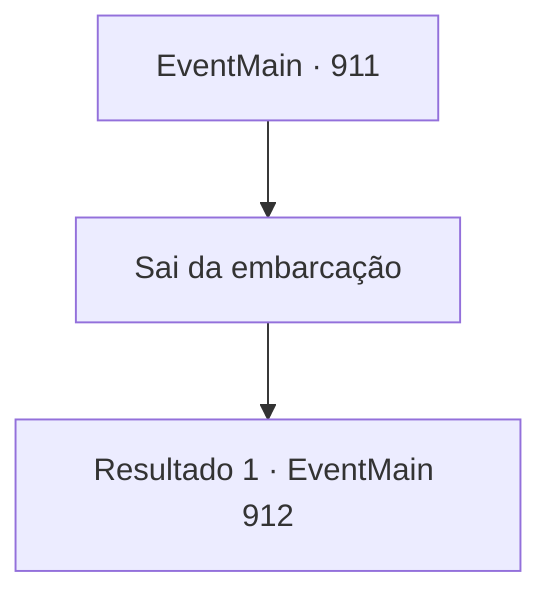

# Eventos principais · 911

[Índice da tabela](index.md) · [Índice geral](../index.md)

ID: `pt:EventMain:911` · Fonte: `EventMain4` · Versão: 1.2.47.

Mapeamento estático dos arquivos; a disponibilidade e a execução dependem do estado da run.

## Texto do evento

*Sem texto no arquivo.*

## Dados de entrada

```json
{
  "id": 911,
  "grade": 1,
  "normalGoal": "",
  "required": ""
}
```

## Mapa das escolhas



## Escolhas e resultados

### Escolha 1

Sai da embarcação

Requisitos e outros campos da escolha:

```json
{
  "required": ""
}
```

#### Resultado 1.1

Você carrega o cadáver de Rosilpha e sai da nave de guerra dos devoradores de almas.  A batalha lá fora também já terminou.  Os guerreiros de Andaria compartilham a alegria da vitória, rugindo de empolgação ou abraçando uns aos outros.  <link=shake>

 "*ribbit* *ribbit* *ribbit*!!"

</link>  O som de sapos ecoa pelo lugar.  Deve ser assim que os gripplis celebram a vitória.

Continuação registrada: [Evento 912](0912.md) na mesma tabela.

```json
{
  "required": "",
  "chance": "1",
  "nextEvent": 912,
  "type": 2,
  "reward": "5_679_1|5_680_1"
}
```

## Referências que chegam a este evento

- [Evento 910 · escolha 2 · resultado 1](0910.md#escolha-2)
