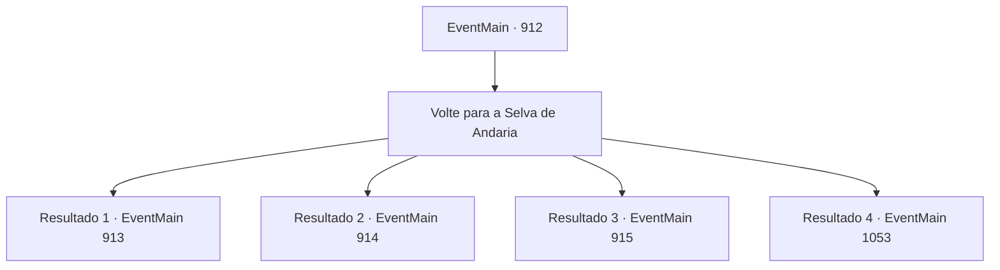

# Eventos principais · 912

[Índice da tabela](index.md) · [Índice geral](../index.md)

ID: `pt:EventMain:912` · Fonte: `EventMain4` · Versão: 1.2.47.

Mapeamento estático dos arquivos; a disponibilidade e a execução dependem do estado da run.

## Texto do evento

*Sem texto no arquivo.*

## Dados de entrada

```json
{
  "id": 912,
  "grade": 1,
  "normalGoal": "",
  "required": ""
}
```

## Mapa das escolhas



## Escolhas e resultados

### Escolha 1

Volte para a Selva de Andaria

Requisitos e outros campos da escolha:

```json
{
  "required": ""
}
```

#### Resultado 1.1

Você deixa o Plano Astral e retorna à Selva de Andaria. A batalha acabou. Alguns estão celebrando a alegria da vitória, alguns estão lamentando a perda de seus entes queridos, e alguns estão simplesmente aliviados por terem sobrevivido. O ancião grippli se aproxima de você, abrindo caminho pela multidão. Ele enxuga suas lágrimas olhando para Rosilpha em suas costas. 

 "Não posso chorar, não neste dia glorioso... Eu o levarei. Nosso corajoso guerreiro dos gripplis, eu o enterrarei pessoalmente."

 Você passa Rosilpha para o ancião grippli. Ele retorna para o Patinho Flutuante, carregando seu corpo. Logo depois, uma serpente de videira se aproxima de você. A voz da Serpente Divina flui dela. 

 "Você desempenhou um papel importante na proteção da selva. Diga, tenho uma oferta a fazer. Você estaria disposto a se tornar um campeão de Andaria?"


Continuação registrada: [Evento 913](0913.md) na mesma tabela.

```json
{
  "required": "5_679_1|5_680_1",
  "chance": "1",
  "nextEvent": 913,
  "type": 2,
  "reward": ""
}
```

#### Resultado 1.2

Você deixa o Plano Astral e retorna à Selva de Andaria. A batalha acabou. Alguns estão celebrando a alegria da vitória, alguns estão lamentando a perda de seus entes queridos, e alguns estão simplesmente aliviados por terem sobrevivido. O ancião grippli se aproxima de você, abrindo caminho pela multidão. Ele enxuga suas lágrimas olhando para Rosilpha em suas costas. 

 "Não posso chorar, não neste dia glorioso... Eu o levarei. Nosso corajoso guerreiro dos gripplis, eu o enterrarei pessoalmente."

 Você passa Rosilpha para o ancião grippli. Ele retorna para o Patinho Flutuante, carregando seu corpo. Logo depois, uma serpente de videira se aproxima de você. A voz da Serpente Divina flui dela. 

 "Você desempenhou um papel importante na proteção da selva. Diga, tenho uma oferta a fazer. Você estaria disposto a se tornar um campeão de Andaria?"

 Naverr olha para você cuidadosamente e fala. 

 "...A decisão é sua afinal, mas eu pessoalmente preferiria que você permanecesse um estudioso."


Continuação registrada: [Evento 914](0914.md) na mesma tabela.

```json
{
  "required": "5_680_1|18_679_1",
  "chance": "1",
  "nextEvent": 914,
  "type": 2,
  "reward": ""
}
```

#### Resultado 1.3

Você deixa o Plano Astral e retorna à Selva de Andaria. A batalha acabou. Alguns estão celebrando a alegria da vitória, alguns estão lamentando a perda de seus entes queridos, e alguns estão simplesmente aliviados por terem sobrevivido. O ancião grippli se aproxima de você, abrindo caminho pela multidão. Abraçando Rosilpha, ele dá tapinhas em suas costas. 

 "Bem feito. Muito bem, Rosilpha."

 Então, uma serpente de videira se aproxima de você. A voz da Serpente Divina flui dela. 

 "Ambos desempenharam um papel enorme na proteção da selva. Diga, tenho uma oferta a fazer. Você estaria disposto a se tornar um campeão de Andaria?"

 Ao ouvir isso, Rosilpha pula de alegria. 

 "S- sério?!"

 Então o ancião cutuca suas costelas com o cotovelo. Quando o ancião dá uma dica, Rosilpha suprime sua alegria e se ajoelha em sua perna. 

 "Caso me conceda tal posição, farei o meu melhor para cumprir meu dever."

 Naverr olha para você cuidadosamente e fala. 

 "... A decisão é sua afinal, mas eu pessoalmente preferiria que você permanecesse um estudioso."


Continuação registrada: [Evento 915](0915.md) na mesma tabela.

```json
{
  "required": "18_680_1|18_679_1",
  "chance": "1",
  "nextEvent": 915,
  "type": 2,
  "reward": ""
}
```

#### Resultado 1.4

Você deixa o Plano Astral e retorna à Selva de Andaria. A batalha acabou. Alguns estão celebrando a alegria da vitória, alguns estão lamentando a perda de seus entes queridos, e alguns estão simplesmente aliviados por terem sobrevivido. O ancião grippli se aproxima de você, abrindo caminho pela multidão. Abraçando Rosilpha, ele dá tapinhas em suas costas. 

 "Bem feito. Bem feito, Rosilpha."

 Então, uma serpente de videira se aproxima de você. A voz da Serpente Divina flui dela. 

 "Ambos desempenharam um papel enorme na proteção da selva. Diga, tenho uma oferta a fazer. Você estaria disposto a se tornar um campeão de Andaria?"

 Ouvindo isso, Rosilpha pula de excitação. 

 "S- sério?!"

 Então o ancião cutuca suas costelas com o cotovelo. Quando o ancião lhe dá uma dica, Rosilpha suprime sua alegria e se ajoelha em sua perna. 

 "Caso você me conceda tal posição, farei o meu melhor para cumprir meu dever."


Continuação registrada: [Evento 1053](1053.md) na mesma tabela.

```json
{
  "required": "5_679_1|18_680_1",
  "chance": "1",
  "nextEvent": 1053,
  "type": 2,
  "reward": ""
}
```

## Referências que chegam a este evento

- [Evento 901 · escolha 1 · resultado 1](0901.md#escolha-1)
- [Evento 902 · escolha 1 · resultado 1](0902.md#escolha-1)
- [Evento 907 · escolha 1 · resultado 1](0907.md#escolha-1)
- [Evento 908 · escolha 1 · resultado 1](0908.md#escolha-1)
- [Evento 910 · escolha 1 · resultado 1](0910.md#escolha-1)
- [Evento 910 · escolha 1 · resultado 2](0910.md#escolha-1)
- [Evento 911 · escolha 1 · resultado 1](0911.md#escolha-1)
