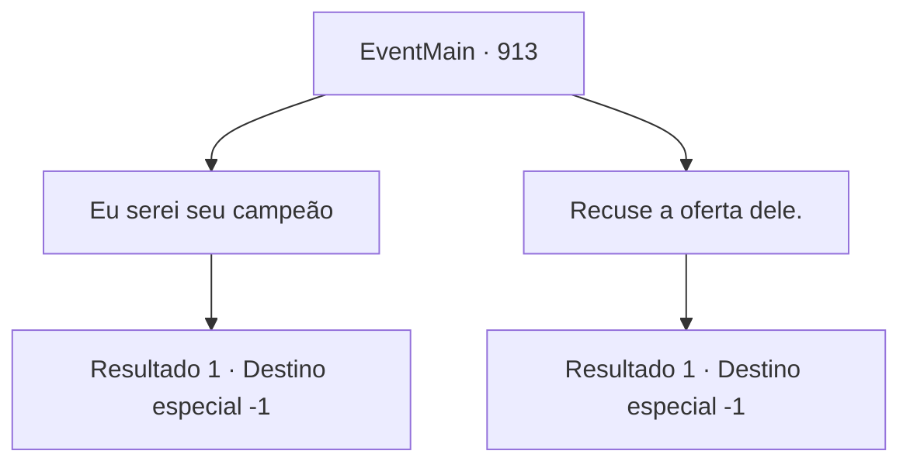

# Eventos principais · 913

[Índice da tabela](index.md) · [Índice geral](../index.md)

ID: `pt:EventMain:913` · Fonte: `EventMain4` · Versão: 1.2.47.

Mapeamento estático dos arquivos; a disponibilidade e a execução dependem do estado da run.

## Texto do evento

*Sem texto no arquivo.*

## Dados de entrada

```json
{
  "id": 913,
  "grade": 1,
  "normalGoal": "",
  "required": ""
}
```

## Mapa das escolhas



## Escolhas e resultados

### Escolha 1

Eu serei seu campeão

Requisitos e outros campos da escolha:

```json
{
  "required": ""
}
```

#### Resultado 1.1

Você aceita a sugestão da Serpente Divina, de se tornar um campeão de Andaria. Então, uma aura mística flui da serpente de videira da árvore e para você. Você sente uma vibração agradável e sente como se estivesse se tornando um com a selva. 

 "Você é meu campeão agora. Daqui em diante, você se dedicará a proteger esta selva."

 Você foi abençoado pela própria Serpente Divina e se tornou seu campeão. Para celebrar a vitória, você ergue seus copos com outros guerreiros de Andaria.

Continuação registrada: [Destino especial `-1`](../destinos-especiais.md).

```json
{
  "required": "",
  "chance": "1",
  "nextEvent": -1,
  "type": 2,
  "reward": "15_6_22|15_6_9|15_6_8"
}
```

### Escolha 2

Recuse a oferta dele.

Requisitos e outros campos da escolha:

```json
{
  "required": ""
}
```

#### Resultado 2.1

Você educadamente recusa a sugestão da Serpente Divina. 

 "Entendo. Ainda assim, deixe-me ao menos mostrar minha gratidão. Aqui, pegue isso."

 Então, uma aura mística flui da serpente da videira da árvore e para você. Você sente uma vibração agradável e sente como se estivesse se tornando um com a selva. 

 "Agora você será capaz de superar qualquer dificuldade, não importa quão grave a situação possa parecer. Agradeço novamente."

 Você foi abençoado pela própria Serpente Divina. Para celebrar a vitória, você ergue seus copos com outros guerreiros de Andaria.

Continuação registrada: [Destino especial `-1`](../destinos-especiais.md).

```json
{
  "required": "",
  "chance": "1",
  "nextEvent": -1,
  "type": 2,
  "reward": "15_6_5|15_6_9|15_6_8"
}
```

## Referências que chegam a este evento

- [Evento 912 · escolha 1 · resultado 1](0912.md#escolha-1)
