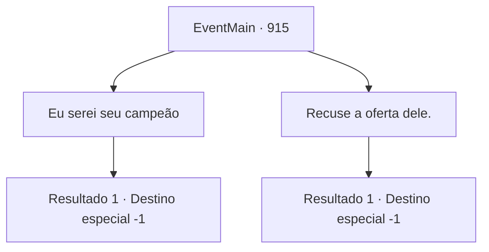

# Eventos principais · 915

[Índice da tabela](index.md) · [Índice geral](../index.md)

ID: `pt:EventMain:915` · Fonte: `EventMain4` · Versão: 1.2.47.

Mapeamento estático dos arquivos; a disponibilidade e a execução dependem do estado da run.

## Texto do evento

*Sem texto no arquivo.*

## Dados de entrada

```json
{
  "id": 915,
  "grade": 1,
  "normalGoal": "",
  "required": ""
}
```

## Mapa das escolhas



## Escolhas e resultados

### Escolha 1

Eu serei seu campeão

Requisitos e outros campos da escolha:

```json
{
  "required": ""
}
```

#### Resultado 1.1

Você aceita a sugestão da Serpente Divina, de se tornar um campeão de Andaria. Então, uma aura mística flui da serpente da videira da árvore e para você. Você sente uma vibração agradável e sente como se estivesse se tornando um com a selva. 

 "Você é meu campeão agora. Daqui em diante, você se dedicará a proteger esta selva."

 Rosilpha não consegue conter sua empolgação por mais tempo. Ele começa a pular e pular. Observando ele ir, o ancião grippli solta um suspiro feliz. Naverr fica ao seu lado, observando a cena se desenrolar, embora sua expressão pareça um pouco triste. 

 "Eu respeito sua decisão... Ainda temos tempo para uma bebida, certo?"

 Você, Rosilpha e Naverr levantam os copos com outros guerreiros de Andaria, para celebrar a vitória.

Continuação registrada: [Destino especial `-1`](../destinos-especiais.md).

```json
{
  "required": "",
  "chance": "1",
  "nextEvent": -1,
  "type": 2,
  "reward": "15_6_22|15_6_7|15_6_8"
}
```

### Escolha 2

Recuse a oferta dele.

Requisitos e outros campos da escolha:

```json
{
  "required": ""
}
```

#### Resultado 2.1

Você educadamente recusa a sugestão da Serpente Divina. 

 "Entendo. Ainda assim, deixe-me ao menos mostrar minha gratidão. Aqui, pegue isso."

 Então, uma aura mística flui da serpente da videira da árvore e para você. Você sente uma vibração agradável e sente como se estivesse se tornando um com a selva. 

 "Agora você será capaz de superar qualquer dificuldade, não importa quão grave a situação possa parecer. Agradeço novamente."

 Naverr fala, batendo em seu ombro. 

 "Obrigado. Estou ansioso para trabalhar com você para o bem."

 Enquanto isso, Rosilpha é escolhido como campeão de Andaria, imbuido com os poderes da Serpente Divina, e agora está pulando de excitação. Assistindo ele ir, o ancião grippli solta um suspiro feliz. Você, Rosilpha e Naverr levantam os copos com outros guerreiros de Andaria, para celebrar a vitória.

Continuação registrada: [Destino especial `-1`](../destinos-especiais.md).

```json
{
  "required": "",
  "chance": "1",
  "nextEvent": -1,
  "type": 2,
  "reward": "15_6_5|15_6_7|15_6_8"
}
```

## Referências que chegam a este evento

- [Evento 912 · escolha 1 · resultado 3](0912.md#escolha-1)
