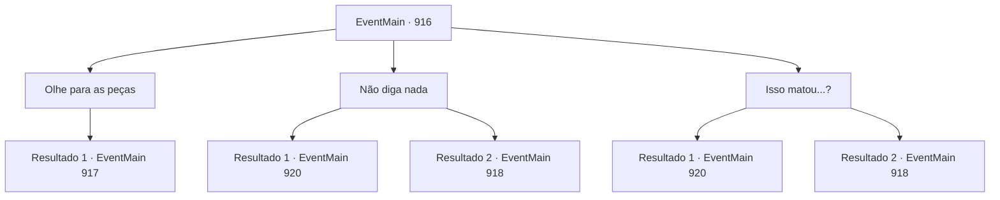

# Eventos principais · 916

[Índice da tabela](index.md) · [Índice geral](../index.md)

ID: `pt:EventMain:916` · Fonte: `EventMain4` · Versão: 1.2.47.

Mapeamento estático dos arquivos; a disponibilidade e a execução dependem do estado da run.

## Texto do evento

*Sem texto no arquivo.*

## Dados de entrada

```json
{
  "id": 916,
  "grade": 1,
  "normalGoal": "",
  "required": ""
}
```

## Mapa das escolhas



## Escolhas e resultados

### Escolha 1

Olhe para as peças

Requisitos e outros campos da escolha:

```json
{
  "required": ""
}
```

#### Resultado 1.1

Sua curiosidade te leva às peças da dimensão. As peças estão ficando cada vez menores, mas você ainda consegue ver através delas o outro lado. Lá jaz o vazio, um vazio vazio. Então, seus olhos se fixam em algo. É a Rainha dos devoradores de almas. Contrariando sua bela aparência, ela se agarra à fenda dimensional com seus tentáculos repugnantes e a você ao mesmo tempo. Ela começa a puxar você, a atravessar para o Plano Material.

Continuação registrada: [Evento 917](0917.md) na mesma tabela.

```json
{
  "required": "",
  "chance": "1",
  "nextEvent": 917,
  "type": 2,
  "reward": ""
}
```

### Escolha 2

Não diga nada

Requisitos e outros campos da escolha:

```json
{
  "required": ""
}
```

#### Resultado 2.1

Você fica em silêncio. Então, Rosilpha murmura olhando para as peças dimensionais. 

 "Aquilo... aquilo o matou?"

 Aquilo não passou de um feitiço para reviver o inimigo. Tentáculos se estendem da fenda dimensional, abrindo-a de forma escandalosa. Com um grito ensurdecedor, a Rainha aparece. Ela lança uma enorme ira, subjugando os guerreiros de Andaria com seu grande domínio. Eles estão congelados de medo. Agora, você e Rosilpha são os únicos que podem lutar contra isso.

Continuação registrada: [Evento 920](0920.md) na mesma tabela.

```json
{
  "required": "-1|23_7_1|8_312_1",
  "chance": "1",
  "nextEvent": 920,
  "type": 2,
  "reward": ""
}
```

#### Resultado 2.2

Você fica em silêncio. Então, Rosilpha murmura olhando para as peças dimensionais. 

 "Aquilo... aquilo o matou?"

 Aquilo não passou de um feitiço para reviver o inimigo. Tentáculos se estendem da fenda dimensional, abrindo-a de forma escandalosa. Com um grito ensurdecedor, a Rainha aparece. Ela lança uma enorme ira, subjugando os guerreiros de Andaria com seu grande domínio. Eles estão congelados de medo.

Continuação registrada: [Evento 918](0918.md) na mesma tabela.

```json
{
  "required": "24_7_1|10_312_1",
  "chance": "1",
  "nextEvent": 918,
  "type": 2,
  "reward": ""
}
```

### Escolha 3

Isso matou...?

Requisitos e outros campos da escolha:

```json
{
  "required": ""
}
```

#### Resultado 3.1

Isso não passava de um feitiço para reviver o inimigo. Tentáculos se estendem do abismo dimensional, abrindo-o de forma escandalosa. Com um grito ensurdecedor, a Rainha aparece. Ela lança uma enorme ira, subjugando os guerreiros de Andaria com seu grande domínio. Eles estão congelados de medo. Agora, você e Rosilpha são os únicos que podem lutar contra isso.

Continuação registrada: [Evento 920](0920.md) na mesma tabela.

```json
{
  "required": "-1|23_7_1|8_312_1",
  "chance": "1",
  "nextEvent": 920,
  "type": 2,
  "reward": ""
}
```

#### Resultado 3.2

Isso não passava de um feitiço para reviver o inimigo. Tentáculos se estendem do abismo dimensional, abrindo-o de forma escandalosa. Com um grito ensurdecedor, a Rainha aparece. Ela lança uma enorme ira, subjugando os guerreiros de Andaria com seu grande domínio. Eles estão congelados de medo.

Continuação registrada: [Evento 918](0918.md) na mesma tabela.

```json
{
  "required": "24_7_1|10_312_1",
  "chance": "1",
  "nextEvent": 918,
  "type": 2,
  "reward": ""
}
```

## Referências que chegam a este evento

- [Evento 889 · escolha 3 · resultado 1](0889.md#escolha-3)
