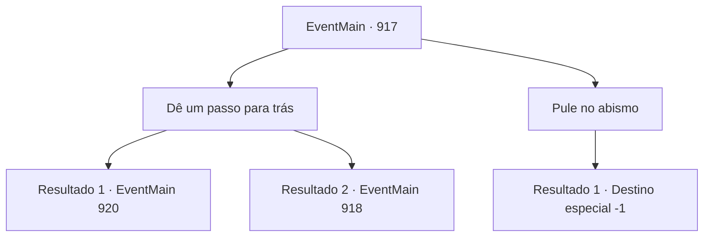

# Eventos principais · 917

[Índice da tabela](index.md) · [Índice geral](../index.md)

ID: `pt:EventMain:917` · Fonte: `EventMain4` · Versão: 1.2.47.

Mapeamento estático dos arquivos; a disponibilidade e a execução dependem do estado da run.

## Texto do evento

*Sem texto no arquivo.*

## Dados de entrada

```json
{
  "id": 917,
  "grade": 1,
  "normalGoal": "",
  "required": ""
}
```

## Mapa das escolhas



## Escolhas e resultados

### Escolha 1

Dê um passo para trás

Requisitos e outros campos da escolha:

```json
{
  "required": ""
}
```

#### Resultado 1.1

Agarrado pelas tentáculos da Rainha, você tenta se libertar. Mas acaba permitindo que a Rainha rompa a fenda dimensional. Assim que ela passa, ela suprime os guerreiros de Andaria com sua dominação. Os orcs, goblins e os gripplis estão todos petrificados no lugar. Eles estão congelados de medo. Agora, você e Rosilpha são os únicos que podem lutar contra ela.

Continuação registrada: [Evento 920](0920.md) na mesma tabela.

```json
{
  "required": "-1|23_7_1|8_312_1",
  "chance": "1",
  "nextEvent": 920,
  "type": 2,
  "reward": ""
}
```

#### Resultado 1.2

Agarrado pelas tentáculos da Rainha, você tenta se libertar. Mas acaba permitindo que a Rainha rompa a fenda dimensional. Assim que ela passa, ela suprime os guerreiros de Andaria com sua dominação.

Continuação registrada: [Evento 918](0918.md) na mesma tabela.

```json
{
  "required": "24_7_1|10_312_1",
  "chance": "1",
  "nextEvent": 918,
  "type": 2,
  "reward": ""
}
```

### Escolha 2

Pule no abismo

Requisitos e outros campos da escolha:

```json
{
  "required": ""
}
```

#### Resultado 2.1

Agarrado pelas tentáculos da Rainha, você decide correr para dentro da fenda dimensional em vez de fugir. Você planta seu joelho no rosto da Rainha. Com um estrondo alto, sua cabeça se fecha de volta. 

 "O QUE...?!"

 Rosilpha tenta agarrar você apressadamente, mas não consegue alcançar seu corpo. Parece que a Rainha não esperava por isso. Seu rosto se contorce grotescamente. <link=shake>

 "O QUE VOCÊ ESTÁ FAZENDO, SEU LOUCO--?!"

</link> Enquanto isso, os pedaços da dimensão desaparecem. Agora você está preso na fenda dimensional com a Rainha. Lá, você encontra o navio de guerra, um aglomerado de devoradores de almas e a Rainha furiosa. 

 "Vou tornar sua morte muito, muito dolorosa...!"

 Seguindo o gesto da Rainha, os devoradores de almas avançam em você como um enxame de abelhas.

Continuação registrada: [Destino especial `-1`](../destinos-especiais.md).

```json
{
  "required": "",
  "chance": "1",
  "nextEvent": -1,
  "type": 2,
  "reward": "15_6_11|25_8_1"
}
```

## Referências que chegam a este evento

- [Evento 916 · escolha 1 · resultado 1](0916.md#escolha-1)
