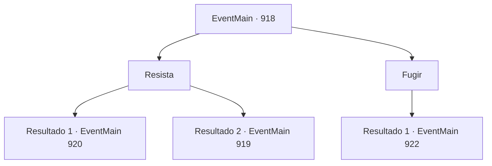

# Eventos principais · 918

[Índice da tabela](index.md) · [Índice geral](../index.md)

ID: `pt:EventMain:918` · Fonte: `EventMain4` · Versão: 1.2.47.

Mapeamento estático dos arquivos; a disponibilidade e a execução dependem do estado da run.

## Texto do evento

*Sem texto no arquivo.*

## Dados de entrada

```json
{
  "id": 918,
  "grade": 1,
  "normalGoal": "",
  "required": ""
}
```

## Mapa das escolhas



## Escolhas e resultados

### Escolha 1

Resista

Requisitos e outros campos da escolha:

```json
{
  "required": ""
}
```

#### Resultado 1.1

Você consegue resistir com sucesso à dominação da Rainha. Quando olha ao redor, outros guerreiros ainda estão congelados.

Continuação registrada: [Evento 920](0920.md) na mesma tabela.

```json
{
  "required": "",
  "chance": "1|0_12_1",
  "nextEvent": 920,
  "type": 0,
  "reward": ""
}
```

#### Resultado 1.2

Você falha em resistir à dominação da Rainha. Sua voz não sai. Seu corpo falha em obedecer à sua vontade. Enquanto isso, Rosilpha começa a lutar contra a Rainha sozinho. Ele utiliza a geografia da selva, pulando de lugar em lugar, mas parece que a batalha não está indo a seu favor.

Continuação registrada: [Evento 919](0919.md) na mesma tabela.

```json
{
  "required": "",
  "chance": "20",
  "nextEvent": 919,
  "type": 1,
  "reward": ""
}
```

### Escolha 2

Fugir

Requisitos e outros campos da escolha:

```json
{
  "required": ""
}
```

#### Resultado 2.1

Você vira as costas para a Rainha, fugindo. Uma solução muito mais fácil do que lutar de frente com a Rainha. 

 "*ofegante*...*ofegante*...!"

 O som da respiração pesada pode ser ouvido. Logo depois, você percebe que a respiração está vindo de você. Seu coração bate tão rápido, você pensa que vai explodir. Então, o totem da Serpente Divina aparece diante de você. Ele te encara e fala. 

 "Então. Você está fugindo."


Continuação registrada: [Evento 922](0922.md) na mesma tabela.

```json
{
  "required": "",
  "chance": "1",
  "nextEvent": 922,
  "type": 2,
  "reward": ""
}
```

## Referências que chegam a este evento

- [Evento 916 · escolha 2 · resultado 2](0916.md#escolha-2)
- [Evento 916 · escolha 3 · resultado 2](0916.md#escolha-3)
- [Evento 917 · escolha 1 · resultado 2](0917.md#escolha-1)
