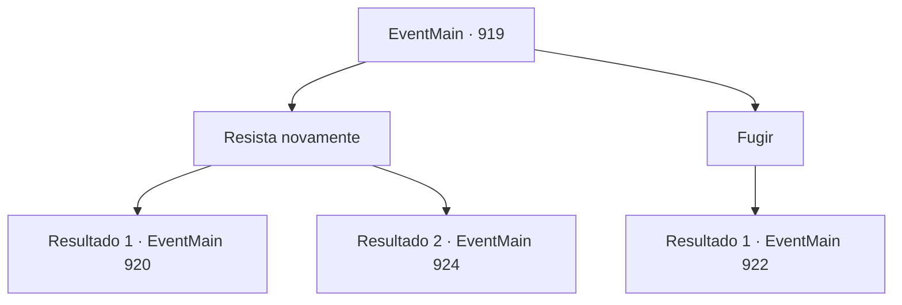

# Eventos principais · 919

[Índice da tabela](index.md) · [Índice geral](../index.md)

ID: `pt:EventMain:919` · Fonte: `EventMain4` · Versão: 1.2.47.

Mapeamento estático dos arquivos; a disponibilidade e a execução dependem do estado da run.

## Texto do evento

*Sem texto no arquivo.*

## Dados de entrada

```json
{
  "id": 919,
  "grade": 1,
  "normalGoal": "",
  "required": ""
}
```

## Mapa das escolhas



## Escolhas e resultados

### Escolha 1

Resista novamente

Requisitos e outros campos da escolha:

```json
{
  "required": ""
}
```

#### Resultado 1.1

Você consegue resistir com sucesso à dominação da Rainha. Quando olha ao redor, outros guerreiros ainda estão congelados.

Continuação registrada: [Evento 920](0920.md) na mesma tabela.

```json
{
  "required": "",
  "chance": "1|0_12_1",
  "nextEvent": 920,
  "type": 0,
  "reward": ""
}
```

#### Resultado 1.2

Você ainda não consegue se libertar do domínio da Rainha. Enquanto isso, a Rainha agita seus tentáculos e perfura Rosilpha. 

 "Ugh...! Oof..."

 Rosilpha cospe sangue e cai no chão. Se vangloriando de sua vitória, a Rainha despedaça Rosilpha em pedaços, cobrindo o chão com pedaços de carne. 

 "A- ARGGHHH!!"

 Observando a cena se desenrolar, os guerreiros de Andaria começam a fugir, largando suas armas. A Rainha, ensopada de sangue, lentamente se aproxima de você, seus olhos brilhando de vermelho. Então, esticando suas mãos ensanguentadas, ela dispara raios de relâmpagos carmesins.

Continuação registrada: [Evento 924](0924.md) na mesma tabela.

```json
{
  "required": "",
  "chance": "10",
  "nextEvent": 924,
  "type": 1,
  "reward": "6_0_171|5_680_2",
  "place": 1
}
```

### Escolha 2

Fugir

Requisitos e outros campos da escolha:

```json
{
  "required": ""
}
```

#### Resultado 2.1

Você vira as costas para a Rainha, fugindo. Uma solução muito mais fácil do que lutar de frente com a Rainha. 

 "*ofegante*...*ofegante*...!"

 O som da respiração pesada pode ser ouvido. Logo depois, você percebe que a respiração está vindo de você. Seu coração bate tão rápido, você pensa que vai explodir. Então, o totem da Serpente Divina aparece diante de você. Ele te encara e fala. 

 "Então. Você está fugindo."


Continuação registrada: [Evento 922](0922.md) na mesma tabela.

```json
{
  "required": "",
  "chance": "1",
  "nextEvent": 922,
  "type": 2,
  "reward": ""
}
```

## Referências que chegam a este evento

- [Evento 918 · escolha 1 · resultado 2](0918.md#escolha-1)
