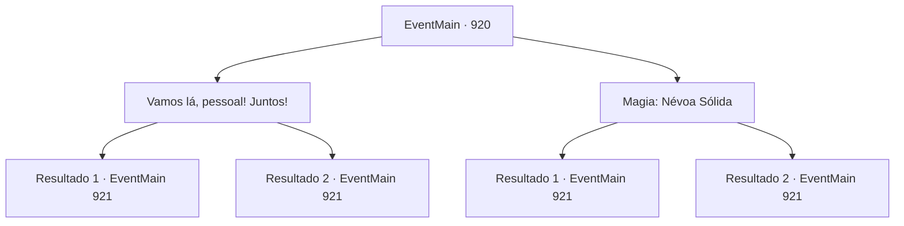

# Eventos principais · 920

[Índice da tabela](index.md) · [Índice geral](../index.md)

ID: `pt:EventMain:920` · Fonte: `EventMain4` · Versão: 1.2.47.

Mapeamento estático dos arquivos; a disponibilidade e a execução dependem do estado da run.

## Texto do evento

*Sem texto no arquivo.*

## Dados de entrada

```json
{
  "id": 920,
  "grade": 1,
  "normalGoal": "",
  "required": ""
}
```

## Mapa das escolhas



## Escolhas e resultados

### Escolha 1

Vamos lá, pessoal! Juntos!

Requisitos e outros campos da escolha:

```json
{
  "required": ""
}
```

#### Resultado 1.1

Você solta um grito alto. Assustados com sua voz, os guerreiros se libertam do domínio da Rainha. Não só isso, mas seu grito de batalha também os anima. 

 "TODOS, AVANÇAAAAAAR!!"

 Como se tentassem esconder o fato de que estavam congelados de medo, os guerreiros avançam corajosamente contra a Rainha.

Continuação registrada: [Evento 921](0921.md) na mesma tabela.

```json
{
  "required": "",
  "chance": "1|0_12_1",
  "nextEvent": 921,
  "type": 0,
  "reward": "6_2_171|5_683_1",
  "place": 1
}
```

#### Resultado 1.2

Você solta um grito alto, mas os guerreiros ainda estão petrificados, como sapos diante de uma cobra. 

 "Somos só nós dois agora!"

 Rosilpha grita, disparando suas flechas contra a Rainha. Vocês dois se preparam para enfrentar a Rainha.

Continuação registrada: [Evento 921](0921.md) na mesma tabela.

```json
{
  "required": "",
  "chance": "40",
  "nextEvent": 921,
  "type": 1,
  "reward": "6_0_171",
  "place": 1
}
```

### Escolha 2

Magia: Névoa Sólida

Requisitos e outros campos da escolha:

```json
{
  "required": "20_0_3|1_1_2"
}
```

#### Resultado 2.1

Você reúne a umidade da selva, condensando-a em uma densa neblina. Na densa neblina, é difícil respirar, quanto mais andar. Ela cobre os guerreiros de Andaria. À medida que a Rainha desaparece de sua visão, a dominação sobre eles começa a diminuir também. O grippli mais velho, que já está perto de você, te elogia. 

 "Obrigado. Deveríamos ser capazes de lutar também."

 Ele levanta seu cajado alto no ar, gritando. 

 "TODOS, AVAAAAANÇAR!!"

 Todos começam a avançar em direção à Rainha. Como peixes na água, os gripplis lutam bem na neblina, nadando através da densa névoa. A Rainha tenta desesperadamente limpar a neblina agitando seus tentáculos, sem sucesso.

Continuação registrada: [Evento 921](0921.md) na mesma tabela.

```json
{
  "required": "",
  "chance": "1|0_7_1|0_12_1",
  "nextEvent": 921,
  "type": 0,
  "reward": "6_2_171|0_1_-1|5_683_1",
  "place": 1
}
```

#### Resultado 2.2

Você tenta lançar um feitiço, mas falha em se concentrar nele. 

 "Somos só nós dois agora!"

 Rosilpha grita, disparando suas flechas na Rainha. Vocês dois se preparam para enfrentar a Rainha.

Continuação registrada: [Evento 921](0921.md) na mesma tabela.

```json
{
  "required": "",
  "chance": "20",
  "nextEvent": 921,
  "type": 1,
  "reward": "6_0_171|0_1_-1",
  "place": 1
}
```

## Referências que chegam a este evento

- [Evento 916 · escolha 2 · resultado 1](0916.md#escolha-2)
- [Evento 916 · escolha 3 · resultado 1](0916.md#escolha-3)
- [Evento 917 · escolha 1 · resultado 1](0917.md#escolha-1)
- [Evento 918 · escolha 1 · resultado 1](0918.md#escolha-1)
- [Evento 919 · escolha 1 · resultado 1](0919.md#escolha-1)
